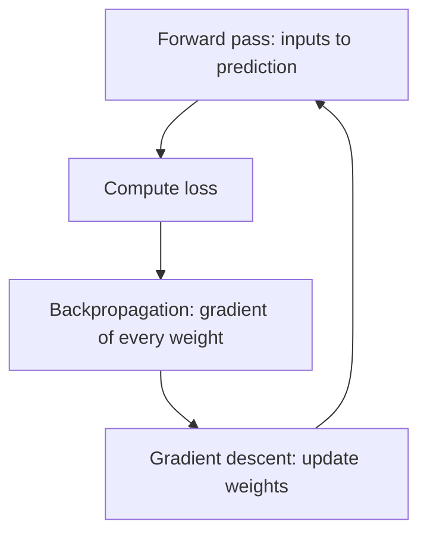

# What is a Neural Network and How Does It Work?

> **Step 2: Deep Learning and Neural Networks** · ⏱️ 17 min read · [Read original](https://outcomeschool.com/blog/neural-network)

## TL;DR
A Neural Network is layers of small units (neurons) that turn input numbers into a prediction; it learns by repeatedly measuring its error and nudging its weights and biases. The same core machinery scales up to LLMs.

## Key Concepts
- **Neuron** — multiplies inputs by weights, adds a bias, applies an activation function.
- **Weights / bias** — importance of each input / constant shift; together the **parameters** (a 7B model has 7 billion).
- **Activation function** — adds nonlinearity; ReLU(z) = max(0, z). Without it, stacked layers collapse into one linear formula.
- **Layers** — input (no computation), hidden, output; fully connected when every neuron links to the next layer. Many hidden layers = Deep Neural Network = Deep Learning.
- **Forward pass** — input to prediction, layer by layer.
- **Loss, gradient descent, backpropagation** — error measure, weight update, gradient finder.

## How It Works
Example: predict a test score from hours studied (2) and slept (3).

**Neuron:** $z = w_1x_1 + w_2x_2 + b$, with w=(0.5, 0.25), b=0.25 gives z=2.0, ReLU(2.0)=2.0.

**Forward pass (2-2-1 network):**
- h1: z=2.0, ReLU gives 2.0.
- h2: z=-0.5, ReLU gives 0.
- Output y = 1.5(2.0) + 2.0(0) + 0.5 = 3.5 (no ReLU on output).

**Learning** (true score 5):
1. *Loss:* $(5 - 3.5)^2 = 2.25$ (squared error).
2. *Gradient descent:* $w_{new} = w_{old} - \eta \cdot \text{gradient}$; like walking downhill in fog. Learning rate too big overshoots, too small is slow.
3. *Backpropagation:* moves backward from the output using the chain rule to get each weight's gradient. Output weight from h1 has gradient -6, so 1.5 becomes 1.56 (lr 0.01). h2 was 0 via ReLU, so its weights don't change.

After one round: prediction 4.63, loss 0.13.

| Round | Prediction | Loss |
|---|---|---|
| 1 | 3.5 | 2.25 |
| 2 | 4.6328 | 0.1348 |
| 3 | 4.9443 | 0.0031 |
| 4 | 4.9931 | 0.00005 |

Real training loops over thousands or millions of examples. Used in image recognition, speech, LLMs, recommendations, healthcare.

## Diagram

## Key Takeaways
- Neuron = weighted sum + bias + activation.
- Activation functions give the network the ability to learn non-linear patterns.
- Training loop: forward pass, loss, backprop, gradient descent, repeat.
- Backprop finds the gradients; gradient descent uses them.
- LLMs are large neural networks built on the same ideas.
