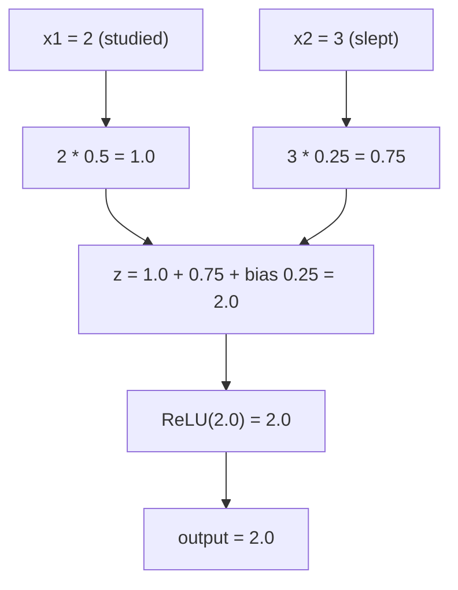
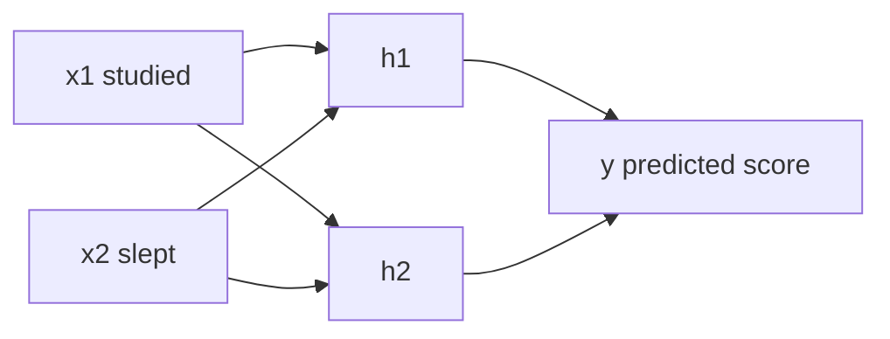
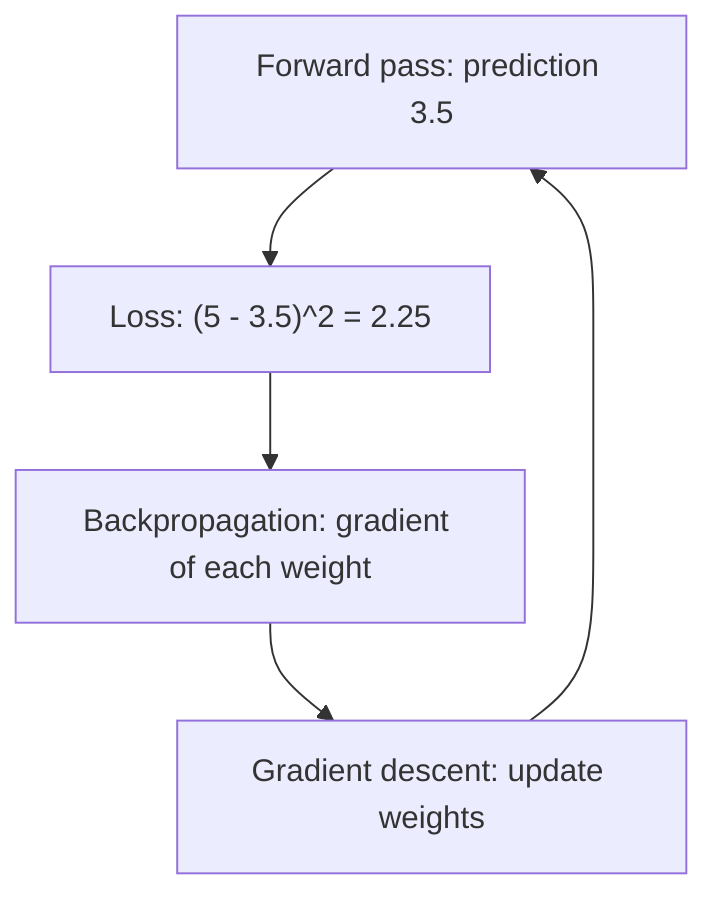

# What is a Neural Network and How Does It Work?

> **Step 2: Deep Learning and Neural Networks** · ⏱️ 17 min read · [Read original](https://outcomeschool.com/blog/neural-network)

## TL;DR
A Neural Network is many small units (neurons) arranged in layers that turn input numbers into a prediction. Each neuron computes a weighted sum plus bias and applies an activation. It learns by repeating: forward pass, loss, backpropagation (gradients), gradient descent (update).

## Key Concepts
- **Neuron** — smallest unit: weights x inputs + bias, then activation, one output.
- **Weight** — importance of an input (big = matters a lot, negative = pushes output down).
- **Bias** — extra constant added regardless of inputs; shifts output up/down (even 0 hours studied can give a score).
- **Weighted sum** — $z=w_1x_1+w_2x_2+b$.
- **Parameters** — all weights and biases; found by the network, not set by hand (7B parameters = 7B such numbers).
- **Activation function** — adds a bend so the network is not one big straight-line formula; ReLU $=\max(0,z)$ (Sigmoid, Tanh similar job).
- **Layers** — input (holds numbers, no calculation), hidden (finds patterns; hidden because we see only input and final output), output (prediction).
- **Fully connected layer** — every neuron connects to every neuron in next layer.
- **Deep Neural Network / Deep Learning** — many hidden layers.
- **Forward pass** — moving inputs layer by layer to a prediction.
- **Loss** — number for how wrong the prediction is; 0 = perfect.
- **Gradient / gradient descent / learning rate / backpropagation** — see below.

## How It Works

### Network task
Predict test score (out of 10) from hours studied = 2 and hours slept = 3. It **predicts** (numbers in, prediction out) and **learns** (adjusts after mistakes on many examples). Inspired by the brain but not the same: each neuron is just a small calculation.

### Single neuron
Weights $w_1=0.5,w_2=0.25$, bias $b=0.25$:

$$
z=(0.5\cdot2)+(0.25\cdot3)+0.25=2.0,\quad \text{ReLU}(2.0)=2.0
$$

Why activation: stacking only multiply-add stays a straight line and cannot capture complex patterns (e.g. faces). ReLU: keep positive, negative becomes 0 (ReLU(-0.5)=0).

### Layers
One neuron learns only simple patterns, so neurons are stacked (see MLP). Example net: 2 inputs, 2 hidden, 1 output; 4 weights input-to-hidden, 2 weights hidden-to-output.

### Forward pass worked example
Given: h1 weights 0.5, 0.25, bias 0.25; h2 weights -1.0, 0.5, bias 0; output weights 1.5 (from h1), 2.0 (from h2), bias 0.5. (Real nets start from small random numbers.)
1. $z_1=1.0+0.75+0.25=2.0$, $h_1=2.0$.
2. $z_2=-2.0+1.5+0=-0.5$, $h_2=\text{ReLU}=0$.
3. $y=1.5\cdot2.0+2.0\cdot0+0.5=3.5$ (no ReLU on output; raw score wanted).

Real networks use matrices to do this at scale.

### Learning
Real score is 5, prediction 3.5.
- **Loss** (squared error): $(5-3.5)^2=2.25$. Squared so always positive and big mistakes are penalized more. Goal: minimize loss.
- **Gradient descent** — hill-in-fog analogy: loss = height, weights = position, gradient = slope underfoot. 

$$
w_{new}=w_{old}-\eta\cdot\text{gradient}
$$

Learning rate $\eta$ (e.g. 0.01): too big overshoots the valley, too small is slow.
- **Backpropagation** — moves backward from output to input to find each weight's gradient (chain rule; libraries like PyTorch automate it).
  - Output too low by 1.5, so must go up.
  - Output weight from h1 had big effect (h1=2.0); from h2 none (h2=0).
  - h1 feeds output via positive 1.5, so its incoming weights/bias must increase.
  - h2 was 0 by ReLU, so its weights don't change this round.
  - Gradient for output weight from h1 = -6: $1.5-0.01\cdot(-6)=1.56$.
  - One round: output bias 0.5->0.53; into h1 0.5->0.59 and 0.25->0.385; h1 bias 0.25->0.295; h2 unchanged.
  - New forward pass: $h_1=\text{ReLU}(1.18+1.155+0.295)=2.63$, $y=1.56\cdot2.63+0.53=4.6328$, loss 0.1348 (from 2.25).

### Training loop
| Round | Prediction | Loss |
|---|---|---|
| 1 | 3.5 | 2.25 |
| 2 | 4.6328 | 0.1348 |
| 3 | 4.9443 | 0.0031 |
| 4 | 4.9931 | 0.00005 |

Real training uses thousands/millions of examples over many passes (see epoch/batch/iteration).

### Where used
Image recognition (faces, digits, self-driving objects), speech-to-text, language (LLMs = very large networks predicting next token), recommendations, healthcare scans. Same core idea; differences are size, layer arrangement, data.

### FAQ
- Same as the brain? No, only inspired.
- NN vs Deep Learning? Deep NN has many hidden layers.
- 7B parameters? 7B weights and biases.
- Learning rate? Step size of the update.
- LLM a NN? Yes.

## Diagrams

### Single neuron

### Network layers

### Training loop

## Trade-offs & Pitfalls
- Without activation, any depth collapses to a straight line.
- Learning rate too large overshoots; too small is slow.
- ReLU can zero out a neuron so its weights get no update that round (h2).

## Key Takeaways
- Neuron = weighted sum + bias, then activation.
- Activation functions add non-linearity; ReLU = max(0, z).
- Parameters (weights, biases) are learned, not hand-set.
- Forward pass makes the prediction; loss measures the error.
- Backprop finds gradients backward; gradient descent updates $w\leftarrow w-\eta\,g$.
- Training repeats this loop over many examples.
- LLMs are large neural networks using the same ideas.
