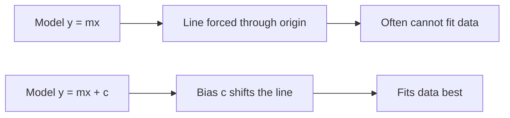

# What is Bias in Artificial Neural Network?

> **Step 2: Deep Learning and Neural Networks** · ⏱️ 3 min read · [Read original](https://outcomeschool.com/blog/bias-in-artificial-neural-network)

## TL;DR
Bias is the constant $c$ in the model $y=mx+c$. Without it the fitted line is forced through the origin; with it the model can shift the line and fit data better. The model learns both $m$ and $c$ during training.

## Key Concepts
- **Model $mx+c$** — takes input $x$, predicts output $y$.
- **$m$** — the weight (slope); **$c$** — the bias (intercept).
- **Bias** — constant that gives the model freedom to fit the data best.

## How It Works
1. In a neural network we have input $x$ and need output $y$; we create a model $mx+c$.
2. While training, the model itself finds suitable values of $m$ and $c$.
3. If the model were $y=mx$ (no bias), it is constrained to lines passing through the origin.
4. For much real data, no line through the origin can fit.
5. Using $mx+c$ removes the constraint; the model has full freedom to find the line that fits best. That constant $c$ is the bias.

| Model | Line constraint | Fit |
|---|---|---|
| $y=mx$ | must pass through origin | often impossible to fit |
| $y=mx+c$ | any intercept | can fit the data best |

### FAQ
- No bias? Line only through origin; often cannot fit.
- Who decides bias? The model, during training.
- Why "freedom"? It removes the through-the-origin constraint.

## Diagram

## Trade-offs & Pitfalls
- Omitting bias limits the model to origin-passing lines and can make fitting impossible.

## Key Takeaways
- Bias = constant $c$ in $y=mx+c$.
- Without it the line must pass through the origin.
- The model learns $m$ and $c$ itself during training.
- Bias gives the model freedom to fit the data best.
