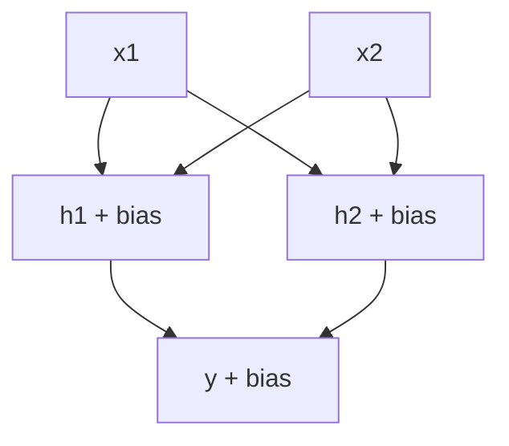
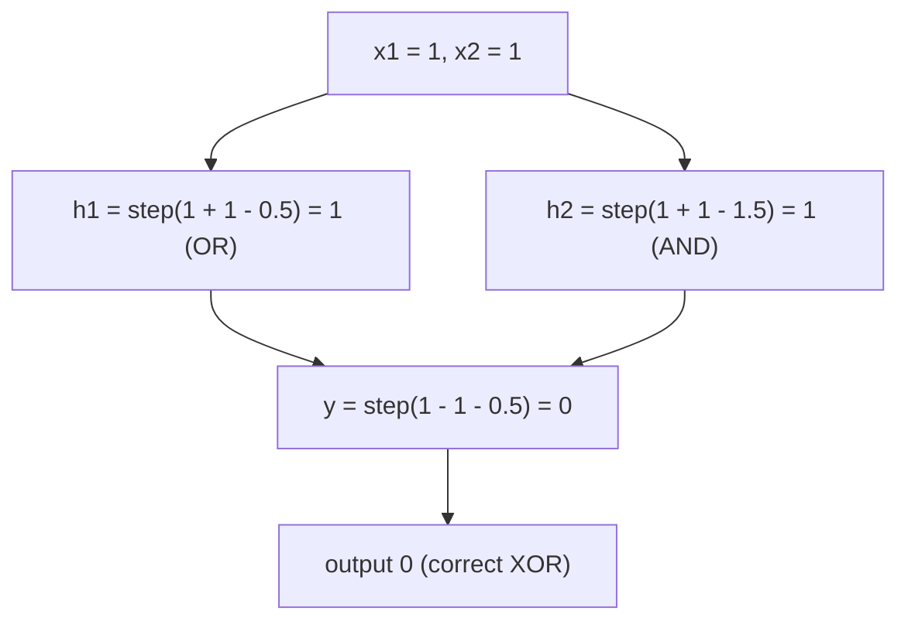
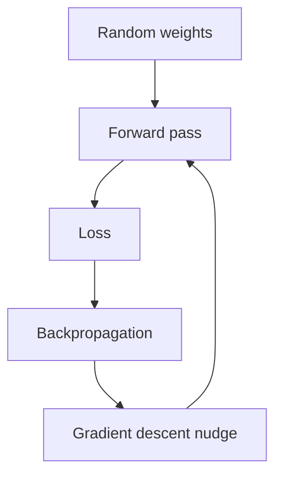

# What is a Multilayer Perceptron (MLP) and How Does It Work?

> **Step 2: Deep Learning and Neural Networks** · ⏱️ 17 min read · [Read original](https://outcomeschool.com/blog/multilayer-perceptron-mlp)

## TL;DR
An MLP is a neural network of layers of perceptrons where every unit connects to every unit in the next layer; numbers flow forward, each unit multiplies, adds, and applies a non-linear activation. A single perceptron cannot solve XOR (only one straight line), but two layers can. Non-linear activation is essential, otherwise all layers collapse to one.

## Key Concepts
- **Perceptron** (Frank Rosenblatt, 1958) — simplest unit: inputs x weights + bias, then step function (sum > 0 gives 1, else 0). Also called a **neuron**.
- **Step function** — non-linear, but jumps 0 to 1.
- **MLP** — perceptrons arranged in layers; output of one layer is input of next.
- **Input / hidden / output layer** — input holds numbers (no calculation); hidden layers are the middle ones (outputs not seen directly); output gives the answer.
- **Fully connected (dense) layer** — each neuron connects to all in next layer; each connection has a weight, each neuron a bias.
- **Feed-forward network** — numbers only move forward.
- **Parameters** — all weights and biases.
- **Forward pass** — passing input through layers to get output.

## How It Works

### Perceptron as AND / OR
$\text{output}=\text{step}(w_1x_1+w_2x_2+b)$. With $w_1=w_2=1$, $b=-1.5$: AND (sum = -1.5, -0.5, -0.5, 0.5 for the four inputs, output 1 only for (1,1)). Change bias to $-0.5$: OR.

### XOR problem
XOR = 1 when exactly one input is 1. Points (0,1),(1,0) are 1; (0,0),(1,1) are 0 on crossing diagonals. A perceptron's boundary $w_1x_1+w_2x_2+b=0$ is a single straight line; AND (line $x_1+x_2-1.5=0$) and OR work since one line separates them, but no line separates XOR (any line putting (0,1),(1,0) on one side also catches (0,0) or (1,1)). Pointed out in 1969 by Minsky and Papert ("Perceptrons"), linked to a slowdown in 1970s research. Fix: stack layers.

### MLP structure and parameters
Example 2 inputs, 2 hidden, 1 output: input-to-hidden $2\times2=4$ weights + 2 biases = 6; hidden-to-output 2 weights + 1 bias = 3; total 9 parameters. Matrix form (`.` = matrix multiplication):
$$h=\text{act}(xW_1+b_1),\qquad y=\text{act}(hW_2+b_2)$$

### Solving XOR with an MLP (step activation, hand-picked)
XOR = (at least one is 1: OR) and not (both are 1: AND).
- $h_1=\text{step}(x_1+x_2-0.5)$ (OR)
- $h_2=\text{step}(x_1+x_2-1.5)$ (AND)
- $y=\text{step}(h_1-h_2-0.5)$

| x1 | x2 | h1 | h2 | y | XOR |
|---|---|---|---|---|---|
| 0 | 0 | 0 | 0 | step(-0.5)=0 | 0 |
| 0 | 1 | 1 | 0 | step(0.5)=1 | 1 |
| 1 | 0 | 1 | 0 | step(0.5)=1 | 1 |
| 1 | 1 | 1 | 1 | step(-0.5)=0 | 0 |

The hidden layer creates new features ("at least one is 1?", "both are 1?") so one line suffices at the output.

```python
W1 = np.array([[1,1],[1,1]]); b1 = np.array([-0.5,-1.5])
W2 = np.array([1,-1]);        b2 = -0.5
h = step(np.array(x) @ W1 + b1); y = step(h @ W2 + b2)
```

### Why non-linear activation
Remove the step: $h_1=x_1+x_2-0.5$, $h_2=x_1+x_2-1.5$, $y=h_1-h_2-0.5=0.5$ for every input (x terms cancel). In general, layers $h=2x+1$ then $y=3h+4$ give $y=6x+7$, a single multiply-add. Without non-linearity any number of layers collapses to one layer. Non-linearity lets each layer bend and combine the previous lines.

### Learning
Real MLPs have thousands to billions of weights, learned by training:
1. Start with random weights.
2. Forward pass.
3. Loss (how far from correct).
4. Backpropagation: how each weight affects loss.
5. Nudge each weight to reduce loss (gradient descent); repeat.

Step function is flat then jumps, so a tiny weight change often changes nothing and backprop cannot learn; real MLPs use smooth non-linear activations like ReLU (positives kept, negatives to 0) or sigmoid (squeezes to 0-1). Training on four XOR examples usually finds working weights.

### Where used
- Tabular data (house price, customer churn).
- Final classification layers of image/text models.
- Recommendation systems (user + item features).
- Inside Transformers: each block's feed-forward network is an MLP with one hidden layer, processing each token alone after Self Attention. Hidden layer is about 4x wider than the token vector (expand, non-linear activation, shrink back). A large share of LLM parameters live in these blocks.

### FAQ
- Perceptron vs MLP: one unit with one line vs layers that can solve XOR.
- MLP = feed-forward? Yes.
- Why not step in real MLPs? No gradient signal.
- Parameter count: one weight per connection + one bias per neuron (9 in the example).

## Diagrams

### MLP architecture (2-2-1)


### XOR forward pass for (1, 1)


### Training loop


## Trade-offs & Pitfalls
- Single perceptron: linearly separable problems only (fails XOR).
- No non-linear activation: depth gives nothing.
- Step activation unsuitable for gradient learning.

## Key Takeaways
- Perceptron: weighted sum + bias + step; can do AND/OR, not XOR.
- MLP stacks fully connected layers; hidden layers build useful new features.
- Without non-linear activation, many layers equal one layer.
- Parameters = weights per connection + bias per neuron (9 for 2-2-1).
- Learning: forward, loss, backprop, gradient descent; needs smooth activations (ReLU, sigmoid).
- Transformer feed-forward blocks are MLPs holding a large share of LLM parameters.
