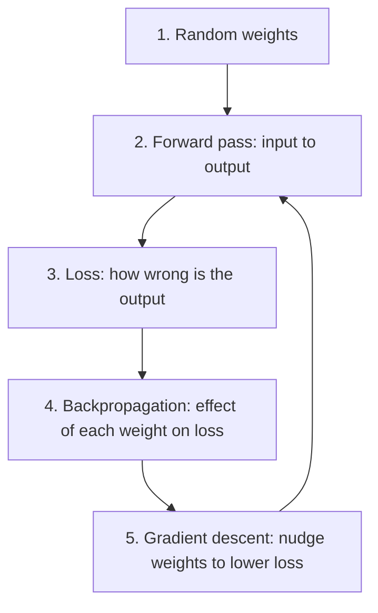

# What is a Multilayer Perceptron (MLP) and How Does It Work?

> **Step 2: Deep Learning and Neural Networks** · ⏱️ 17 min read · [Read original](https://outcomeschool.com/blog/multilayer-perceptron-mlp)

## TL;DR
An MLP is a neural network built from layers of perceptrons where every neuron connects to every neuron in the next layer. Stacking layers (with a non-linear activation) lets it solve problems like XOR that a single perceptron cannot. MLPs are a core building block, including inside every Transformer block.

## Key Concepts
- **Perceptron** — simplest neural unit: multiply inputs by weights, add a bias, apply an activation (originally a step function). Introduced by Rosenblatt in 1958.
- **Step function** — outputs 1 if the sum is greater than 0, else 0.
- **XOR problem** — XOR is 1 when exactly one input is 1; no single straight line separates its 1s from its 0s.
- **Hidden layer** — middle layer(s) whose outputs we never see directly.
- **Fully connected (dense) layer** — every neuron connects to every neuron in the next layer.
- **Feed-forward network** — numbers only move forward from input to output.
- **Forward pass** — passing input through the layers to get the output.
- **Parameters** — all weights and biases.

## How It Works
### Single perceptron
`output = step(w1*x1 + w2*x2 + b)`. With w1 = w2 = 1 and b = -1.5 it acts as AND; changing b to -0.5 makes it OR. Its decision boundary (where the sum is 0) is one straight line, so it can only split the grid into two parts.

### Why XOR breaks it
The 1s of XOR sit on one diagonal and the 0s on the other, so no single line separates them. Minsky and Papert pointed this out in 1969, often linked to a 1970s slowdown in neural network research.

### Solving XOR with a hidden layer
- h1 = step(x1 + x2 - 0.5) computes OR
- h2 = step(x1 + x2 - 1.5) computes AND
- y = step(h1 - h2 - 0.5) computes "OR and not AND" = XOR

The hidden layer creates new features ("at least one is 1", "both are 1"), after which one line suffices.

### Parameter count (2-2-1 MLP)
Input to hidden: 4 weights + 2 biases = 6. Hidden to output: 2 weights + 1 bias = 3. Total 9. A layer is computed with matrix multiplication: `hidden = activation(x . W1 + b1)`.

### Why non-linearity is needed
Without an activation, layers collapse: `3*(2x+1)+4 = 6x+7`, one layer's worth. In the XOR MLP, removing the step makes y always 0.5. Non-linear activations let each layer bend the previous layer's lines into new shapes.

### How an MLP learns
Weights are learned, not hand-picked. Step functions have no useful gradient (tiny weight changes do not change the output), so real MLPs use smooth activations like ReLU or sigmoid.

### Where MLPs are used
Tabular data, final classification layers, recommendation systems, and the feed-forward network inside Transformers (hidden layer usually about 4x wider than the token vector; a large share of LLM parameters live here).

## Diagram

## Key Takeaways
- A single perceptron draws one straight line, so it cannot solve XOR.
- Hidden layers turn inputs into new features, making non-linearly separable problems solvable.
- Without a non-linear activation, any number of layers collapses into one.
- Parameters = one weight per connection + one bias per neuron.
- Training loop: forward pass, loss, backpropagation, gradient descent, repeat.
- Smooth activations (ReLU, sigmoid) replace the step function so gradients exist.
