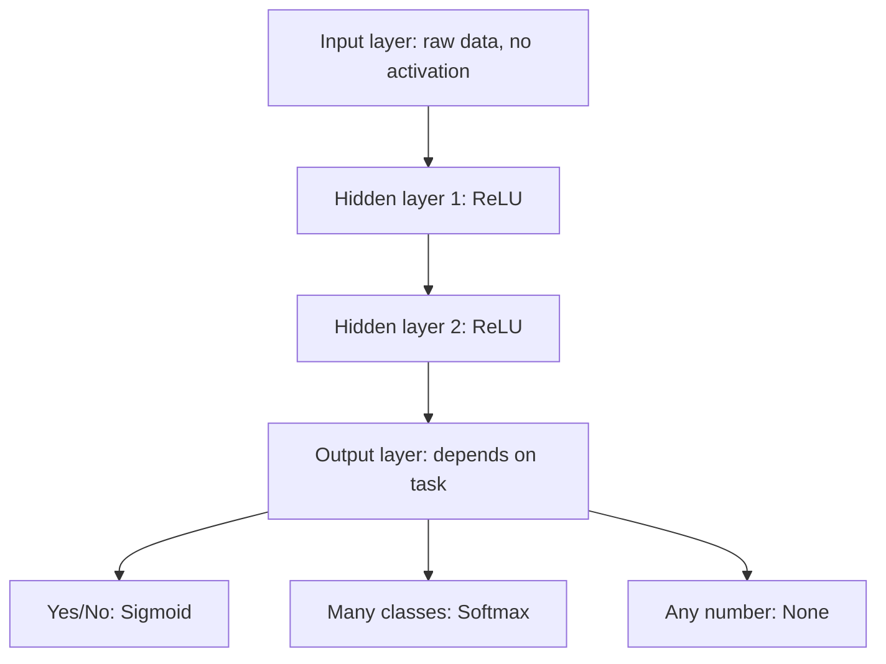

# What are Activation Functions in Neural Networks? Sigmoid, Tanh, ReLU, and Softmax Explained

> **Step 2: Deep Learning and Neural Networks** · ⏱️ 17 min read · [Read original](https://outcomeschool.com/blog/activation-functions)

## TL;DR
An activation function turns a neuron's weighted sum into its output and adds the non-linearity that lets networks learn curved, complex patterns. Sigmoid, Tanh, ReLU, and Softmax are the common ones, each with its own range, problems, and best-fit layer.

## Key Concepts
- **Activation function** — applied right after the weighted sum `z = w1*x1 + w2*x2 + b`; decides how strongly the neuron "fires" (like a light dimmer).
- **Non-linearity** — without it, stacked layers collapse into one straight line (`3*(2x+1)+4 = 6x+7`).
- **Vanishing gradient** — gradient shrinks as it passes back through many flat-sloped activations.
- **Dying ReLU** — a neuron whose z is always negative outputs 0 with gradient 0, so it never learns again.
- **Logits** — raw output-layer scores before softmax.
- **Sparsity** — many ReLU neurons output exactly 0, so only some are active.

## How It Works
### Sigmoid
`1 / (1 + e^(-z))`, range 0 to 1, readable as a probability. Max slope is 0.25, so through 10 layers gradient becomes about 0.25^10 = 0.00000095 (vanishing gradients). Outputs not zero-centered. Used for binary output layers.

### Tanh
`(e^z - e^-z) / (e^z + e^-z)`, range -1 to 1, zero-centered, slope 1 at z = 0. Still flattens for large |z| (slope about 0.0099 at z = 3). Used in small hidden layers, RNNs, LSTMs.

### ReLU
`max(0, z)`. Slope is exactly 1 for positive inputs, very cheap to compute, gives sparsity. Downside is dying ReLU. Fix: Leaky ReLU `max(0.01*z, z)`. Default for hidden layers; LLMs use smoother relatives (GELU, SwiGLU).

### Softmax
Works on a whole list: `e^(z_i) / sum(e^(z_j))`. Example logits [2.0, 1.0, 0.1] give probabilities Cat 0.659, Dog 0.242, Bird 0.099 (sum 1). Used for multi-class output and for LLM next-token probabilities.

### Which goes where
| Layer / task | Activation |
|---|---|
| Input layer | None |
| Hidden layers | ReLU (default) |
| Yes/no output | Sigmoid |
| One of many classes | Softmax |
| Any number (house price) | None |

### Comparison
| Feature | Sigmoid | Tanh | ReLU | Softmax |
|---|---|---|---|---|
| Range | 0 to 1 | -1 to 1 | 0 to infinity | 0 to 1, sums to 1 |
| Zero-centered | No | Yes | No | No |
| Works on | One number | One number | One number | Whole list |
| Limitation | Vanishing gradients | Vanishing gradients | Dying ReLU | Not for hidden layers |

## Diagram

## Key Takeaways
- Activation functions sit right after the weighted sum and supply non-linearity.
- Without them, a 100-layer network is no more powerful than one layer.
- Sigmoid's max slope of 0.25 causes vanishing gradients in deep stacks.
- ReLU's slope of 1 on positives and low cost made deep networks trainable; Leaky ReLU fixes dying ReLU.
- Softmax converts logits to probabilities that sum to 1.
- Regression outputs use no activation so values are not squeezed into a range.
