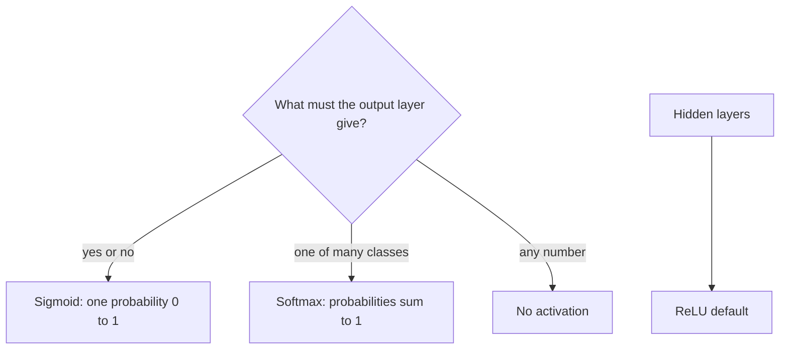
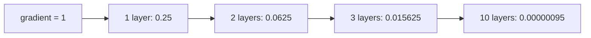

# What are Activation Functions in Neural Networks? Sigmoid, Tanh, ReLU, and Softmax Explained

> **Step 2: Deep Learning and Neural Networks** · ⏱️ 17 min read · [Read original](https://outcomeschool.com/blog/activation-functions)

## TL;DR
An activation function converts a neuron's weighted sum $z$ into its output and adds the non-linearity that lets a network learn curved, complex patterns. Sigmoid (0-1), Tanh (-1 to 1), ReLU (max(0,z)), and Softmax (probabilities summing to 1) are the main ones. ReLU is the default for hidden layers; the output layer's activation matches the task.

## Key Concepts
- **Activation function** — last step of a neuron's calculation (dimmer-switch analogy: decides how strongly it "fires").
- **Weighted sum** $z=w_1x_1+w_2x_2+b$.
- **Linear vs non-linear** — linear = straight line; stacking linear gives linear.
- **Gradient** — how much each weight must change; tiny gradient = weight almost stops learning.
- **Vanishing gradient**, **dying ReLU**, **sparsity**, **logits** (raw output scores).

## How It Works

### Place in a neuron
Inputs $x_1=2,x_2=3$; weights 0.5, 0.25; bias -0.25: $z=1+0.75-0.25=1.5$; sigmoid(1.5)=0.818 goes to next layer.

### Why non-linearity
Layer 1 $y=2x+1$, layer 2 $out=3y+4$ gives $6x+7$: still a line, even for 100 layers; a deep net without activation equals one layer. Real patterns (cats, sentences, house prices) need curves. A non-linear activation after each layer lets each bend the pattern more.

### Sigmoid
$$\sigma(z)=\frac{1}{1+e^{-z}}$$ ($e\approx2.718$). Values: -10 -> 0.00005, -2 -> 0.119, 0 -> 0.5, 2 -> 0.881, 10 -> 0.99995. S-shaped; output readable as probability (0.881 = 88.1% spam).
- **+** Probability for yes/no.
- **-- Vanishing gradients**: max slope 0.25 (at $z=0$), about 0.00005 at $z=10$. Gradient is multiplied by the slope at each layer going backward; 10 layers at best slope: $0.25^{10}\approx0.00000095$ (4x smaller per layer). Early layers stop learning.
- Outputs always positive (not zero-centered), slows training slightly.
- Use: output layer for binary classification; rarely hidden layers.

### Tanh
$$\tanh(z)=\frac{e^z-e^{-z}}{e^z+e^{-z}}$$ Range -1 to 1; -2 -> -0.964, 0 -> 0, 2 -> 0.964.
- **+** Zero-centered, usually faster training than sigmoid; slope at 0 is 1 (4x sigmoid's best).
- **--** Still flat for large |z| (slope about 0.0099 at $z=3$), so vanishing gradients in deep nets.
- Use: hidden layers of smaller nets, RNNs/LSTMs, outputs needing -1 to 1.

### ReLU
$$\text{ReLU}(z)=\max(0,z)$$ -10, -2, 0 -> 0; 2 -> 2; 10 -> 10. Each half is a line but the bend at 0 makes it non-linear; many ReLUs bending at different places build complex shapes.
- **+** Slope exactly 1 for positives (no gradient shrink; a key reason deep nets became trainable); very fast (no $e$, no division, just compare with 0); sparsity (many outputs exactly 0, simpler and more efficient).
- **-- Dying ReLU**: if $z$ becomes negative for all inputs, output 0 and gradient 0, weights never update again. Fix: **Leaky ReLU** $\max(0.01z,z)$ (z=-2 gives -0.02; negative slope 0.01 so it can recover).
- Use: default for hidden layers; modern LLMs use smoother relatives GELU and SwiGLU.

### Softmax
$$\text{softmax}(z_i)=\frac{e^{z_i}}{\sum_j e^{z_j}}$$ Works on the whole list; outputs positive and sum to 1. Logits [2.0, 1.0, 0.1]: exps 7.389, 2.718, 1.105, total 11.212.
| Class | Logit | Probability |
|---|---|---|
| Cat | 2.0 | 0.659 |
| Dog | 1.0 | 0.242 |
| Bird | 0.1 | 0.099 |

Sum = 1.0; probabilities feed Cross-Entropy Loss. Use: multi-class output layer; LLMs use it to get token probabilities over vocabulary.

### Which goes where
Input: no activation. Hidden: ReLU default (non-linearity + good gradient flow). Output matches the answer form:
- Yes/no: Sigmoid
- One of many classes: Softmax
- Any number (house price): none, so output isn't squeezed (sigmoid forces 0-1, ReLU blocks negatives)

### Comparison
| Feature | Sigmoid | Tanh | ReLU | Softmax |
|---|---|---|---|---|
| Range | 0 to 1 | -1 to 1 | 0 to infinity | 0 to 1, sums to 1 |
| Zero-centered | No | Yes | No | No |
| Works on | one number | one number | one number | whole list |
| Limitation | vanishing gradients | vanishing gradients | dying ReLU | not for hidden layers |
| Speed | slower (e) | slower (e) | very fast | slower (e) |
| Mostly used | output, yes/no | hidden, RNNs | hidden (default) | output, many classes |

### FAQ
- No activation? Runs but only one straight line, even at 100 layers.
- ReLU over sigmoid? Slope 1 vs at most 0.25, and fast.
- ReLU vs Leaky ReLU? 0 vs 0.01z for negatives.
- LLMs? GELU/SwiGLU and softmax over vocabulary.

## Diagrams

### Output activation decision

### Vanishing gradient through sigmoid layers

## Trade-offs & Pitfalls
- Sigmoid/Tanh: vanishing gradients; sigmoid also not zero-centered.
- ReLU: dying neurons (use Leaky ReLU).
- Softmax: not for hidden layers.
- Wrong output activation squeezes or blocks values.

## Key Takeaways
- Activation = non-linearity after the weighted sum; without it depth is useless.
- Sigmoid for binary output, Softmax for multi-class, none for regression, ReLU for hidden.
- Sigmoid slope max 0.25 causes vanishing gradients in deep stacks.
- Tanh is zero-centered but still vanishes.
- ReLU: slope 1, fast, sparse; risk is dying ReLU, fixed by Leaky ReLU.
- GELU/SwiGLU are smooth ReLU relatives used in LLMs.
