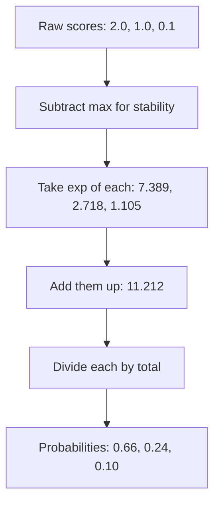

# What is the Softmax Function and How Does It Work?

> **Step 2: Deep Learning and Neural Networks** · ⏱️ 15 min read · [Read original](https://outcomeschool.com/blog/softmax-function)

## TL;DR
Softmax converts a list of raw scores (logits) into probabilities that are all between 0 and 1 and add up to 1. It does this by exponentiating each score and dividing by the total. It is used for classification outputs, LLM next-token prediction, and attention weights.

## Key Concepts
- **Logits** — raw model scores, any number, not probabilities.
- **Softmax** — `exp(x_i) / (exp(x_1) + ... + exp(x_n))`.
- **Temperature (T)** — divide scores by T before softmax: `softmax(x_i / T)`.
- **Numerical stability trick** — subtract the max score before `exp`.

## How It Works
### Why not divide by the sum?
Dividing scores by their total breaks with negatives. For scores 3, 1, -2 (total 2) you get 1.5 and -1.0; for 2 and -2 the total is 0. Exponentiating first fixes this: `exp` is always positive and preserves order.

### Worked example
Scores Cat 2.0, Dog 1.0, Bird 0.1 give exps 7.389, 2.718, 1.105 (total 11.212), so probabilities 0.659, 0.242, 0.099. Scores 3, 1, -2 give 0.876, 0.118, 0.006.

### Properties
1. Outputs sum to 1.
2. Order is preserved (highest score gets highest probability).
3. Gaps are amplified: a lead of 1 gives about 2.718x probability, a lead of 5 about 148x. It is a "soft" version of max.
4. Only differences matter; adding the same number to all scores changes nothing.

### Temperature
| T | Cat | Dog | Bird | Effect |
|---|---|---|---|---|
| 0.5 | 0.86 | 0.12 | 0.02 | Sharper |
| 1.0 | 0.66 | 0.24 | 0.10 | Normal |
| 2.0 | 0.50 | 0.30 | 0.19 | Flatter |

Low T makes an LLM focused and predictable; high T makes it more varied.

### Numerical stability
`exp(1000)` overflows to infinity, giving `nan`. Because only differences matter, subtract the max score first (1002, 1001, 1000.1 becomes 0, -1.0, -1.9), so the largest exponent is `exp(0) = 1`. Libraries like PyTorch do this internally.

```python
def softmax(scores, temperature=1.0):
    scores = scores / temperature
    scores = scores - scores.max()
    exps = np.exp(scores)
    return exps / exps.sum()
```

### Where it is used
Classification outputs (paired with cross-entropy loss), LLM next-token probabilities over a vocabulary of 100,000+ tokens, and attention in Transformers (scores become weights summing to 1).

## Diagram


## Key Takeaways
- Softmax = exponentiate, then normalize; output is a valid probability distribution.
- `exp` makes everything positive while keeping order.
- Adding a constant to all logits does not change the result, which enables the subtract-max trick.
- Temperature below 1 sharpens, above 1 flattens the distribution.
- Softmax never outputs exactly 0 and never changes the ranking.
