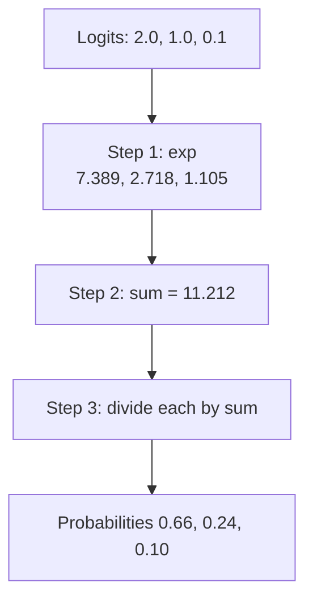
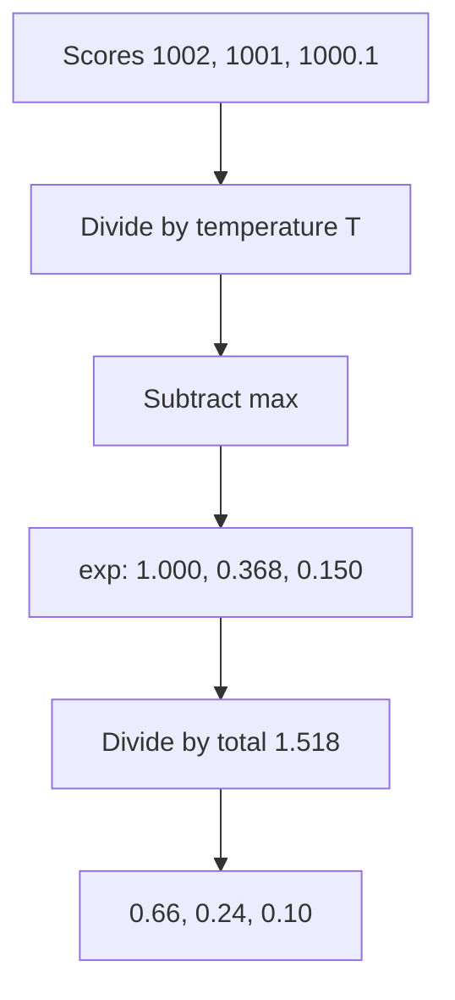

# What is the Softmax Function and How Does It Work?

> **Step 2: Deep Learning and Neural Networks** · ⏱️ 15 min read · [Read original](https://outcomeschool.com/blog/softmax-function)

## TL;DR
Softmax turns a list of raw scores (logits) into probabilities in (0,1) that sum to 1: exponentiate each score, then divide by the total. Temperature controls sharpness, and subtracting the max score keeps it numerically stable. It is used in classifiers, LLM next-token prediction, and Transformer attention.

## Key Concepts
- **Logits** — raw scores per option; higher = more belief; can be any number (7.5, -3.2), sum to anything.
- **Probability rules** — each in [0,1], all sum to 1.
- **exp** — $e^x$ with $e\approx2.718$; always positive, monotonic (keeps order).
- **Softmax** — "soft" version of max: most share to the top, some for others.
- **Temperature $T$** — divides scores before softmax.
- **nan** — "not a number" from inf/inf.

## How It Works

### Why not divide by the sum?
Scores 2.0, 1.0, 0.1 (sum 3.1) give 0.65, 0.32, 0.03 and seem fine. But for 3, 1, -2 (sum 2): 1.5, 0.5, -1.0 — above 1 and negative. For 2 and -2 the sum is 0 (division impossible). Negatives are the problem; first make all scores positive while preserving order.

### Formula
$$\text{softmax}(x_i)=\frac{e^{x_i}}{\sum_{j=1}^{n}e^{x_j}}$$
Exponent makes all positive (exp(-2)=0.135, exp(-100) tiny positive) and monotonic; division makes them sum to 1.

### Worked example (Cat 2.0, Dog 1.0, Bird 0.1)
1. exps: 7.389, 2.718, 1.105.
2. Total = 11.212.
3. Divide: 0.659, 0.242, 0.099 (sum 1.000): about 66%, 24%, 10%.
4. Scores 3, 1, -2: exps 20.086, 2.718, 0.135; total 22.939; probs 0.876, 0.118, 0.006 — valid.

```python
def softmax(scores):
    exps = np.exp(scores)
    return exps / exps.sum()
```
Prints [0.66 0.24 0.1] and sum 1.0.

### Properties
1. Outputs sum to 1 (each is a share of the total).
2. Keeps order (highest score = highest probability).
3. Amplifies gaps: score lead of 1 means probability about 2.718x bigger (0.659/0.242 about 2.72); lead of 5 means about 148x.
4. Only differences matter: adding the same number to all scores changes nothing (2.0,1.0,0.1 same as 102.0,101.0,100.1).

Never gives exactly 0: exp is always positive.

### Temperature
$\text{softmax}(x_i/T)$.
| T | Cat | Dog | Bird | Effect |
|---|---|---|---|---|
| 0.5 | 0.86 | 0.12 | 0.02 | sharper |
| 1.0 | 0.66 | 0.24 | 0.10 | normal |
| 2.0 | 0.50 | 0.30 | 0.19 | flatter |

(Rounded; rows may sum to 0.99.) T=0.5 doubles gaps (4.0, 2.0, 0.2), so Cat goes 0.66 to 0.86; T=2 halves gaps. In LLMs: low T = focused/predictable, high T = varied/creative.

### Numerical stability
exp(10)≈22,026; exp(100) has 44 digits; exp(1000) overflows to infinity. Scores 1002.0, 1001.0, 1000.1 give [nan nan nan]. Fix via property 4: subtract the max score: 0, -1.0, -1.9; exps 1.000, 0.368, 0.150; total 1.518; probs 0.66, 0.24, 0.10. Biggest exponent is exp(0)=1. PyTorch does this internally.
```python
scores = scores / temperature
scores = scores - scores.max()
exps = np.exp(scores); return exps / exps.sum()
```

### Where used
- **Classifier output** — cat/dog/bird; sentiment pos/neg/neutral; pick the highest; probabilities feed Cross-Entropy Loss.
- **LLM next-token** — a score for every vocabulary token (100,000+), softmax gives probabilities, next token sampled; temperature applies here.
- **Attention in Transformers** — pairwise token scores become weights summing to 1; each token splits 100% focus over visible tokens.

### FAQ
- Why "softmax"? Soft version of hard max.
- Logits? Raw scores.
- Exactly 0 probability? No.
- Adding constant to all scores? No change, enabling the stability trick.

## Diagrams

### Softmax pipeline


### Stable softmax with temperature


## Trade-offs & Pitfalls
- Dividing by the sum fails with negatives or zero sum.
- Overflow of exp on large scores gives nan; always subtract max.
- Low temperature can make output too deterministic; high gives flat probabilities.

## Key Takeaways
- Softmax = exp then normalize; output is a valid probability distribution.
- It preserves ranking and amplifies gaps (soft max).
- Shift invariant: only differences matter, enabling the max-subtraction stability trick.
- Temperature $T<1$ sharpens, $T>1$ flattens.
- Used for classifier outputs, LLM token distributions, and attention weights.
