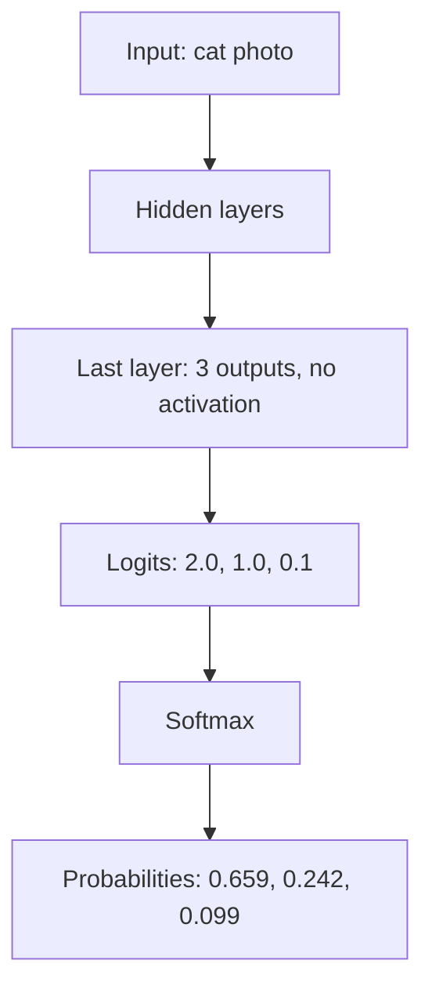
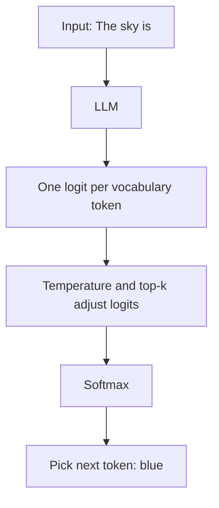
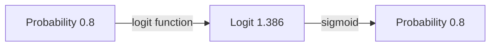

# What are Logits in Machine Learning?

> **Step 2: Deep Learning and Neural Networks** · ⏱️ 15 min read · [Read original](https://outcomeschool.com/blog/logits-in-machine-learning)

## TL;DR
Logits are the raw, unnormalized scores from a model's last layer, one per possible answer. Softmax (multi-class) or sigmoid (yes/no) turns them into probabilities. Models output logits because it gives numerical stability and lets loss functions combine softmax and log stably; LLMs use logits to pick the next token with temperature and top-k.

## Key Concepts
- **Logit** — raw score from the last layer (no activation); any number, not summing to 1; not a percentage.
- **Softmax** — logits to probabilities for multi-class.
- **Sigmoid** — one logit to probability for yes/no.
- **Odds** $=p/(1-p)$.
- **Logit function** $=\log(p/(1-p))$, the log-odds.
- **Vocabulary** — fixed token list of an LLM.
- **Greedy decoding** — always choose the highest-logit token.

## How It Works

### Where logits come from
Layers multiply by weights and add bias. Last layer has one output per class (3 classes = 3 logits; yes/no = 1 logit), with no activation. Pipeline: input -> hidden layers -> last layer -> logits -> softmax -> probabilities.

### Softmax

$$
\text{softmax}(z_i)=\frac{e^{z_i}}{\sum_j e^{z_j}}
$$

Logits cat 2.0, dog 1.0, bird 0.1: exps 7.389, 2.718, 1.105; total 11.212; probs 0.659, 0.242, 0.099 (65.9% cat). Order is preserved (highest logit = highest probability). Adding the same number to all logits changes nothing (12.0, 11.0, 10.1 give the same).

### Sigmoid for yes/no
$\sigma(z)=1/(1+e^{-z})$. Logit 0 means 0.5 (unsure); big positive near 1 (yes); big negative near 0 (no). Spam logit 2.0 gives $1/(1+0.135)=0.881$; logit -1.0 gives 0.269.

### Why "logit"
Odds example: rain p=0.8, odds $0.8/0.2=4$. $\text{logit}(p)=\log\frac{p}{1-p}$, so logit(0.8)=log 4=1.386 (natural log: e to what power gives 4). Sigmoid(1.386)=$1/(1+0.25)=0.8$: sigmoid and logit are inverses. Reference values: p=0.5 gives 0; p=0.9 gives 2.197; p=0.1 gives -2.197. The name was later extended to raw scores into softmax; not exactly one class's log-odds but same idea.

### Why models output logits, not probabilities
1. **Numerical stability** — exp(1000) overflows to infinity (in 32-bit even exp(100)); one infinity breaks everything. Subtract the max logit first so the largest exp input is 0 (exp(0)=1). Logits 2.0,1.0,0.1 and 1000.0,999.0,998.1 both give 0.659, 0.242, 0.099; without subtraction np.exp(1000) = inf and result nan.
2. **Loss functions take logits** — cross-entropy needs log of the correct-class probability. Softmax then log risks a tiny probability rounding to 0 and log(0) = -inf. Combine stably:

$$
\log\text{softmax}(z_i)=z_i-\log\sum_j e^{z_j}
$$

With the max-subtraction the sum inside the log is at least 1, so never -inf.
   - PyTorch: `nn.CrossEntropyLoss` takes logits; `nn.BCEWithLogitsLoss` takes the single yes/no logit. TensorFlow: `from_logits=True`.
   - Pitfall: applying softmax in the model and again in the loss (applied twice, poor learning).
3. Bonus: for the best answer just take the highest logit; softmax doesn't change ranking.

### Logits in LLMs
The LLM gives one logit per vocabulary token every step (e.g. 50,000). Input "The sky is": blue 2.0, clear 1.0, dark 0.1, banana -5.0, ... Then temperature/top-k modify logits, softmax gives probabilities, next token chosen.
- **Temperature** — divide logits by T. 3-token logits 2.0, 1.0, 0.1:
| T | Logits after | Probabilities |
|---|---|---|
| 0.5 | 4.0, 2.0, 0.2 | 0.864, 0.117, 0.019 |
| 1.0 | 2.0, 1.0, 0.1 | 0.659, 0.242, 0.099 |
| 2.0 | 1.0, 0.5, 0.05 | 0.502, 0.304, 0.194 |
Low T = focused/predictable; high T = varied/creative.
- **Top-k** — keep k highest logits, set others to -infinity (softmax gives probability 0). k=2: blue 2.0, clear 1.0 give 0.731, 0.269; banana can never be picked.
- Then sample at random by probability; or **greedy decoding** (highest logit; no softmax needed). See Top-K and Top-P Sampling.

### FAQ
- Negative logit? Yes.
- Logit 0? Unsure (p=0.5; equal odds).
- Softmax before loss? No.
- Need softmax for best answer? No.
- Add constant to all logits? No change.

## Diagrams

### From input to probabilities

### LLM next-token selection

### Probability and logit are inverses

## Trade-offs & Pitfalls
- Raw logits are not probabilities and can't be read as confidence percentages.
- Double softmax with a logits-based loss hurts learning.
- Overflow without max-subtraction produces nan.

## Key Takeaways
- Logits = raw last-layer scores; softmax or sigmoid converts them to probabilities.
- Logit is log-odds: $\log(p/(1-p))$; sigmoid inverts it.
- Softmax is shift-invariant and rank-preserving.
- Models output logits for stability and stable log-softmax in cross-entropy.
- Feed raw logits to the loss (PyTorch CrossEntropyLoss, BCEWithLogitsLoss).
- LLMs act on logits: temperature, top-k, greedy decoding.
