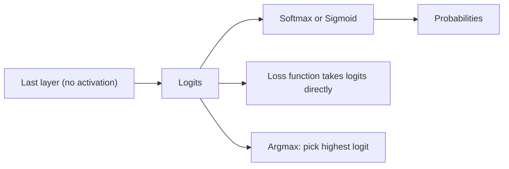

# What are Logits in Machine Learning?

> **Step 2: Deep Learning and Neural Networks** · ⏱️ 15 min read · [Read original](https://outcomeschool.com/blog/logits-in-machine-learning)

## TL;DR
Logits are the raw, unnormalized scores from a model's last layer, one per possible answer. Softmax (many classes) or sigmoid (yes/no) turns them into probabilities. Models output logits because it is numerically stable and loss functions want them directly.

## Key Concepts
- **Logit** — raw score from the last layer; any real number, not bounded, does not sum to 1.
- **Softmax** — converts a set of logits into probabilities summing to 1.
- **Sigmoid** — `1 / (1 + exp(-z))`, converts a single logit into a 0 to 1 probability.
- **Odds / log-odds** — `odds = p / (1 - p)`; `logit(p) = log(p / (1 - p))`.
- **Greedy decoding** — always pick the highest-logit token.

## How It Works
### Where logits come from
The last layer has one output per class (3 classes means 3 logits; yes/no means 1 logit) and applies no activation. Example: cat 2.0, dog 1.0, bird 0.1. The number 2.0 is not a percentage.

### Logits to probabilities
- Softmax on [2.0, 1.0, 0.1] gives 0.659, 0.242, 0.099. Ranking is unchanged and shifting all logits by a constant changes nothing (12.0, 11.0, 10.1 give the same result).
- Sigmoid for spam: logit 2.0 gives 0.881; logit -1.0 gives 0.269; logit 0 gives 0.5.

### Why "logit"?
Logit is the log of the odds. With p = 0.8, odds = 4, logit = log(4) = 1.386, and sigmoid(1.386) = 0.8. Sigmoid and logit undo each other. p = 0.5 gives 0; p = 0.9 gives 2.197. The name was later extended to raw softmax inputs.

### Why models output logits, not probabilities
1. **Numerical stability** — `exp(1000)` overflows to infinity. With logits, subtract the max before `exp` so the largest value is `exp(0) = 1`.
2. **Loss functions take logits** — cross-entropy needs `log(prob)`; a tiny probability can round to 0 and give minus infinity. Combining them stably: `log(softmax(z_i)) = z_i - log(sum of exp(z_j))`. PyTorch `nn.CrossEntropyLoss` and `nn.BCEWithLogitsLoss` expect logits; TensorFlow uses `from_logits=True`. Applying softmax before such a loss applies it twice and hurts learning.

To get just the best answer, pick the highest logit; no softmax is needed.

### Logits in LLMs
The LLM outputs one logit per vocabulary token (e.g. 50,000) at each step.
- **Temperature** divides logits first: T=0.5 gives 0.864, 0.117, 0.019; T=2.0 gives 0.502, 0.304, 0.194 for logits 2.0, 1.0, 0.1.
- **Top-k** keeps the k highest logits and sets the rest to minus infinity, so softmax gives them probability 0.
- Then sample from the probabilities, or use greedy decoding.

## Diagram

## Key Takeaways
- Logits are raw scores, not probabilities; they can be negative or large.
- Softmax for multi-class, sigmoid for binary.
- Logit literally means log-odds.
- Feed logits (not softmax outputs) to PyTorch/TensorFlow classification losses.
- Temperature and top-k act on logits in LLM decoding.
