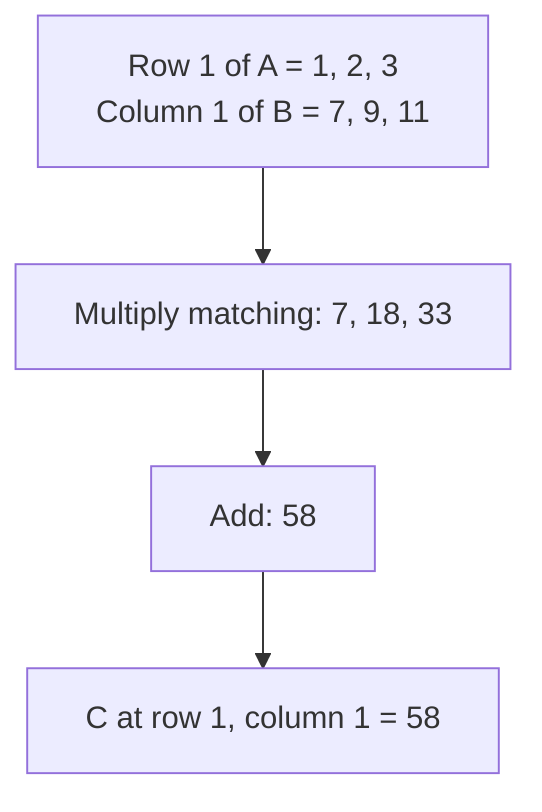
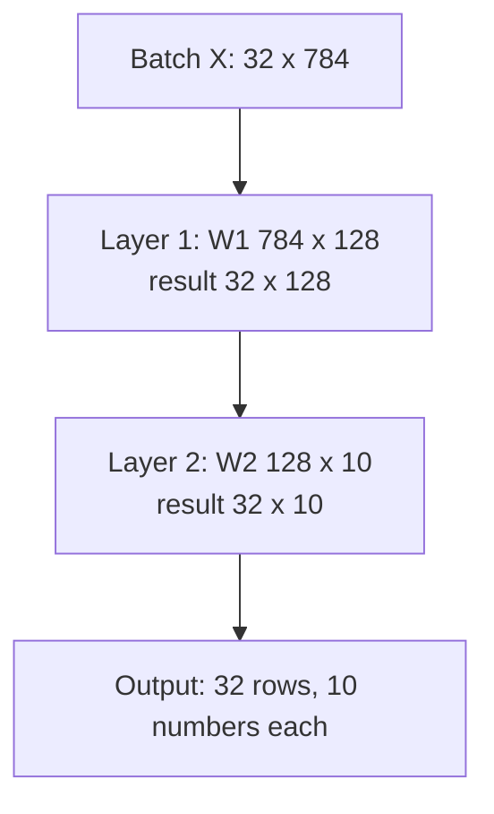

# How Does Matrix Multiplication Work in Neural Networks?

> **Step 2: Deep Learning and Neural Networks** · ⏱️ 19 min read · [Read original](https://outcomeschool.com/blog/matrix-multiplication-in-neural-networks)

## TL;DR
Most of a neural network's work is matrix multiplication: each output number is a dot product of a row of one matrix with a column of another. A layer of neurons is `x @ W + b`, a batch of inputs is just more rows, and because every output number is independent, GPUs with thousands of cores compute them in parallel.

## Key Concepts
- **Vector** — ordered list of numbers (house: [3, 2, 1] bedrooms, bathrooms, floors).
- **Matrix** — table of rows and columns; shape = rows x columns (2 houses x 3 features = 2 x 3).
- **Dot product** — multiply matching entries of two equal-length vectors and sum to one number.
- **Weight** — importance of each input to a neuron (like prices in a shopping bill).
- **Bias** — extra number that shifts a neuron's output.
- **Batch** — group of inputs processed together.
- **Broadcasting** — NumPy adds one bias row to every row of the result.
- **Core** — one worker inside a chip.

## How It Works

### Dot product
Quantities [2,3,1] and prices [10,5,20]: $2\cdot10+3\cdot5+1\cdot20=55$. One neuron = one dot product of inputs and weights.

### Matrix multiplication (row-times-column)
Every entry of $C=AB$ is the dot product of one row of A with one column of B.
$A=\begin{bmatrix}1&2&3\\4&5&6\end{bmatrix}$ (2x3), $B=\begin{bmatrix}7&8\\9&10\\11&12\end{bmatrix}$ (3x2); C is 2x2:
- C11 = 1*7+2*9+3*11 = 58
- C12 = 1*8+2*10+3*12 = 64
- C21 = 4*7+5*9+6*11 = 139
- C22 = 4*8+5*10+6*12 = 154

$C=\begin{bmatrix}58&64\\139&154\end{bmatrix}$. NumPy: `C = A @ B`, `C.shape` is (2, 2).

### Shape rule
$$(m\times n)\,@\,(n\times p)=(m\times p)$$
Inside numbers must match; outside numbers give the result shape. (2x3)@(3x2)=(2x2). Mismatch (2x3)@(2x3) raises `ValueError ... size 2 is different from 3`. Shape mismatches are among the most common errors in building networks; this rule is how to debug them.

### One layer = one matrix multiplication
Input $x=[1,2,3]$; neuron 1 weights [2,1,0] bias 1; neuron 2 weights [0,1,3] bias -2.
- Neuron 1: (2+2+0)+1 = 5; neuron 2: (0+2+9)-2 = 9.
- Put each neuron's weights as a column of W (3x2): W = [[2,0],[1,1],[0,3]], b = [1,-2].
$$\text{output}=xW+b$$
x is 1x3, (1x3)@(3x2) = (1x2) = [4, 11]; add bias gives [5, 9]. Bias doesn't change shape. A 1,000-neuron layer is still one line; only W's shape changes: $W=(\#inputs)\times(\#neurons)$. (Some libraries store W transposed and flip before multiplying.) Activation comes after the multiplication and is kept separate. Deep network = many such layers, output of one is input of next.

### Many inputs at once
Stack inputs as rows: $X=\begin{bmatrix}1&2&3\\4&5&6\end{bmatrix}$ (2x3): $(2\times3)@(3\times2)=(2\times2)$, result [[5, 9], [14, 21]]. Second row check: (4*2+5*1+6*0)+1=14, (4*0+5*1+6*3)-2=21. Same W for every input; bias broadcast to every row; one big multiplication is faster than many small ones.

Bigger example: batch 32 x 784 inputs; W1 784x128 gives 32x128; W2 128x10 gives 32x10. Rows stay 32 (one per input); columns become the neuron count. Bias is left out as it doesn't change shape.

### Why GPU
Work: $m\cdot n\cdot p$ multiplications. Layer 1: $32\cdot784\cdot128=3{,}211{,}264$. Large models do billions per input. No output number depends on another, so all run in parallel. CPU: few powerful cores, complex tasks sequentially. GPU: thousands of simple cores, each doing multiply-add; different dot products on different cores (professor vs a thousand teachers checking 10,000 sheets). In the 2x2 example, 4 cores compute 58, 64, 139, 154 simultaneously. GPUs also have special matrix-multiplication units.

### FAQ
- `@` = matrix multiplication in NumPy.
- W shape = inputs x neurons.
- Multiplications = m*n*p.
- Activation is not part of the matrix multiplication.

## Diagrams

### Row times column

### Shapes through two layers

## Trade-offs & Pitfalls
- Inner dimension mismatch causes errors.
- Cost scales as m*n*p; needs parallel hardware.
- Library convention differences in the W layout can confuse (transpose).

## Key Takeaways
- Neuron = dot product + bias; layer = `x @ W + b`.
- Matrix multiplication is many dot products: row of A times column of B.
- Shape rule (m,n)@(n,p)=(m,p); inside must match.
- W shape = (#inputs, #neurons); batching adds rows, not weights.
- Each output entry is independent, so GPU cores compute them in parallel.
- Cost is m*n*p multiplications.
