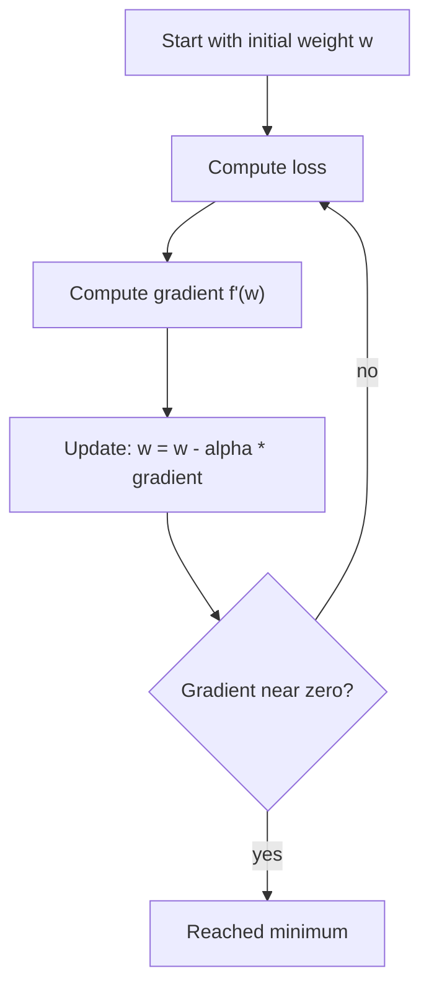
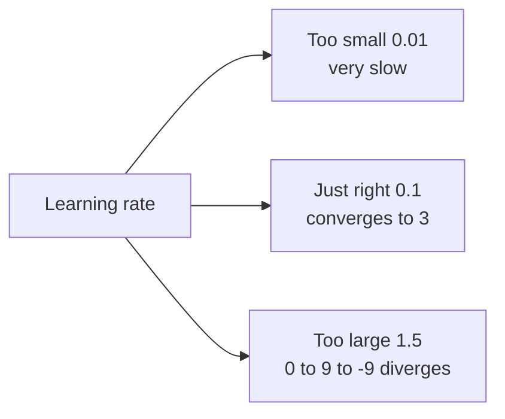

# How Does Gradient Descent Work?

> **Step 2: Deep Learning and Neural Networks** · ⏱️ 15 min read · [Read original](https://outcomeschool.com/blog/math-behind-gradient-descent)

## TL;DR
Gradient descent trains models by repeatedly moving weights opposite to the gradient of the loss: $w \leftarrow w-\alpha f'(w)$. The learning rate sets step size: too small is slow, too large diverges. Variants (batch, SGD, mini-batch) differ in how much data computes each gradient.

## Key Concepts
- **Loss function** — measures how far prediction is from actual (how wrong). Example: actual 60, predicted 50, loss $(60-50)^2=100$.
- **MSE** — average of squared errors over the dataset. Squaring makes errors positive (no cancelling) and penalizes large errors more.
- **Gradient** — slope/steepness; **descent** — going down. Together: move in the steepest downhill direction.
- **Derivative** $f'(w)=df/dw$ — rate of change/slope (speedometer analogy). Positive = going up, negative = going down, zero = flat (min or max).
- **Learning rate $\alpha$** — step size.
- **Partial derivative** $\partial L/\partial w_1$ — change in loss wrt one weight, others fixed (TV with volume and brightness knobs).
- **Gradient (vector)** — all partial derivatives.

## How It Works

### Intuition
Foggy hill: feel the slope, step downhill; steeper = bigger step; stop when flat. Hill = loss; valley bottom = minimum loss; slope = gradient; step = weight update.

### Update rule

$$
w_{new}=w_{old}-\alpha\,f'(w_{old})
$$

Why subtract: positive gradient moves left (downhill); negative gradient subtracts a negative = moves right (also downhill). Either side of the minimum, you move toward it.

### Numeric example
$f(w)=(w-3)^2$, $f'(w)=2(w-3)$, start $w=0$, $\alpha=0.1$:
| Step | w before | Gradient | New w |
|---|---|---|---|
| 1 | 0 | -6 | 0.6 |
| 2 | 0.6 | -4.8 | 1.08 |
| 3 | 1.08 | -3.84 | 1.464 |
| 4 | 1.464 | -3.072 | 1.7712 |
| 5 | 1.7712 | -2.4576 | 2.0170 |

w approaches 3; gradient shrinks so steps shrink near the minimum.

### Multiple parameters
Real networks have millions of weights. Gradient $=[\partial L/\partial w_1,\partial L/\partial w_2,\dots]$. Each weight updates independently: $w_i\leftarrow w_i-\alpha\,\partial L/\partial w_i$. This scales to billions of parameters.

### Learning rate
Same function, start $w=0$:
- **Too small ($\alpha=0.01$):** step 1 gives 0.06, step 2 gives 0.1188; after 20 steps only about 0.997, while $\alpha=0.1$ reaches about 2.02 in 4 steps.
- **Just right (0.1):** steady convergence.
- **Too large ($\alpha=1.5$):** 0 -> 9 (overshoot) -> -9 (farther); diverges.
- Typical starts: 0.001 or 0.01; Transformers often 1e-4. Also appears when fine-tuning a pretrained model.

### Types
| Type | Data per step | Speed | Gradient accuracy |
|---|---|---|---|
| Batch | entire dataset | slow | high |
| Stochastic (SGD) | 1 data point | fast | low (noisy) |
| Mini-batch | a batch (32, 64, 128... up to 1024, bigger on GPUs) | moderate | moderate |

Note: "SGD" in modern DL often means mini-batch SGD (e.g. `torch.optim.SGD` works with any batch size). Mini-batch is most used.

### Python
```python
w, lr = 0.0, 0.1
for step in range(50):
    gradient = 2 * (w - 3)
    w = w - lr * gradient
```
After 50 steps: w = 3.0000, loss = 0.000000. Frameworks compute gradients automatically via backpropagation.

### FAQ
- Why subtract the gradient? To go downhill from either side.
- Learning rate to start? 0.001 or 0.01; 1e-4 for Transformers.
- SGD in PyTorch single-sample? No, any batch size.
- Why square error? Positive, penalizes big errors.
- Hand-compute gradients? No, backprop does it.

## Diagrams

### Gradient descent loop


### Learning rate effects


## Trade-offs & Pitfalls
- Learning rate: too small = slow; too large = unstable/diverging.
- Batch GD: accurate but slow on big data; SGD: fast but noisy.
- Zero gradient means flat: could be min or max.

## Key Takeaways
- Gradient descent minimizes loss by stepping against the gradient.
- Update: $w_{new}=w_{old}-\alpha\cdot\text{gradient}$; the minus sign works from either side.
- Gradient shrinks near the minimum, so steps self-shrink.
- Each weight uses its own partial derivative.
- Learning rate is critical (0.001 to 0.01 typical, 1e-4 for Transformers).
- Mini-batch gradient descent is the practical standard.
