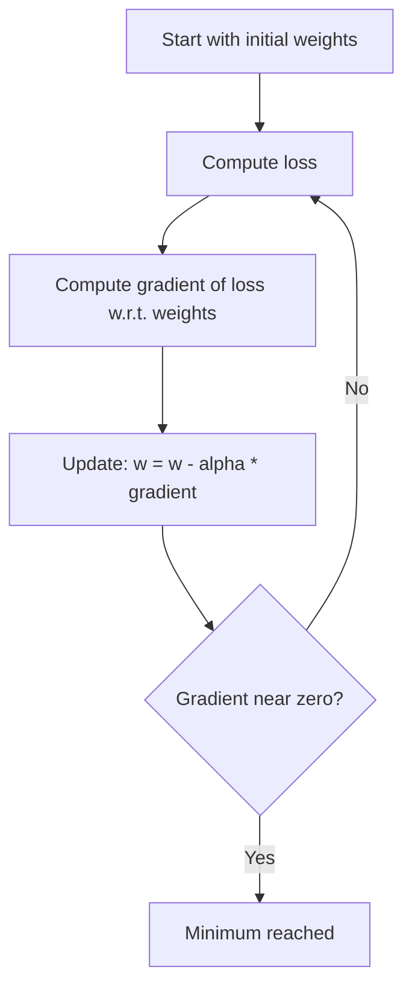

# How Does Gradient Descent Work?

> **Step 2: Deep Learning and Neural Networks** · ⏱️ 15 min read · [Read original](https://outcomeschool.com/blog/math-behind-gradient-descent)

## TL;DR
Gradient descent is the optimization algorithm that adjusts a model's weights step by step in the direction that reduces the loss. Each step uses the gradient (slope) of the loss and a learning rate that sets the step size. It is the foundation of how every neural network learns.

## Key Concepts
- **Loss function** — measures how wrong the prediction is. Example: actual 60, predicted 50, squared error $(60-50)^2 = 100$.
- **MSE** — average of squared errors; squaring keeps errors positive and penalizes large errors more.
- **Gradient** — slope of the loss with respect to the weights (derivative). Positive means going up, negative going down, zero means flat (min or max).
- **Learning rate (alpha)** — small positive number controlling step size.
- **Partial derivative** — slope with respect to one weight while others are held fixed.

## How It Works
### Intuition
Standing on a foggy hill, you feel the slope and step downhill; steeper means bigger step. Hill = loss, valley bottom = minimum loss, slope = gradient, step = weight update.

### Update rule
$$w_{new} = w_{old} - \alpha \cdot f'(w_{old})$$
Subtracting works on both sides of the minimum: a positive gradient moves left, a negative gradient moves right, both downhill.

### Numeric example
Loss $f(w) = (w-3)^2$, gradient $2(w-3)$, start w = 0, alpha = 0.1: w goes 0, 0.6, 1.08, 1.464, 1.7712, 2.0170. Steps shrink as the gradient shrinks near the minimum. After 50 steps in Python, w is about 3.0000 and loss about 0.

### Many parameters
Gradient = vector of partial derivatives, `[dL/dw1, dL/dw2, ...]`. Each weight updates with its own partial derivative: `w1_new = w1_old - alpha * dL/dw1`. This scales to billions of parameters; frameworks compute gradients via backpropagation.

### Learning rate effects (start w = 0)
| alpha | Behaviour |
|---|---|
| 0.01 | Too small: about 0.997 after 20 steps, very slow |
| 0.1 | Just right: steady convergence |
| 1.5 | Too large: 0 jumps to 9, then to -9, diverges |

Common starting values: 0.001 or 0.01; Transformers often 1e-4.

### Types of gradient descent
| Type | Data per step | Speed | Gradient accuracy |
|---|---|---|---|
| Batch | Entire dataset | Slow | High |
| Stochastic (SGD) | 1 data point | Fast | Low (noisy) |
| Mini-batch | A batch (e.g. 32 to 1024) | Moderate | Moderate |

Mini-batch is the practical default. In PyTorch, `torch.optim.SGD` works with any batch size.

## Diagram

## Key Takeaways
- Gradient descent minimizes loss by repeatedly stepping against the gradient.
- Update rule: $w_{new} = w_{old} - \alpha \cdot \text{gradient}$.
- Learning rate too small is slow; too large diverges.
- Steps naturally shrink as the slope flattens near the minimum.
- Mini-batch gradient descent balances speed and accuracy and is the standard in practice.
