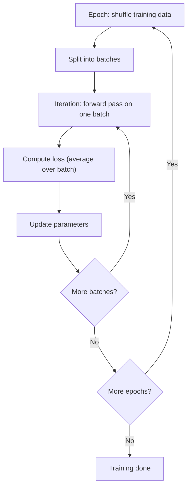

# What are Epoch, Batch, Batch Size, and Iteration in Machine Learning?

> **Step 2: Deep Learning and Neural Networks** · ⏱️ 16 min read · [Read original](https://outcomeschool.com/blog/epoch-batch-and-iteration)

## TL;DR
Training feeds data to the model in small batches rather than all at once. A batch is a group of samples, an iteration is one update on one batch, and an epoch is one full pass over the training data. Choosing batch size and epoch count controls memory use, speed, and overfitting.

## Key Concepts
- **Sample** — one example with its correct answer.
- **Batch / batch size** — a group of samples processed together / the number of samples in it. Batch loss is the average of its sample losses.
- **Iteration (step)** — one forward pass, loss, and parameter update on one batch.
- **Epoch** — one complete pass over all training data; data is usually shuffled before each epoch.
- **Underfitting / overfitting** — too few epochs / too many epochs (memorizing).
- **Early stopping** — stop when validation loss stops falling.

## How It Works
### Why batches?
Feeding everything at once needs enough GPU memory for all samples and gives only one update per pass. Batches let the model improve right after the first small group.

### The arithmetic
$$\text{iterations per epoch} = \lceil \text{samples} / \text{batch size} \rceil$$
$$\text{total iterations} = \text{iterations per epoch} \times \text{epochs}$$
Example: 1000 samples, batch size 100, 5 epochs gives 10 per epoch and 50 total. With 1050 samples, batches are 10 x 100 plus one of 50, so 11 per epoch (33 for 3 epochs). Some tools can drop the last smaller batch.

### Batch vs mini-batch vs stochastic
| Type | Batch size | Iterations/epoch (1000 samples) | Trade-off |
|---|---|---|---|
| Batch GD | 1000 (all) | 1 | Accurate but slow, memory heavy |
| Mini-batch GD | 100 | 10 | Balanced |
| SGD | 1 | 1000 | Fast, noisy, wastes GPU parallelism |

Most modern training uses mini-batches (and often calls it SGD).

### Choosing batch size
- Larger: more accurate updates, better GPU use, more memory, fewer updates per epoch.
- Smaller: less memory, more updates, noisier (a little noise can help generalization).
- Start with 32, 64, or 128. When batch size changes, the learning rate often needs to change too (larger batch often tolerates a larger rate).

### Choosing epochs
Use a validation set held out from training. If validation loss rises while training loss keeps falling, stop (early stopping). Small models may need 50 to 100 epochs; large LLMs on trillions of tokens see most data about once (about 1 epoch).

### Loop shape
```python
for epoch in range(num_epochs):
    random.shuffle(data)
    for start in range(0, num_samples, batch_size):
        batch = data[start:start + batch_size]
        # forward pass, loss, update
```

## Diagram


## Key Takeaways
- Batch = data group, iteration = one update on it, epoch = one pass over all data.
- Iterations per epoch = ceil(samples / batch size).
- Mini-batch gradient descent balances accuracy, memory, and GPU use.
- Too few epochs underfit, too many overfit; use a validation set and early stopping.
- Shuffle each epoch so the model does not learn from data order.
