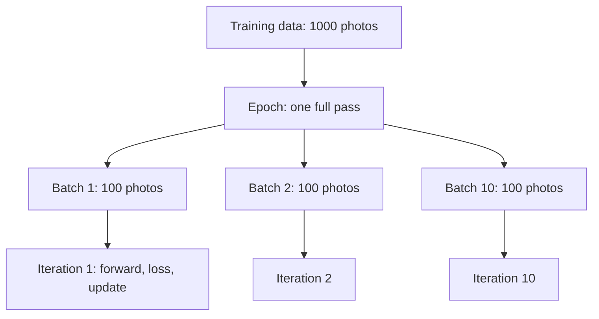
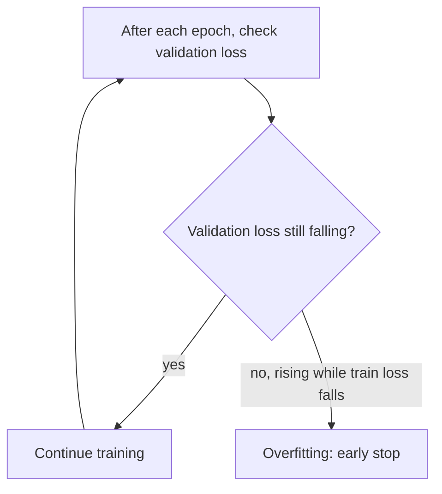

# What are Epoch, Batch, Batch Size, and Iteration in Machine Learning?

> **Step 2: Deep Learning and Neural Networks** · ⏱️ 16 min read · [Read original](https://outcomeschool.com/blog/epoch-batch-and-iteration)

## TL;DR
A batch is a small group of samples; batch size is how many samples it holds; an iteration (step) is one forward pass + loss + update on one batch; an epoch is one full pass over all training data. Feeding all data at once is too memory-heavy and gives too few updates, so we use mini-batches.

## Key Concepts
- **Parameters / weights** — numbers inside the model, random at start, updated during training.
- **Sample (example)** — one data item with its correct answer.
- **Loss** — number for how wrong guesses are; a batch's loss = average of its samples' losses (one batch = one loss = one update).
- **Batch / batch size** — group of samples processed together / its size.
- **Iteration (step)** — one training step on one batch ("step 500" = 500 iterations).
- **Epoch** — one complete pass over all training data.
- **Shuffle** — mix sample order before each epoch.
- **Underfitting / overfitting / validation set / early stopping**.

## How It Works

### One training step
1. Forward pass: samples go in, model guesses.
2. Loss: compare guesses with answers.
3. Update: gradient descent nudges parameters to reduce loss (backprop finds the directions).
Repeated many times, loss keeps dropping.

### Why not all data at once
- **Memory** — GPU must hold all samples and intermediate calculations; millions of images (or trillions of LLM tokens) don't fit.
- **Slow learning** — only one update after seeing the whole dataset.
Batches: update after each small group, so improvement starts after the first group.

### Example (1000 photos, batch size 100, 5 epochs)
- 10 batches; 10 iterations see every photo once = 1 epoch. Iteration count keeps rising across epochs (epoch 2 = iterations 11 to 20, epoch 5 = 41 to 50).
- Shuffle before each epoch so batches differ and the model doesn't learn from order.

$$
\text{iterations/epoch}=\frac{N}{B}=\frac{1000}{100}=10,\qquad \text{total}=10\times5=50
$$

50 updates; each photo seen 5 times.

### Uneven division
1050 photos, batch 100: 10 full batches + one of 50 = 11 iterations.

$$
\text{iterations/epoch}=\lceil N/B\rceil=\lceil10.5\rceil=11
$$

3 epochs = 33. Some tools can drop the last small batch (then 10 per epoch; 50 photos skipped that epoch).

### Batch vs mini-batch vs SGD
| Type | Batch size | Iterations/epoch (1000 samples) | Updates |
|---|---|---|---|
| Batch GD | 1000 (all) | 1 | accurate but slow |
| Mini-batch GD | e.g. 100 (32, 64, 128 typical) | 10 | balanced |
| Stochastic GD (SGD) | 1 | 1000 | fast but noisy |

- Batch: accurate, but heavy memory and one update per epoch.
- SGD ("stochastic" = random): tiny memory, many updates; noisy, wastes GPU parallelism.
- Mini-batch: fairly accurate, bounded memory, busy GPU; need to choose batch size, small noise remains.
- Almost all modern training uses mini-batches; people often say "SGD" for mini-batch.

### Choosing batch size
- **Larger**: more accurate updates, better GPU use (faster epochs), more memory, fewer updates/epoch.
- **Smaller**: less memory, more updates, noisier (a bit of noise can improve generalization), poorer GPU use.
- Start with 32, 64, or 128 (powers of 2 are popular, not required); go higher if memory allows and learning stays good.
- Changing batch size often needs a learning-rate change; larger batch often tolerates a larger rate.

### How many epochs
- Too few = underfitting (bad on training and new data). Too many = overfitting (memorizes; great on training, bad on new data).
- Use a validation set (held out, never trained on); check its loss each epoch. If validation loss rises while training loss falls, stop: **early stopping**. Set a large epoch count and let early stopping decide.
- Small model on small data: 50 to 100 epochs. Large LLMs on trillions of tokens: about 1 epoch.

### Training loop code
```python
for epoch in range(num_epochs):
    random.shuffle(data)
    for start in range(0, num_samples, batch_size):
        batch = data[start:start + batch_size]
        # forward pass, loss, update
        total_iterations += 1
```
For 1050 samples, batch 100, 3 epochs: 11 iterations/epoch, last batch 50, total 33.

### FAQ
- Epoch vs iteration: whole pass vs one batch step.
- Iteration = step: yes.
- Shuffle each epoch: so order is different and not learned.
- Large LLM epochs: about 1.
- Change LR with batch size: often yes.

## Diagrams

### Data hierarchy


### Choosing epochs with early stopping


## Trade-offs & Pitfalls
- Large batch: memory and fewer updates; small batch: noise and poor GPU usage.
- Ignoring the last partial batch (round up with ceil).
- Too many epochs overfit; too few underfit.
- Forgetting to retune the learning rate when batch size changes.

## Key Takeaways
- Batch = group, batch size = its size, iteration = one update on a batch, epoch = full data pass.
- Iterations per epoch $=\lceil N/B\rceil$; total = that x epochs.
- Mini-batch is the standard compromise between batch and SGD.
- Shuffle each epoch.
- Use validation loss and early stopping to pick epochs.
- LLMs on huge data often train about 1 epoch.
