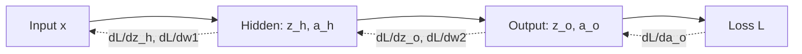

# How Does Backpropagation Work? The Math Explained Step by Step

> **Step 2: Deep Learning and Neural Networks** · ⏱️ 16 min read · [Read original](https://outcomeschool.com/blog/math-behind-backpropagation)

## TL;DR
Backpropagation uses the chain rule to compute how much each weight contributed to the loss by sending the error backward through the network. Gradient descent then uses these gradients to update the weights. Reusing error signals from later layers makes it efficient.

## Key Concepts
- **Backpropagation** — propagate the error backward to get the gradient of the loss for every weight (like a teacher tracing which step of the math went wrong).
- **Chain rule** — if $z=g(y)$ and $y=f(x)$, then $\frac{dz}{dx}=\frac{dz}{dy}\cdot\frac{dy}{dx}$.
- **Forward pass** — weighted sum $z = w_1x_1 + w_2x_2 + b$, then activation $a=\sigma(z)$.
- **Loss** — here squared error $L=\tfrac12(y-a_o)^2$; the 1/2 only simplifies the derivative and rescales gradients.
- **Sigmoid derivative** — $\sigma'(z)=a(1-a)$, reusing the value already computed in the forward pass.

## How It Works
### Network
Tiny network: input x, one hidden neuron, one output neuron, sigmoid on both.
`z_h = w1*x + b1; a_h = sigmoid(z_h); z_o = w2*a_h + b2; a_o = sigmoid(z_o)`

### Gradients via chain rule
$$\frac{\partial L}{\partial w_2} = -(y-a_o)\cdot a_o(1-a_o)\cdot a_h$$
$$\frac{\partial L}{\partial w_1} = -(y-a_o)\cdot a_o(1-a_o)\cdot w_2\cdot a_h(1-a_h)\cdot x$$
The w1 gradient reuses the error signal $\frac{\partial L}{\partial a_o}\cdot\frac{\partial a_o}{\partial z_o}$ already computed for w2; that reuse is the key insight. Bias gradients have the same form with last term 1 instead of the input/activation.

### Numeric example
x = 0.5, y = 1.0, w1 = 0.3, b1 = 0.1, w2 = 0.7, b2 = 0.2.
- Forward: z_h = 0.25, a_h = 0.5622, z_o = 0.5935, a_o = 0.6442, loss = 0.0633.
- Backward: dL/dw2 = -0.0459, dL/dw1 = -0.0070 (negative, so increase both weights).
- Update with learning rate 0.5: w2 = 0.7229, w1 = 0.3035.

Repeating in Python for 1000 iterations: loss falls from 0.063306 to about 0.000426 at epoch 800, prediction rises from 0.644 to 0.974.

### Update rule
$$w_{new} = w_{old} - \eta \cdot \frac{\partial L}{\partial w}$$
Too large a learning rate overshoots; too small is slow. The same loop is used when fine-tuning a pre-trained model.

## Diagram

## Key Takeaways
- Backprop = chain rule applied from output back to input to get every weight's gradient.
- It is not the same as gradient descent: backprop computes gradients, gradient descent applies them.
- Error signals from later layers are reused, so gradients are computed efficiently.
- Sigmoid's derivative is $a(1-a)$, cheap because $a$ is already known.
- Training loop: forward pass, loss, backward pass, weight update, repeat.
