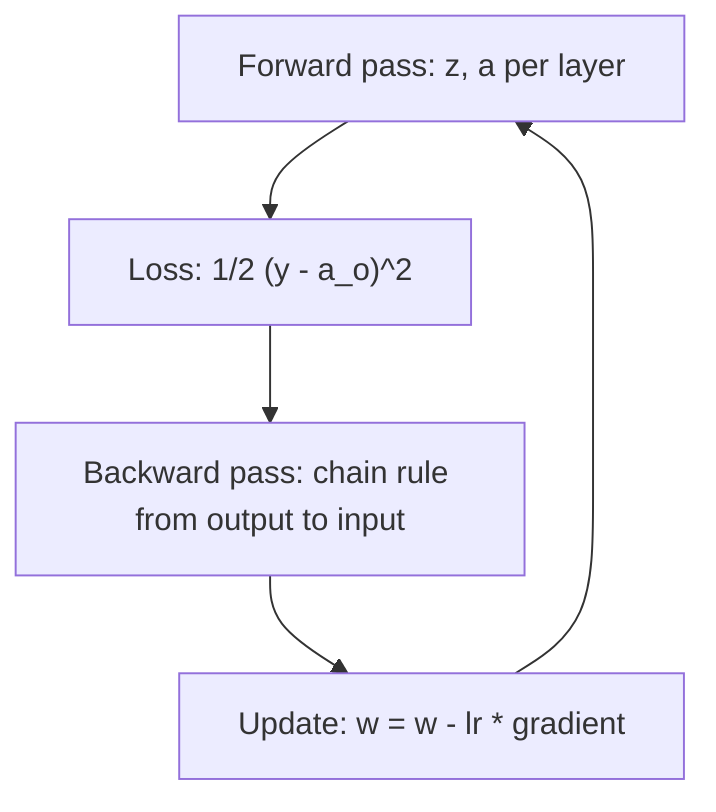
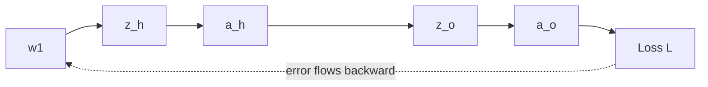

# How Does Backpropagation Work? The Math Explained Step by Step

> **Step 2: Deep Learning and Neural Networks** · ⏱️ 16 min read · [Read original](https://outcomeschool.com/blog/math-behind-backpropagation)

## TL;DR
Backpropagation computes how much each weight contributed to the loss by sending the error backward through the network with the chain rule. Gradient descent then uses these gradients to update the weights. Earlier layers reuse error signals from later layers, which makes it efficient.

## Key Concepts
- **Backpropagation** — backward + propagation: send error backward to get each weight's gradient (teacher tracing a student's wrong steps).
- **Chain rule** — if $y=f(x)$, $z=g(y)$: $dz/dx=(dz/dy)(dy/dx)$.
- **Forward pass** — weighted sum then activation, layer by layer.
- **Loss** — squared error $L=\tfrac12(y-\hat y)^2$ (the 1/2 simplifies derivatives, only scales gradients; learning rate compensates). Averaged over examples = MSE.
- **Gradient** — slope: direction (increase/decrease) and steepness for each weight.
- **Sigmoid** — $a=1/(1+e^{-z})$, output 0-1; adds non-linearity (without it, stacked layers learn only straight lines; see MLP/XOR).

## How It Works

### Network
Input x -> w1 -> hidden h -> w2 -> output o, sigmoid at hidden and output.
$z_h=w_1x+b_1$, $a_h=\sigma(z_h)$, $z_o=w_2a_h+b_2$, $a_o=\sigma(z_o)$ (prediction), $L=\tfrac12(y-a_o)^2$.

### Gradients via chain rule
**$w_2$:**
$$\frac{\partial L}{\partial w_2}=\frac{\partial L}{\partial a_o}\frac{\partial a_o}{\partial z_o}\frac{\partial z_o}{\partial w_2}=-(y-a_o)\,a_o(1-a_o)\,a_h$$
- $\partial L/\partial a_o=-(y-a_o)$
- Sigmoid derivative: $a(1-a)$. Derivation: $a=(1+e^{-z})^{-1}$, derivative $e^{-z}/(1+e^{-z})^2$; and $1-a=e^{-z}/(1+e^{-z})$, so product $=a(1-a)$. Convenient: reuses $a_o$ from the forward pass.
- $\partial z_o/\partial w_2=a_h$.

**$w_1$** (longer chain):
$$\frac{\partial L}{\partial w_1}=-(y-a_o)\,a_o(1-a_o)\,w_2\,a_h(1-a_h)\,x$$
Uses $\partial z_o/\partial a_h=w_2$, $\partial a_h/\partial z_h=a_h(1-a_h)$, $\partial z_h/\partial w_1=x$. It reuses the error signal $\frac{\partial L}{\partial a_o}\frac{\partial a_o}{\partial z_o}$ from $w_2$ — the key insight and source of efficiency. (Long chains cause vanishing/exploding gradients.)

**Biases:** last chain term is 1 instead of the input:
- $\partial L/\partial b_2=-(y-a_o)a_o(1-a_o)$
- $\partial L/\partial b_1=-(y-a_o)a_o(1-a_o)w_2a_h(1-a_h)$

### Numeric example
$x=0.5,\ y=1.0,\ w_1=0.3,\ b_1=0.1,\ w_2=0.7,\ b_2=0.2$ (4-decimal rounding).
- Forward: $z_h=0.25$, $a_h=0.5622$; $z_o=0.7\cdot0.5622+0.2=0.5935$, $a_o=0.6442$ (target 1.0). Loss $=\tfrac12(0.3558)^2=0.0633$.
- Backward: $\partial L/\partial a_o=-0.3558$; $a_o(1-a_o)=0.2292$.
  - $\partial L/\partial w_2=-0.3558\cdot0.2292\cdot0.5622=-0.0459$.
  - $a_h(1-a_h)=0.2461$; $\partial L/\partial w_1=-0.3558\cdot0.2292\cdot0.7\cdot0.2461\cdot0.5=-0.0070$.
- Negative gradients mean both weights should increase.

### Weight update
$$w_{new}=w_{old}-\eta\,\frac{\partial L}{\partial w}$$
$\eta=0.5$: $w_2=0.7+0.0229=0.7229$; $w_1=0.3+0.0035=0.3035$. Learning rate too large overshoots, too small is slow. Repeat forward, loss, backward, update many times; the same loop runs in fine-tuning.

### Python (1000 epochs, one example)
```python
dL_da_o = -(y - a_o); da_o_dz_o = a_o*(1-a_o)
dL_dw2 = dL_da_o*da_o_dz_o*a_h
dL_dw1 = dL_da_o*da_o_dz_o*w2*a_h*(1-a_h)*x
w2 -= lr*dL_dw2; w1 -= lr*dL_dw1  # likewise b1, b2
```
Output: Epoch 0 loss 0.063306 pred 0.644173; epoch 200 loss 0.001997 pred 0.936796; epoch 400 0.000917 / 0.957166; epoch 600 0.000585 / 0.965799; epoch 800 0.000426 / 0.970806; final prediction 0.974146 (target 1.0). (Single example, so each iteration is an epoch; full precision gives slight differences from hand rounding.)

### FAQ
- Backprop = gradient descent? No: backprop computes gradients, GD updates weights.
- Why efficient? Reuses later-layer error signals.
- Why activation? Non-linearity.
- LR too large/small? Overshoot / slow.
- Why 1/2? Cleaner derivative; scale only.

## Diagrams

### Training loop


### Chain rule dependency for w1


## Trade-offs & Pitfalls
- Long chains of multiplications can cause vanishing or exploding gradients.
- Learning rate too large overshoots; too small slows learning.
- Rounded hand values differ slightly from full-precision code.

## Key Takeaways
- Backprop applies the chain rule backward from the loss to each weight.
- Sigmoid derivative $a(1-a)$ reuses the forward-pass value.
- Earlier-layer gradients reuse later-layer error signals, giving efficiency.
- Bias gradients = same chain with last term 1.
- Gradient descent uses the gradients: $w\leftarrow w-\eta\,g$.
- Repeating forward, loss, backward, update drives loss toward 0 (0.0633 to about 0.0004 in the example).
