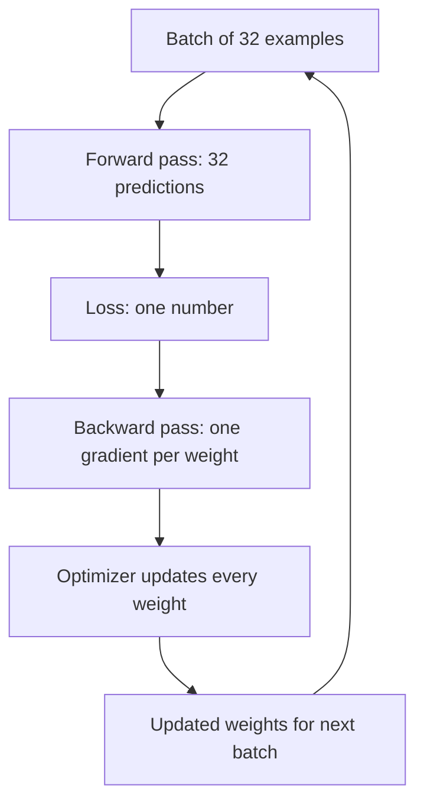
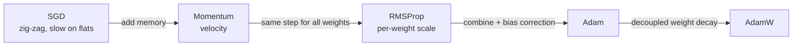

# What are Optimizers in Deep Learning? SGD, Momentum, RMSProp, and Adam Explained

> **Step 2: Deep Learning and Neural Networks** · ⏱️ 16 min read · [Read original](https://outcomeschool.com/blog/optimizers-in-deep-learning)

## TL;DR
An optimizer takes the gradients from backprop and decides how to update every weight. SGD steps against the gradient; Momentum adds velocity (memory of past gradients); RMSProp scales each weight's step by its recent gradient size; Adam combines both with bias correction; AdamW decouples weight decay and is common for LLMs.

## Key Concepts
- **Weights** — the network's numbers (random at start). **Loss** — one number for how wrong. 
- **Optimizer** — uses the gradient to update weights step by step. It does not compute loss or gradient; it is the last stage of each training step.
- **Gradient** — direction (does increasing the weight raise or lower the loss) and size; every optimizer moves opposite to it (positive gradient = decrease the weight).
- **Learning rate** — step size chosen before training (0.1, 0.001): too big bounces around/jumps over the valley, too small is very slow.
- **Velocity** — running memory of past gradients (Momentum).
- **Running average of squared gradient** — measures typical gradient size (squaring avoids sign cancellation).
- **Weight decay** — shrink weights slightly each step to prevent them growing too large.

All examples use loss $w^2$ (min at $w=0$, gradient $2w$), start $w=2$, lr 0.1.

## How It Works

### SGD
$$w\leftarrow w-\eta\,g$$
"Stochastic" = random: gradient computed on a small random batch, much faster than the whole dataset.
- Step 1: $g=4$, $w=2-0.1\cdot4=1.6$. Step 2: $g=3.2$, $w=1.6-0.32=1.28$.
- Problems: **zig-zag** in long narrow valleys (steep across, gentle along: bounces between walls, slow along the floor); **slow in flat areas** (tiny gradient = tiny step). Each step only looks at the current gradient and forgets the past.

### Momentum
Ball rolling downhill builds speed.
$$v\leftarrow\beta v+g,\qquad w\leftarrow w-\eta v$$
$\beta\approx0.9$ keeps 90% of old velocity. Steps: $v=4$, $w=1.6$; then $v=0.9\cdot4+3.2=6.8$, $w=1.6-0.68=0.92$ (vs SGD 1.28 after two steps).
- Fixes zig-zag: opposite side-to-side gradients cancel in velocity, along-valley gradients add up.
- Fixes flat areas: velocity carries earlier speed.
- Remaining issue: same learning rate for every weight; one safe for large-gradient weights is too small for tiny-gradient weights.

### RMSProp (Root Mean Square Propagation)
Per-weight step size: divide gradient by typical recent gradient size.
$$s\leftarrow\beta s+(1-\beta)g^2,\qquad w\leftarrow w-\eta\frac{g}{\sqrt{s}+\epsilon}$$
$s$ starts at 0, $\beta\approx0.9$, $\epsilon\approx10^{-8}$ avoids division by zero.
Weights A ($g=4$) and B ($g=0.04$), lr 0.1:
- A: $s=0.1\cdot16=1.6$, $\sqrt s=1.2649$, step $=0.1\cdot4/1.2649=0.3162$.
- B: $s=0.1\cdot0.0016=0.00016$, $\sqrt s=0.012649$, step $=0.3162$.
Same step despite 100x gradient difference; plain SGD would give 0.4 vs 0.004. Large-gradient steps shrink, tiny-gradient steps are boosted. Downside: no velocity, loses Momentum's benefits.

### Adam (Adaptive Moment Estimation)
Momentum average of gradients (direction/speed) + RMSProp average of squared gradients (per-weight scale):
$$m\leftarrow\beta_1m+(1-\beta_1)g,\quad v\leftarrow\beta_2v+(1-\beta_2)g^2$$
$$\hat m=\frac{m}{1-\beta_1^t},\quad \hat v=\frac{v}{1-\beta_2^t},\quad w\leftarrow w-\eta\frac{\hat m}{\sqrt{\hat v}+\epsilon}$$
$\beta_1\approx0.9$, $\beta_2\approx0.999$, $t$ = step number.
Bias correction: $m,v$ start at 0 so early values are much smaller than true gradients; dividing by $(1-\beta^t)$ corrects it, and as $t$ grows $\beta^t\to0$ so the correction vanishes.
One step ($g=4$, $t=1$, lr 0.1): $m=0.4$, $v=0.016$; $\hat m=0.4/0.1=4$, $\hat v=0.016/0.001=16$; $w=2-0.1\cdot4/\sqrt{16}=1.9$. Without correction $m$ would be 0.4 instead of 4.

Code test: two weights at 2.0 with gradients $[2.0,0.02]\cdot w$ (100x apart), lr 0.1, 3 steps prints [1.9 1.9], [1.8002 1.8002], [1.7006 1.7006]: both move almost equally (RMSProp part). Real Adam lr is smaller, e.g. 0.001 or 0.0003.

### AdamW
Common for LLMs. In plain Adam, weight decay is added to the gradient, so it gets divided by $\sqrt{\hat v}$ and shrinking becomes uneven. AdamW applies decay separately:
$$w\leftarrow w-\eta\frac{\hat m}{\sqrt{\hat v}+\epsilon}-\eta\,\lambda\,w$$
($\lambda$ = weight decay) so every weight shrinks by the same fraction regardless of gradient size; models often generalize better.

### Comparison
| Optimizer | Remembers past direction | Own step per weight | Bias correction | Common use |
|---|---|---|---|---|
| SGD | No | No | No | simple problems, baseline |
| Momentum | Yes | No | No | image models, with careful tuning |
| RMSProp | No | Yes | No | some RL setups |
| Adam | Yes | Yes | Yes | default for most DL |
| AdamW | Yes | Yes | Yes | training LLMs |

Adam/AdamW is the default start; SGD + Momentum is still used for some image models (generalizes well with careful learning-rate tuning).

### FAQ
- Does the optimizer compute the gradient? No, backward pass does.
- Which optimizer? Adam/AdamW default.
- Why bias correction? $m,v$ start at 0.
- Adam learning rate? 0.001 or 0.0003.

## Diagrams

### Optimizer in the training loop

### Evolution of optimizers

## Trade-offs & Pitfalls
- SGD: zig-zag and slow on flat regions.
- Momentum/SGD: one global learning rate for all weights.
- RMSProp: no direction memory.
- Learning rate too large bounces, too small is slow; Adam needs a much smaller lr in real training.
- Plain Adam weight decay becomes uneven; use AdamW.

## Key Takeaways
- The optimizer turns gradients into weight updates; it is the last stage of each step.
- Momentum = velocity; RMSProp = per-weight scaling by squared-gradient average.
- Adam = both + bias correction ($\beta_1=0.9$, $\beta_2=0.999$).
- Bias correction fixes the zero-start of $m$ and $v$.
- AdamW decouples weight decay; common for LLMs.
- Default: Adam/AdamW; SGD + Momentum still used for some image models.
