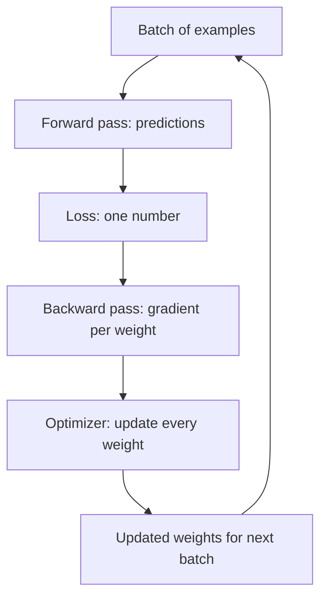

# What are Optimizers in Deep Learning? SGD, Momentum, RMSProp, and Adam Explained

> **Step 2: Deep Learning and Neural Networks** · ⏱️ 16 min read · [Read original](https://outcomeschool.com/blog/optimizers-in-deep-learning)

## TL;DR
An optimizer takes the gradients from the backward pass and decides how to update each weight so the loss keeps falling. Each optimizer fixes a weakness of the previous one: SGD zig-zags, Momentum adds memory, RMSProp gives per-weight step sizes, and Adam combines both. AdamW is the common choice for LLMs.

## Key Concepts
- **Optimizer** — last stage of a training step; it neither computes loss nor gradients, only updates weights.
- **Gradient** — direction and size of loss change per weight; weights move opposite to it.
- **Learning rate** — step size; too big and the loss bounces, too small and training crawls.
- **Weight decay** — shrinking weights each step to keep them from growing.

## How It Works
All examples use loss $w^2$, gradient $2w$, start $w=2$, learning rate 0.1.

### SGD
$w \leftarrow w - \eta g$, computed on a random mini-batch. Steps: 2 to 1.6 to 1.28. Problems: zig-zags across narrow valleys; slow on flat areas; only looks at the current gradient.

### Momentum
$v \leftarrow \beta v + g,\ w \leftarrow w - \eta v$ (beta about 0.9). Same two steps reach 0.92 versus SGD's 1.28. Opposing side-to-side gradients cancel, consistent ones add up, and velocity carries speed over flat areas. Problem: same step size for every weight.

### RMSProp
$s \leftarrow \beta s + (1-\beta) g^2,\ w \leftarrow w - \eta\, g/(\sqrt{s}+\epsilon)$. Each weight is scaled by the typical size of its own gradients. Gradients 4 and 0.04 (100x apart) both give a step of 0.3162. Problem: no memory of direction.

### Adam (Adaptive Moment Estimation)
Momentum-style average $m$ (beta1 = 0.9) plus RMSProp-style average $v$ (beta2 = 0.999), with bias correction because both start at 0:
$$\hat m = \frac{m}{1-\beta_1^t},\quad \hat v = \frac{v}{1-\beta_2^t},\quad w \leftarrow w - \eta\,\frac{\hat m}{\sqrt{\hat v}+\epsilon}$$
First step with gradient 4: m = 0.4 corrects to 4, v = 0.016 corrects to 16, step = 0.1 x 4/4, so w = 1.9. Real training often uses a rate like 0.001 or 0.0003.

### AdamW
Applies weight decay directly to the weight, separate from the gradient, so shrinkage is the same fraction for every weight rather than being rescaled by $\sqrt{\hat v}$. Often generalizes better; common for LLMs.

### Comparison
| Optimizer | Remembers direction | Per-weight step | Bias correction | Use |
|---|---|---|---|---|
| SGD | No | No | No | Simple problems, baseline |
| Momentum | Yes | No | No | Some image models, tuned |
| RMSProp | No | Yes | No | Some RL setups |
| Adam | Yes | Yes | Yes | Default for most deep learning |
| AdamW | Yes | Yes | Yes | Training LLMs |

## Diagram

## Key Takeaways
- The optimizer only turns gradients into weight updates; backprop computes the gradients.
- Momentum = memory of past gradients; RMSProp = adaptive per-weight scaling; Adam = both plus bias correction.
- Bias correction is needed because the running averages start at zero.
- AdamW decouples weight decay from the gradient.
- Adam or AdamW is the default starting point; SGD with Momentum is still used for some image models.
