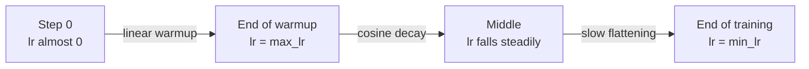
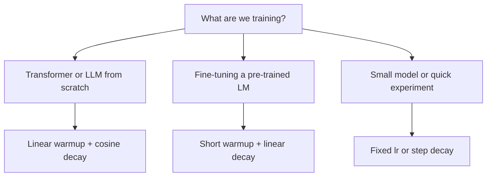

# How do learning rate schedules and warmup work?

> **Step 2: Deep Learning and Neural Networks** · ⏱️ 16 min read · [Read original](https://outcomeschool.com/blog/learning-rate-schedules-and-warmup)

## TL;DR
A learning rate schedule changes the step size during training instead of keeping it fixed. Warmup starts with tiny steps and ramps up to the full rate, then a decay (e.g. cosine) lowers the rate so the model settles at a good answer. Warmup plus cosine decay is the standard recipe for Transformers and LLMs.

## Key Concepts
- **Learning rate** — size of the step taken along the gradient: `new_weight = old_weight - learning_rate x gradient`. Gradient gives direction, learning rate gives step size.
- **Gradient / loss / weights** — loss = how wrong the guess is; gradient = direction each weight must move to reduce loss; weights = importance numbers, random at the start.
- **Analogy** — walking downhill in fog: slope = gradient, stride = learning rate, valley bottom = best weights.
- **Learning rate schedule** — a timetable for the step size, usually high first then lower. **Decay** = slowly going down.
- **Epoch** — one round over the full training data.
- **Warmup** — short phase at the start where lr rises from tiny to full value.
- **Divergence** — loss explodes to a huge number and training crashes.

## How It Works

### Problem with a fixed learning rate
- **Big** — fast at the start, but near the bottom it keeps jumping over the minimum and never settles.
- **Small** — settles nicely, but very slow at the start.
- Want: big steps far from the bottom, small steps near it.

### Popular schedules
- **Step decay** — keep lr fixed, then cut by a fixed factor repeatedly (staircase). Example: 0.1 for epochs 1-10, 0.05 for 11-20, 0.025 for 21-30. Pro: simple. Con: sudden rough drops; must tune when and how much.
- **Exponential decay** — multiply by a number slightly below 1 each step/epoch (0.9: 0.1, 0.09, 0.081, 0.0729). Smooth, but drops very fast early then flattens; lr can become tiny too early so the model stops improving.
- **Linear decay** — straight line from start value to final value; needs start, final, total steps. Pro: simple, predictable. Popular for fine-tuning (further training a trained model on own data).
- **Cosine decay** — half-wave curve: slow at start (stays high, learns fast), steady drop in the middle, slow at end (settles gently). Needs only max lr, min lr, total steps.

### Warmup
- Linear warmup (most common): target 0.001, 100 warmup steps: step 0 = 0.00001, step 49 = 0.0005, step 99 = 0.001.
- **Why start slow** — the start is the most unstable moment:
  1. Weights are random, so loss is high and gradients are wild/large; a big step can throw weights to a bad place or cause divergence (see vanishing/exploding gradients).
  2. Optimizers like Adam keep running averages of past gradients; at step 0 there is no history, so averages are unreliable and a high lr gives oversized steps. Warmup lets the averages build first.
- Especially important for Transformers; the original "Attention Is All You Need" used 4000 warmup steps. Without warmup Transformers often fail to train.

### Modern recipe: warmup + cosine decay
Phase 1: lr climbs linearly from almost 0 to max. Phase 2: cosine decay from max to a small min.

### In code
```python
import math

def get_lr(step, max_lr=0.001, min_lr=0.0001, warmup_steps=100, total_steps=1000):
    if step < warmup_steps:
        return max_lr * (step + 1) / warmup_steps   # +1 so step 0 is not exactly 0
    progress = (step - warmup_steps) / (total_steps - warmup_steps)
    cosine = 0.5 * (1 + math.cos(math.pi * progress))
    return min_lr + (max_lr - min_lr) * cosine
```
Output: step 0 = 0.000010, 49 = 0.000500, 99 = 0.001000, 325 = 0.000868, 550 = 0.000550 (halfway), 775 = 0.000232, 999 = 0.000100.

In PyTorch, each step set `group["lr"] = lr` for every group in `optimizer.param_groups`, then `optimizer.step()`. Built-ins exist in `torch.optim.lr_scheduler`: `StepLR`, `ExponentialLR`, `CosineAnnealingLR`.

## Diagram

### Warmup plus cosine decay training flow


### Choosing a schedule


## Comparison of schedules

| Schedule | Shape | Advantage | Disadvantage | Common use |
|---|---|---|---|---|
| Fixed | Flat | Simplest | Too slow or too bouncy | Quick experiments |
| Step decay | Staircase | Easy to understand | Sudden drops, tuning needed | Older image models |
| Exponential | Smooth, flattens fast | Smooth | Tiny too early | Simple models |
| Linear | Straight down | Simple, predictable | Lowers rate even when model still learns fast | Fine-tuning LMs |
| Cosine | Half wave | High early, gentle late | Needs total steps known upfront | Many modern models |
| Warmup | Straight up, start only | Prevents early crashes | One more setting | Before almost any schedule, esp. Transformers |

## Trade-offs & Pitfalls
- Training crashes or loss explodes in the first steps: add warmup or lengthen it.
- Loss stops improving at the end: lower the minimum lr or let decay run longer.
- Cosine needs the total number of steps known in advance.
- Keep warmup short, often a few percent of total steps; warmup plus cosine is a good starting point, then experiment.

## Key Takeaways
- Learning rate = step size; gradient = direction.
- A fixed lr is either too bouncy (big) or too slow (small); schedules give big steps early, small late.
- Warmup is needed because random weights give wild gradients and Adam's averages are not yet reliable.
- Transformers often fail without warmup (original paper: 4000 steps).
- Default for LLM pre-training: linear warmup then cosine decay; for fine-tuning: short warmup then linear decay.
- Cosine decay needs only max lr, min lr and total steps.
- Warmup is typically a few percent of total steps.
