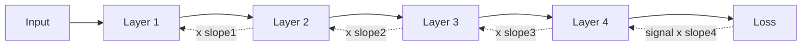
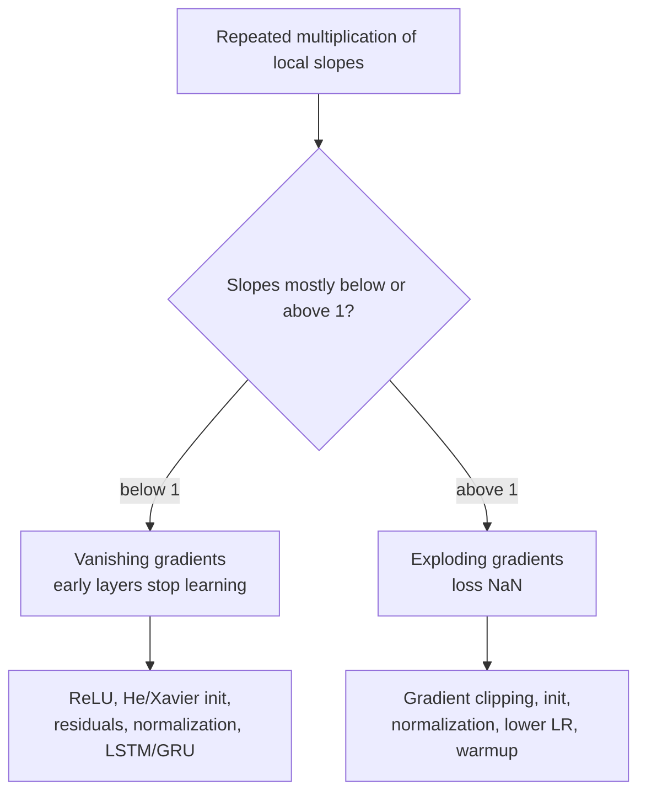

# Why do vanishing and exploding gradients happen?

> **Step 2: Deep Learning and Neural Networks** · ⏱️ 18 min read · [Read original](https://outcomeschool.com/blog/vanishing-and-exploding-gradients)

## TL;DR
During backprop the learning signal is multiplied by one local slope per layer. If those slopes are mostly below 1 the gradient shrinks to ~0 (vanishing, early layers stop learning); if mostly above 1 it blows up (exploding, loss goes NaN). Depth, activation functions and weight sizes decide which happens, and each has a targeted fix.

## Key Concepts
- **Weight / loss** — weights decide how much each input matters; loss is one number measuring how wrong the guess is.
- **Gradient** — slope telling each weight which direction and how strongly to move to reduce the loss (the "learning signal").
- **Update rule** — `new_weight = old_weight - learning_rate x gradient`. Healthy gradient: learns; ~0: barely moves; huge: jumps wildly.
- **Forward / backward pass** — forward: input to guess to loss; backward (backpropagation): signal travels from loss to Layer 1.
- **Local slope** — how much a layer's output changes when its input changes a little.
- **Chain rule** — multiply local slopes along the path.
- **Activation function** — small rule in each neuron that bends its output; its slope is multiplied into the gradient.
- **Weight initialization** — the starting values of weights.
- **RNN** — reads a sequence one word at a time, reusing the same weights each step.
- **Residual connection** — shortcut adding a block's input to its output.
- **Normalization** — rescales numbers to mean near 0, spread near 1.
- **Gradient clipping** — caps gradient size at a chosen maximum.

## How It Works

### Backward travel and the root cause
Gradient at Layer 1 = slope4 x slope3 x slope2 x slope1 x (signal from loss). Gear-chain analogy: if each gear slows the turn the first barely moves; if each speeds it up it spins out of control.

Repeated multiplication turns a small gap from 1 into a huge effect:

| Number | 10 times | 20 times | 50 times |
|---|---|---|---|
| 0.25 | 0.00000095 | 0.0000000000009 | almost 0 |
| 0.5 | 0.00098 | 0.00000095 | almost 0 |
| 1.0 | 1 | 1 | 1 |
| 1.5 | 57.7 | 3,325 | about 638 million |
| 2.0 | 1,024 | about 1 million | about 1 million billion |

0.5 and 1.5 are not extreme, yet after 50 multiplications one is ~nothing and the other hundreds of millions. Only exactly 1 stays healthy.

### Vanishing
- Gradient so small at early layers that they almost stop learning. E.g. 20 layers x 0.5 each: Layer 1 gets about one millionth of the last layer's gradient.
- Last layers learn normally; early layers stay near random initial values. Bad because early layers learn basics (edges, corners in images) that later layers build on.

### Exploding
- E.g. 1.5 per layer, 50 layers: Layer 1 gradient is hundreds of millions times larger.
- Huge gradient means huge step, weight lands somewhere bad, loss shoots up, gradients grow more, numbers overflow to **NaN**; training fails.

### What sets the slopes
1. **Activation function** — Sigmoid (squashes to 0-1, S-curve) has max slope only 0.25 and about 0 at flat ends; so each layer multiplies by at most 0.25, after 10 layers under one millionth (classic vanishing cause). Tanh max slope 1, better, but flat ends still near 0.
2. **Weights** — gradient is also multiplied by layer weights; too small shrinks, too big grows. Hence initialization matters.
3. **Depth** — more layers, more multiplications. 3 layers at 0.5 gives 0.125; 50 layers gives almost 0.

### Why RNNs suffer most
A 100-word sentence means the gradient goes back through 100 steps, each multiplied by the same weights, like a 100-layer net with shared weights. So plain RNNs forget the start of long sentences (the problem LSTMs solve).

### Code simulation
Loop multiplying gradient 1.0 by `slope_per_layer` for N layers:

| slope | 10 layers | 50 layers |
|---|---|---|
| 0.25 | 9.54e-07 | 7.89e-31 |
| 0.5 | 0.000977 | 8.88e-16 |
| 1.0 | 1 | 1 |
| 1.5 | 57.7 | 6.38e+08 |

### Symptoms
- Vanishing: loss falls very slowly or stalls early; early-layer weights barely change; early-layer gradients tiny vs later ones.
- Exploding: loss jumps wildly or spikes; loss/weights become NaN; gradients very large.
- Habit: print per-layer gradient sizes during training.

### Fixes for vanishing
1. **ReLU instead of Sigmoid** — keeps positives, zeroes negatives; slope exactly 1 for positives.
2. **Good initialization** — Xavier / He pick start weights by number of inputs, keeping signal size steady.
3. **Residual connections** — gradient gets two paths; the shortcut carries it back almost untouched ("highway for the gradient"). Made famous by ResNet (2015, 100+ layers); used in Transformers.
4. **Normalization** — Batch Norm / Layer Norm keep numbers at steady size per layer; Transformers use Layer Norm.
5. **LSTM / GRU instead of plain RNN** — carry memory mostly by gated addition rather than repeated multiplication, so gradients travel across many more words.

### Fixes for exploding
Good init, normalization, residuals also help, plus:
- **Gradient clipping** (speed limiter). Clip by norm: if norm > max, multiply gradient by `max_norm / norm`; direction unchanged. Example: `[300, 400]` has norm 500; max 1 gives `[0.6, 0.8]`.
- PyTorch: `torch.nn.utils.clip_grad_norm_(model.parameters(), max_norm=1.0)`; 1.0 is common for LLMs.
- Lower learning rate and short **warmup** (tiny steps, slowly increasing) tame early unstable steps.

### Comparison

| Point | Vanishing | Exploding |
|---|---|---|
| What happens | Gradient shrinks to ~0 | Gradient grows huge |
| Root cause | Slopes mostly below 1, multiplied many times | Slopes mostly above 1, multiplied many times |
| Triggers | Sigmoid/Tanh, tiny weights, deep nets, long sequences | Big weights, deep nets, long sequences |
| Effect | Early layers stop learning | Training unstable, breaks |
| Symptoms | Loss slow or stalls | Loss jumps, NaN |
| Fixes | ReLU, init, residuals, normalization, LSTM/GRU | Clipping, init, normalization, lower LR |

### FAQ
- Why does Sigmoid cause vanishing? Max slope 0.25, near 0 at ends; 10 layers gives under one millionth.
- How do Transformers avoid it? Residual connections plus Layer Norm.
- Does clipping change direction? No; all values shrink by the same factor.
- Common clip max? 1.0 for LLMs.

## Diagram(s)

### Forward vs backward gradient flow

### Diagnosing and fixing

## Trade-offs & Pitfalls
- Sigmoid and Tanh saturate; plain RNNs on long sequences are the worst case.
- Deeper networks strengthen both problems.
- Match fixes to the problem: clipping fixes explosion, not vanishing.

## Key Takeaways
- Gradient at an early layer is a product of many local slopes (chain rule).
- Slopes below 1 vanish, above 1 explode; only about 1 is healthy.
- Sigmoid's max slope of 0.25 is the classic vanishing cause; ReLU's slope is 1 for positives.
- Residual connections and normalization stabilize deep nets and Transformers.
- LSTM/GRU use additive memory to fix RNN vanishing.
- Gradient clipping by norm caps size but keeps direction; max 1.0 is common.
- Watch per-layer gradient norms and NaN loss as symptoms.
