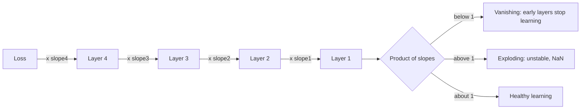

# Why do vanishing and exploding gradients happen?

> **Step 2: Deep Learning and Neural Networks** · ⏱️ 18 min read · [Read original](https://outcomeschool.com/blog/vanishing-and-exploding-gradients)

## TL;DR
The gradient reaching an early layer is a product of many local slopes (chain rule). If those slopes are mostly below 1 the product vanishes; if mostly above 1 it explodes. Deeper networks and long sequences make both worse, and several well-known fixes exist.

## Key Concepts
- **Gradient** — learning signal telling each weight which way and how strongly to move: `new_weight = old_weight - learning_rate x gradient`.
- **Backpropagation / chain rule** — gradient at Layer 1 = product of the local slopes of all later layers.
- **Vanishing gradient** — early layers receive near-zero signal and barely learn (e.g. 20 layers x 0.5 gives about one millionth).
- **Exploding gradient** — updates become huge, loss shoots up, values become NaN (e.g. 50 layers x 1.5 gives about 638 million).
- **Gradient clipping** — cap the gradient's norm while keeping its direction.

## How It Works
### Root cause: repeated multiplication
| Slope | 10 layers | 50 layers |
|---|---|---|
| 0.25 | 9.54e-07 | 7.89e-31 |
| 0.5 | 0.000977 | 8.88e-16 |
| 1.0 | 1 | 1 |
| 1.5 | 57.7 | 6.38e+08 |

Even 0.5 and 1.5 (near 1) are extreme after many layers; only exactly 1 stays healthy.

### What sets the slopes
1. **Activation function** — Sigmoid's max slope is 0.25 (near 0 at the flat ends), so 10 layers gives under one millionth. Tanh peaks at 1 but also flattens.
2. **Weights** — small weights shrink the gradient, big ones grow it, hence weight initialization matters.
3. **Depth** — more layers, more multiplications.

### Why RNNs suffer most
An RNN reuses the same weights at each time step, so a 100-word sentence is like a 100-layer network with shared weights. Plain RNNs forget the start of long sequences.

### Symptoms
- Vanishing: loss falls slowly or stalls; early-layer weights barely change; early gradients tiny.
- Exploding: loss jumps wildly or turns NaN; gradients huge. Print per-layer gradient sizes to check.

### Fixes
| Fix | Targets | Idea |
|---|---|---|
| ReLU | Vanishing | Slope exactly 1 for positives |
| Xavier / He init | Both | Starting weights sized by inputs per neuron |
| Residual connections | Vanishing | Shortcut carries gradient back untouched (ResNet 2015, Transformers) |
| Normalization (Batch/Layer) | Both | Keeps numbers at steady scale |
| LSTM / GRU | Vanishing in RNNs | Gated, additive memory instead of repeated multiplication |
| Gradient clipping | Exploding | Rescale gradient if norm exceeds max, direction preserved |

Clipping example: [300, 400] has norm 500; with max_norm 1.0 it becomes [0.6, 0.8]. In PyTorch: `torch.nn.utils.clip_grad_norm_(model.parameters(), max_norm=1.0)`; 1.0 is common for LLMs. Lower learning rates and warmup also help.

## Diagram

## Key Takeaways
- Both problems come from multiplying many slopes via the chain rule.
- Sigmoid (max slope 0.25) is the classic cause of vanishing gradients.
- ReLU, good init, residual connections, normalization, and LSTM/GRU fight vanishing gradients.
- Gradient clipping by norm limits explosions without changing direction.
- Deeper networks and long sequences (RNNs) amplify both problems.
