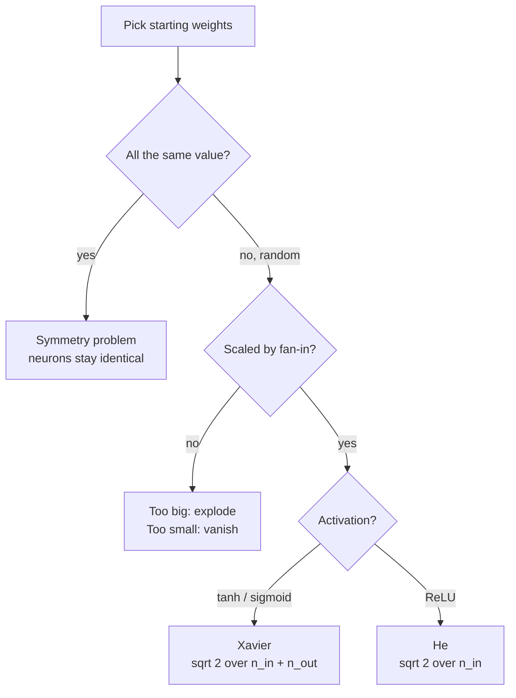

# Why Do We Initialize Weights Randomly in Neural Networks?

> **Step 2: Deep Learning and Neural Networks** · ⏱️ 20 min read · [Read original](https://outcomeschool.com/blog/random-weight-initialization)

## TL;DR
Training only changes weights, it does not create them, so starting values matter. Identical starting weights make neurons identical forever (symmetry problem); plain random values break symmetry but can explode or vanish through layers; random values scaled by fan-in (Xavier, He) keep signal size stable.

## Key Concepts
- **Neuron / weight** — neuron computes weighted sum of inputs; a weight says how much one input matters. Example: x=(1,2), w=(0.5,0.5) gives 1.5.
- **Gradient** — a weight's share of blame for the error.
- **Weight initialization** — picking starting weights once, before step 1.
- **Symmetry problem** — same weights lead to same output, gradient, update, so neurons stay identical; 512 neurons act like 1 copied 512 times.
- **Breaking the symmetry** — random starts give different outputs and gradients.
- **Fan-in `n_in` / fan-out `n_out`** — number of inputs to a neuron / outputs of a layer.
- **Standard deviation** — spread of the random numbers around 0.
- **Saturation** — with tanh/sigmoid and big weights, outputs stick near -1/1 where the curve is flat, so gradient is ~0.
- **Bias** — extra number added after the weighted sum; shifts output.
- **Random seed** — start number for the RNG; same seed gives same "random" sequence.

## How It Works

### Approach 1: all weights equal
Tiny net: inputs x1=1, x2=2; hidden h1, h2; output y; target 3; all 6 weights 0.5; no activation.
1. h1 = h2 = 0.5*1 + 0.5*2 = 1.5.
2. y = 0.5*1.5 + 0.5*1.5 = 1.5.
3. error = y - target = -1.5.
4. Gradient of input weight = x * error * (outgoing weight): x1 gives -0.75, x2 gives -1.5, identical for h1 and h2.
5. LR 0.01: both neurons go from [0.5, 0.5] to [0.5075, 0.515].

After 50 steps: prediction 2.9975, but both neurons have weights [0.5942, 0.6884]. Network learned the answer, but neurons are clones. All zeros is worse: hidden outputs 0, gradients 0, nothing moves.

### Approach 2: plain random
`np.random.randn` (bell curve centered at 0). Same net: prediction 2.999, neuron 1 [0.507, 0.6682], neuron 2 [-0.0702, 1.6593]; symmetry broken.

But size matters since layers compound: too big explodes, too small vanishes. Experiment: 1000 inputs through 10 ReLU layers of 512 neurons, input size about 1:

| Weight scale | Avg size at layer 10 |
|---|---|
| 1.0 | 6.13e+11 (exploding) |
| 0.01 | 6.88e-09 (vanishing) |

Effects: exploding means updates throw weights far away or overflow; vanishing means early layers barely learn. Saturation: tanh with scale 1.0, about 91 percent of first-layer outputs already beyond +-0.99.

### Approach 3: scaled random
Right size keeps numbers roughly constant across layers. A neuron summing many inputs needs smaller weights, so std depends on fan-in.

| Property | Xavier (Glorot) | He (Kaiming) |
|---|---|---|
| Formula | $\sigma=\sqrt{2/(n_{in}+n_{out})}$ | $\sigma=\sqrt{2/n_{in}}$ |
| Best for | tanh, sigmoid | ReLU and variants |
| Size for 512 inputs | about 0.044 | 0.0625 |

- Xavier looks at fan-in and fan-out so forward signal and backward gradients both stay stable (Glorot and Bengio). For 512/512: sqrt(2/1024) = about 0.044.
- He: the extra 2 compensates for ReLU zeroing about half the numbers (Kaiming He et al.).
- He on the experiment: layer 1 = 0.563, layer 5 = 0.532, layer 10 = 0.557. Stable.
- Mismatch: Xavier with ReLU drops to about 0.017 at layer 10.
- PyTorch and Keras use scaled random init by default.

### Biases
Usually start at 0. No symmetry problem: weights are already different, so bias gradients differ after the first update.

### Random seed
Random init makes runs differ, hindering comparison and debugging. Fix the seed (e.g. 42): `[0.4967 -0.1383 0.6477]` every time. Weights still look random to the network, so symmetry stays broken.

### FAQ
- All zeros? No movement. Equal non-zero? Clones.
- Xavier or He? Match the activation.
- Tiny random weights? Signal vanishes (0.00000000688 after 10 layers).
- Write it ourselves? Usually no, but understand it.
- Seed brings back symmetry? No, only repeatability.

## Diagram(s)

### Choosing an initialization

### Symmetric training loop

## Trade-offs & Pitfalls
- Zeros and constants fail; plain randn at scale 1.0 or 0.01 fails after only 10 layers.
- Wrong pairing (Xavier with ReLU) shrinks signal.
- Random init hurts reproducibility unless the seed is fixed.

## Key Takeaways
- Training modifies weights, so initialization decides the start.
- Equal weights cause the symmetry problem; randomness breaks it.
- Random scale must depend on fan-in or signals explode/vanish.
- Xavier for tanh/sigmoid, He for ReLU (extra 2 offsets ReLU zeroing half).
- Biases can start at 0.
- Fixed seed gives repeatable experiments, not symmetry.
