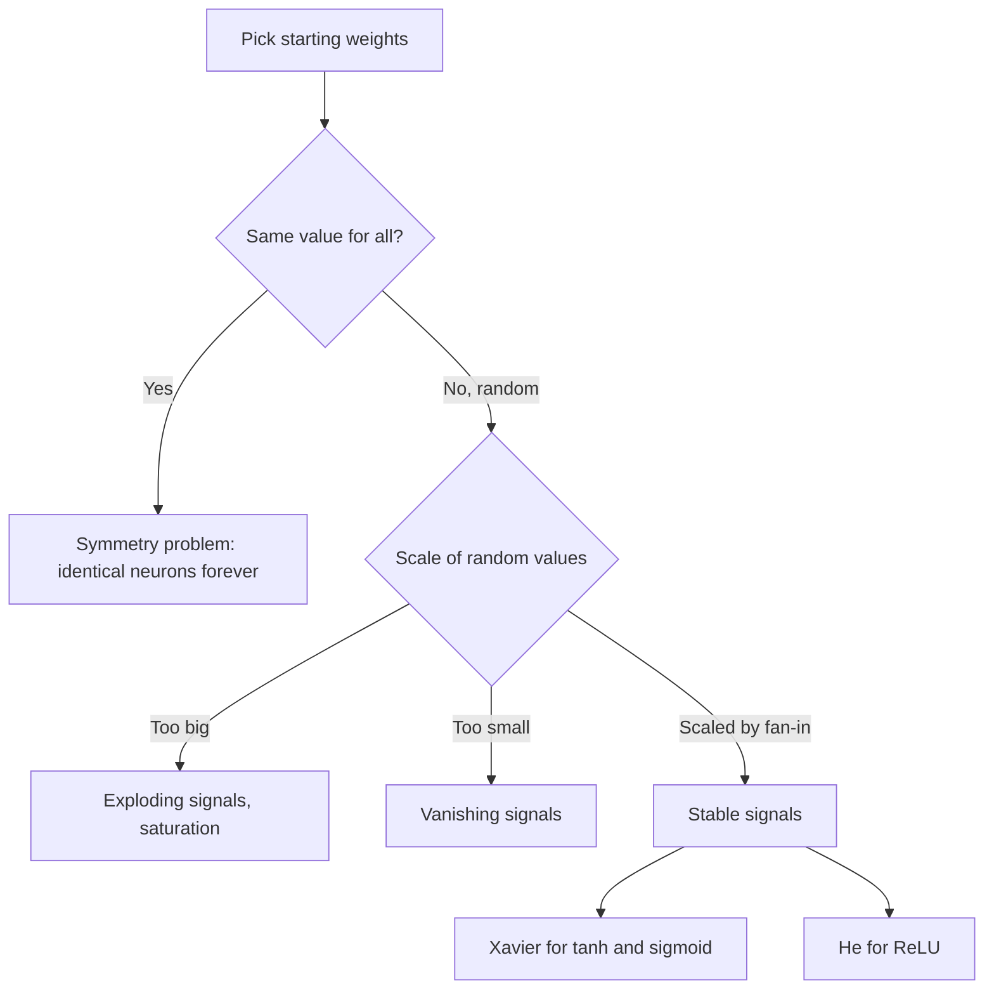

# Why Do We Initialize Weights Randomly in Neural Networks?

> **Step 2: Deep Learning and Neural Networks** · ⏱️ 20 min read · [Read original](https://outcomeschool.com/blog/random-weight-initialization)

## TL;DR
Weights must have starting values before training, and those values decide whether the network learns well, slowly, or not at all. Identical values keep neurons identical forever (the symmetry problem), random values break the symmetry, and scaling the random values by layer size (Xavier or He) keeps signals from exploding or vanishing.

## Key Concepts
- **Weight initialization** — choosing starting weights once, before training.
- **Symmetry problem** — neurons with identical weights compute identical outputs and gradients, so they stay identical.
- **Fan-in / fan-out** ($n_{in}$, $n_{out}$) — number of inputs to a neuron / outputs of a layer.
- **Saturation** — with tanh or sigmoid and large weights, outputs stick near the flat ends, gradients near 0.
- **Random seed** — fixes the random sequence so experiments are repeatable.

## How It Works
### Approach 1: same value for all weights
Tiny network (inputs 1 and 2, two hidden neurons, target 3, all weights 0.5): both hidden neurons output 1.5, get identical gradients (-0.75, -1.5), and update identically. After 50 steps the prediction is 2.9975 but both neurons have the same weights (0.5942, 0.6884). A 512-neuron layer then behaves like one neuron copied 512 times. All zeros is worse: outputs and gradients are 0, so nothing moves.

### Approach 2: random values
Random weights give different outputs, hence different gradients, so each neuron learns its own thing (symmetry broken). But the scale matters: through 10 ReLU layers of 512 neurons, scale 1.0 gives average size 6.13e+11 (exploding) and scale 0.01 gives 6.88e-09 (vanishing), starting from inputs of size about 1.

### Approach 3: scaled random values
A neuron sums many inputs, so more inputs need smaller weights. Keep numbers roughly constant layer to layer by setting the standard deviation from fan-in/fan-out.

| Property | Xavier (Glorot) | He (Kaiming) |
|---|---|---|
| Formula | $\sqrt{2/(n_{in}+n_{out})}$ | $\sqrt{2/n_{in}}$ |
| Best for | tanh, sigmoid | ReLU and variants |
| Std for 512 inputs | about 0.044 | 0.0625 |

He's extra factor of 2 compensates for ReLU zeroing about half the values. With He, average size stays about 0.55 from layer 1 to 10. Xavier with ReLU shrinks to about 0.017. PyTorch and Keras already use scaled random init by default.

### Biases and seeds
Biases usually start at 0; symmetry is already broken by the random weights, so bias gradients differ. A fixed seed (e.g. 42) reproduces the same "random" weights, which still break symmetry but make experiments repeatable.

## Diagram

## Key Takeaways
- Identical initial weights make neurons identical forever; randomness breaks the symmetry.
- Random alone is not enough: too large explodes, too small vanishes.
- Xavier = $\sqrt{2/(n_{in}+n_{out})}$ for tanh/sigmoid; He = $\sqrt{2/n_{in}}$ for ReLU.
- Match the init method to the activation function.
- Biases can start at zero; fix the seed for reproducibility without hurting symmetry breaking.
