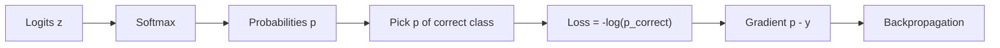

# What is Cross-Entropy Loss?

> **Step 2: Deep Learning and Neural Networks** · ⏱️ 17 min read · [Read original](https://outcomeschool.com/blog/math-behind-cross-entropy-loss)

## TL;DR
Cross-entropy loss measures how far a predicted probability distribution is from the true one. For a one-hot label it reduces to the negative log of the probability the model gave the correct class, so confident wrong answers are punished heavily. Paired with softmax it has a very clean gradient, $p - y$.

## Key Concepts
- **Entropy** — uncertainty of a distribution (fair coin high, always-heads zero).
- **Cross-entropy** — uncertainty when using the predicted distribution to describe events following the true one; minimal when they match.
- **One-hot vector** — zeros with a single 1 at the correct class.
- **Forecaster analogy** — model = forecaster, softmax output = announced probabilities, true label = what happened. "90% sunshine" on a rainy day gets a huge penalty.
- **Perplexity** — $\exp(\text{average cross-entropy})$.

## How It Works
### Formula
$$CE = -\sum_i y_i \log(p_i) \;\Rightarrow\; CE = -\log(p_{correct})$$
Pipeline: logits to softmax probabilities to negative log of the correct class.

### Why negative log
- Log stretches small probabilities: $-\log(0.1)=2.303$, $-\log(0.01)=4.605$, $-\log(0.001)=6.908$. Each 10x drop adds about 2.303.
- $1-p$ is linear and capped at 1 (p = 0.01 gives only 0.99); $-\log p$ is unbounded as p goes to 0.
- Negative sign flips log of a probability (always negative) into a positive loss: p = 1 gives 0, p = 0.9 gives 0.105.

### Binary vs categorical
| Type | Use | Formula |
|---|---|---|
| Binary CE | Two classes, sigmoid output | $-[y\log p + (1-y)\log(1-p)]$ |
| Categorical CE | Many classes, softmax, one-hot label | $-\log(p_{correct})$ |

Binary examples: y=1 with p=0.8 gives 0.223; with p=0.2 gives 1.609. Categorical: p = [0.2, 0.7, 0.05, 0.05], true class 2 gives $-\log 0.7 = 0.357$.

### Worked example (cat, dog, rabbit; true = dog)
| Logits | p_dog | Loss |
|---|---|---|
| [2, 3, 1] | 0.6652 | 0.4076 |
| [1, 5, 0.5] (confident, right) | 0.9714 | 0.0290 |
| [5, 1, 0.5] (confident, wrong) | 0.0178 | 4.029 |

### Language models
Next-token prediction over 50,000+ tokens: loss per position is $-\log(p_{actual\ next\ token})$, averaged over the N positions. Perplexity is its exponential; lower is better.

### Gradient
$$\frac{\partial CE}{\partial z_i} = p_i - y_i$$
For p = [0.2447, 0.6652, 0.0900], y = [0,1,0] gives [0.2447, -0.3348, 0.0900]: lower wrong-class scores, raise the correct one. This is the starting point of backpropagation.

### In practice
Frameworks fuse softmax and cross-entropy (PyTorch `CrossEntropyLoss`, TensorFlow `softmax_cross_entropy_with_logits`) using log-sum-exp to avoid overflow and underflow. Pass raw logits, not probabilities.

## Diagram

## Key Takeaways
- For one-hot labels, cross-entropy = $-\log(p_{correct})$.
- Log makes confident wrong predictions cost far more than mildly wrong ones; the loss is unbounded as p goes to 0.
- Binary CE pairs with sigmoid, categorical CE with softmax.
- Gradient w.r.t. logits is simply $p - y$, which is why softmax plus cross-entropy is the default for classification.
- Feed raw logits to framework loss functions.
- Perplexity = exp(average cross-entropy).
