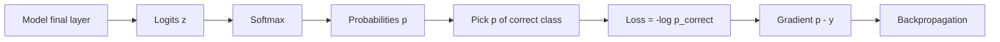
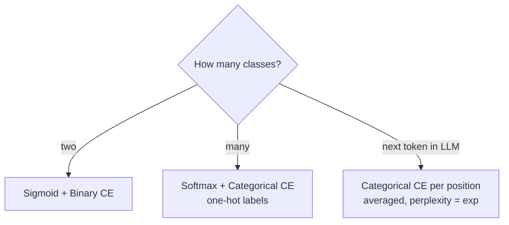

# What is Cross-Entropy Loss?

> **Step 2: Deep Learning and Neural Networks** · ⏱️ 17 min read · [Read original](https://outcomeschool.com/blog/math-behind-cross-entropy-loss)

## TL;DR
Cross-entropy loss measures how wrong predicted probabilities are versus the truth. With one-hot labels it is simply the negative log of the probability given to the correct class: small when confident and right, huge when confidently wrong. It is the default classification loss (GPT, BERT, image classifiers) and pairs with softmax to give a clean gradient $p_i - y_i$.

## Key Concepts
- **Entropy** — uncertainty of a distribution (fair coin high, always-heads zero).
- **Cross** — comparing true distribution with predicted one.
- **Cross-entropy** — uncertainty when the predicted distribution describes events that follow the true one; minimal when they are identical (gap is KL Divergence).
- **Logits** — raw scores from the final layer.
- **Softmax** — turns logits into probabilities summing to 1: $p_i = e^{z_i}/\sum_j e^{z_j}$.
- **Sigmoid** — single probability for two-class problems.
- **One-hot vector** — zeros with a single 1 at the correct class.
- **Perplexity** — $\exp$(average cross-entropy).
- Analogy: the model is a weather forecaster, softmax output is her announced probabilities, true label is what happened. Confident and right: tiny penalty; confidently wrong: huge penalty; fully unsure: moderate.

## How It Works

### Formula

$$
CE = -\sum_i y_i \log p_i \;\;\Rightarrow\;\; CE = -\log p_{correct}
$$

$y_i$ true label (1 or 0), $p_i$ predicted probability, natural log. Pipeline: logits then softmax then $-\log$ of correct class's probability (e.g. z=[2,3,1] gives p=[0.24,0.66,0.09], loss 0.4076). Training minimizes it via gradient descent.

### Why negative log
- **Why log**: stretches small probabilities. log(0.9) = -0.105, log(0.1) = -2.303. Penalties: $-\log 0.1$=2.303, $-\log 0.01$=4.605, $-\log 0.001$=6.908 (each 10x drop adds about 2.303).
- **Why not 1 - p**: linear, capped at 1 (p=0.01 gets only 0.99); $-\log p$ is unbounded as p goes to 0, strongly discouraging confident mistakes.
- **Why negative**: log of a probability is negative; flip to get positive loss. p=0.9 gives 0.105; p=0.1 gives 2.303; p=1 gives 0; p near 0 gives near infinity.

### Binary cross-entropy (sigmoid, two classes)

$$
BCE = -[y\log p + (1-y)\log(1-p)]
$$

Only one term is active. y=1, p=0.8 gives 0.223; y=1, p=0.2 gives 1.609.

### Categorical cross-entropy (softmax, multi-class)
True y=[0,1,0,0], p=[0.2,0.7,0.05,0.05]: CE = -log 0.7 = 0.357. Only the correct-class term survives.

### Step-by-step example (cat, dog, rabbit; truth dog)

| Scenario | Logits | Probabilities (cat, dog, rabbit) | Loss |
|---|---|---|---|
| Decent | [2,3,1] | 0.2447, 0.6652, 0.0900 | 0.4076 |
| Confident and right | [1,5,0.5] | 0.0178, 0.9714, 0.0108 | 0.0290 |
| Confident and wrong | [5,1,0.5] | 0.9714, 0.0178, 0.0108 | 4.029 |

(Decent: exps 7.389, 20.086, 2.718, sum 30.193.)

Practice: frameworks fuse softmax + CE (PyTorch `CrossEntropyLoss`, TF `softmax_cross_entropy_with_logits`) using the log-sum-exp trick to avoid exp overflow and log underflow. Pass raw logits, not softmax output.

### Language models
Predict next token over a 50,000+ vocabulary; true label is one-hot of the actual token. Sequence loss = average of $-\log p_{actual}$ over N positions (e.g. "The cat sat on the mat": average over cat, sat, on, the, mat). Perplexity = exp(avg CE); lower is better.

### Gradient

$$
\frac{\partial CE}{\partial z_i} = p_i - y_i
$$

Example: p=[0.2447,0.6652,0.0900], y=[0,1,0] gives [0.2447, -0.3348, 0.0900]: positive lowers cat/rabbit scores, negative raises dog. Clean, no chain-rule blow-up or vanishing from the loss; it is the starting point of backpropagation. This is why softmax + CE is the default pairing.

### FAQ
- Logits or softmax into the loss? Raw logits.
- Why not 1 - p? Capped and linear.
- BCE vs CCE? Two classes with sigmoid vs multi-class with softmax and one-hot.
- Can loss be zero? Yes, p_correct = 1.0.
- Perplexity? exp of average CE.

## Diagram(s)

### Loss computation pipeline

### Which variant to use

## Trade-offs & Pitfalls
- Passing softmax output to a fused loss double-applies softmax and risks numeric instability.
- Probability exactly 0 on the true class gives infinite loss.

## Key Takeaways
- CE = -log of the probability assigned to the correct class (one-hot labels).
- Log punishes confident wrong answers without bound; 1 - p cannot.
- BCE uses sigmoid, categorical CE uses softmax.
- LLM loss = mean token CE; perplexity = exp(CE).
- Gradient w.r.t. logits is p - y.
- Use fused, log-sum-exp-stable ops on raw logits.
