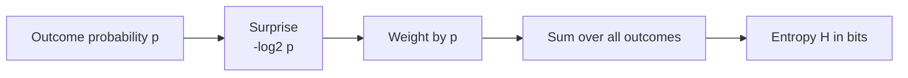

# What is Entropy in Information Theory?

> **Step 2: Deep Learning and Neural Networks** · ⏱️ 8 min read · [Read original](https://outcomeschool.com/blog/entropy-in-information-theory)

## TL;DR
Entropy measures uncertainty: the average surprise of an outcome, weighted by how often each outcome happens. Easy-to-guess outcomes give low entropy, evenly balanced ones give high entropy. It is measured in bits and underlies compression, decision trees and cross-entropy loss.

## Key Concepts
- **Entropy** — measure of unpredictability. Always-heads coin = 0; fair coin = high.
- **Surprise** — rare event, big surprise, lots of information; certain event ("the sun rose today"), no surprise. Surprise of an outcome is $-\log_2 p$.
- **Bit** — information from one fair coin flip. With equally likely outcomes, bits = number of yes/no questions needed: 2 outcomes = 1 bit, 4 = 2 bits, 8 = 3 bits. Each question halves the possibilities, hence log base 2.

## How It Works

### The formula

$$
H = -\sum_i p_i \log_2 p_i
$$

- $p$ = probability of one outcome; $-\log_2 p$ = its surprise.
- Multiply by $p$ so common outcomes count more; sum over all outcomes.
- Minus sign makes the result positive, since $\log_2$ of a probability is zero or negative.
- In words: average surprise weighted by frequency.

### Worked examples
- **Fair coin (0.5/0.5)**: $\log_2 0.5 = -1$; each term 0.5 x (-1) = -0.5; sum -1; apply minus: **H = 1 bit**.
- **Biased coin (0.9/0.1)**: heads 0.9 x (-0.152) = -0.137; tails 0.1 x (-3.322) = -0.332; sum -0.469; **H = 0.469 bits** (about 0.47), much lower since heads is easy to bet on.

Rule: the more balanced the outcomes, the higher the entropy; the more one dominates, the lower. Entropy is maximal when everything is equally likely.

### Where entropy is used
- **Data compression** — minimum average bits per symbol; cannot compress below entropy without losing information.
- **Decision trees** — pick the question that reduces uncertainty most.
- **ML loss** — cross-entropy measures how surprised a model is by the true answer (see KL Divergence note for the link).
- **Communication** — sets limit on information a channel can carry.

## Diagram

### Probability to entropy

## Key Takeaways
- Entropy = average surprise = uncertainty.
- Fair coin = 1 bit; 90/10 coin = about 0.47 bits; always-heads = 0.
- Highest when all outcomes are equally likely.
- Log base 2 because information is measured in bits (each yes/no question halves the options).
- Minus sign keeps entropy positive.
- Cross-entropy loss, compression limits and decision trees all build on it.
