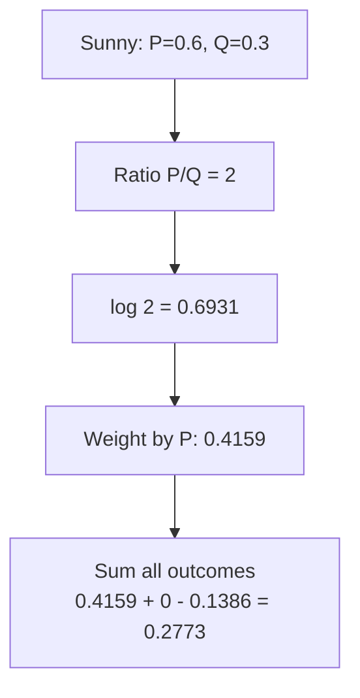
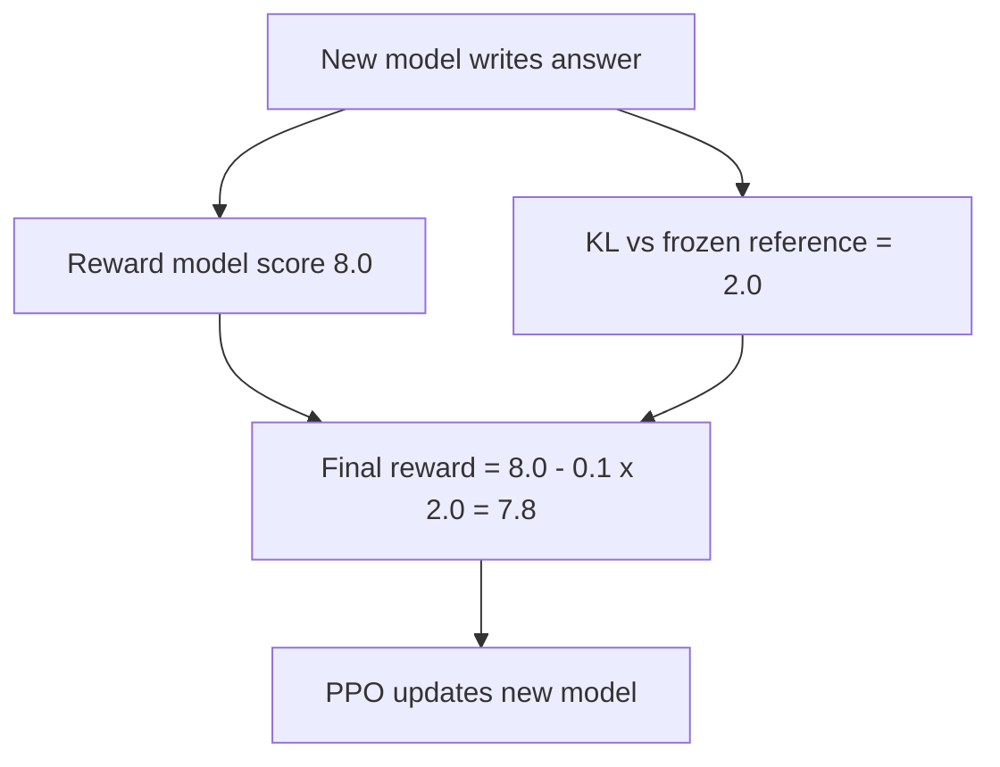

# What is KL Divergence? The Math Explained Step by Step

> **Step 2: Deep Learning and Neural Networks** · ⏱️ 16 min read · [Read original](https://outcomeschool.com/blog/kl-divergence)

## TL;DR
KL Divergence is one number saying how different a guess distribution Q is from the truth P: the P-weighted average of log(P/Q). It is always >= 0, zero only when identical, and not symmetric. KL = cross-entropy - entropy, which is why minimizing cross-entropy pulls Q toward P. Used in RLHF/PPO penalties, distillation and VAEs.

## Key Concepts
- **Probability distribution** — all outcomes with chances summing to 1. Example truth P: Sunny 0.6, Cloudy 0.3, Rainy 0.1. Weather app guess Q: 0.3, 0.3, 0.4. LLM next-token chances are also one.
- **KL (Kullback-Leibler)** — "how far Q is from P"; written $KL(P\|Q)$, P = truth, Q = guess. Order matters.
- **Nats / bits** — units with natural log / log base 2.
- **Surprise** — $-\log$(chance); rare outcome, big surprise (Rainy 0.1: 2.3026; Sunny 0.6: 0.5108).
- **Entropy** $H(P)=-\sum P\log P$ — average surprise measuring with P itself.
- **Cross-entropy** $H(P,Q)=-\sum P\log Q$ — outcomes from P, surprise measured with Q.

## How It Works

### Building the formula
1. **Ratio** $P(x)/Q(x)$ per outcome (Sunny 0.6/0.3 = 2). 1 = agree; >1 = guess too low; <1 = guess too high. Ratio beats difference: 0.02 vs 0.01 differ by 0.01 but are 2x off.
2. **Log of ratio** — log 1 = 0 so agreement adds nothing; positive if >1, negative if <1; 2x more and 2x less are equal and opposite (0.6931 vs -0.6931).
3. **Weight by P(x)** — mistakes on common outcomes matter more.
4. **Sum**.

$$
KL(P\|Q)=\sum_x P(x)\log\frac{P(x)}{Q(x)}
$$

Weighted average of log ratio, weights = true chances. If P(x)=0 the term is 0; if Q(x)=0 where P says possible, it is infinite.

### Worked example

| Outcome | P | Q | P/Q | log | P*log |
|---|---|---|---|---|---|
| Sunny | 0.6 | 0.3 | 2 | 0.6931 | 0.4159 |
| Cloudy | 0.3 | 0.3 | 1 | 0 | 0 |
| Rainy | 0.1 | 0.4 | 0.25 | -1.3863 | -0.1386 |

$KL(P\|Q)=0.4159+0-0.1386=0.2773$ nats. Code `np.sum(p*np.log(p/q))` prints KL(P,Q)=0.2773, KL(Q,P)=0.3466, KL(P,P)=0.0.

### Properties
1. **>= 0** (Gibbs' inequality). Negative terms (Rainy) are small because weighted by small P(Rainy)=0.1; positive Sunny term is weighted by 0.6.
2. **Zero only if P = Q** (all ratios 1, logs 0).
3. **Not symmetric**: $KL(Q\|P)$ = -0.2079 + 0 + 0.5545 = 0.3466 vs 0.2773. Weights come from Q now (Q gives Rainy 0.4 vs P's 0.1), so the big Rainy error weighs more. Hence "divergence", not "distance".

### Relation to cross-entropy

$$
KL(P\|Q)=H(P,Q)-H(P)
$$

From log(P/Q) = log P - log Q. KL = extra surprise from using Q instead of P. Check: H(P) = 0.3065+0.3612+0.2303 = about 0.898; H(P,Q) = 0.7224+0.3612+0.0916 = about 1.175; difference 0.277. In training P comes from data, so H(P) is fixed: minimizing cross-entropy = minimizing KL. For a one-hot label H(P)=0, so CE loss equals KL exactly.

### Where used
- **RLHF / PPO KL penalty** — reward model scores answers; LLM may reward-hack (high score, broken text). Keep a frozen **reference model**; compare token chances. Final reward = RM score - beta * KL(new || reference), beta e.g. 0.1. New model first because it writes the answers (its chances are the weights). Example: score 8.0, KL 2.0, final 8.0 - 0.1*2.0 = 7.8. PPO updates with that.
- **Knowledge distillation** — teacher (e.g. cat 0.7, tiger 0.2, dog 0.1) gives richer signal than a hard label; loss KL(teacher || student).
- **VAEs** — KL term keeps latent distribution near standard normal so random samples generate new images.

### FAQ
- Unit? Nats (ln) or bits (log2).
- Infinite? Yes if Q=0 where P>0.
- Not a distance? Asymmetric (0.2773 vs 0.3466).
- Min CE = min KL? Yes, when P is from data since H(P) is constant.

## Diagram(s)

### Building KL for one outcome

### RLHF KL penalty

## Trade-offs & Pitfalls
- Asymmetric: always mind the order.
- Infinite when Q assigns 0 to a possible event.
- Individual terms can be negative; the total never is.

## Key Takeaways
- KL(P||Q) = sum P log(P/Q): P-weighted log ratio.
- >= 0, zero iff identical, not symmetric.
- KL = cross-entropy - entropy.
- Minimizing CE loss on data = minimizing KL.
- Q=0 where P>0 means infinite KL.
- Used as RLHF leash, distillation loss and VAE regularizer.
