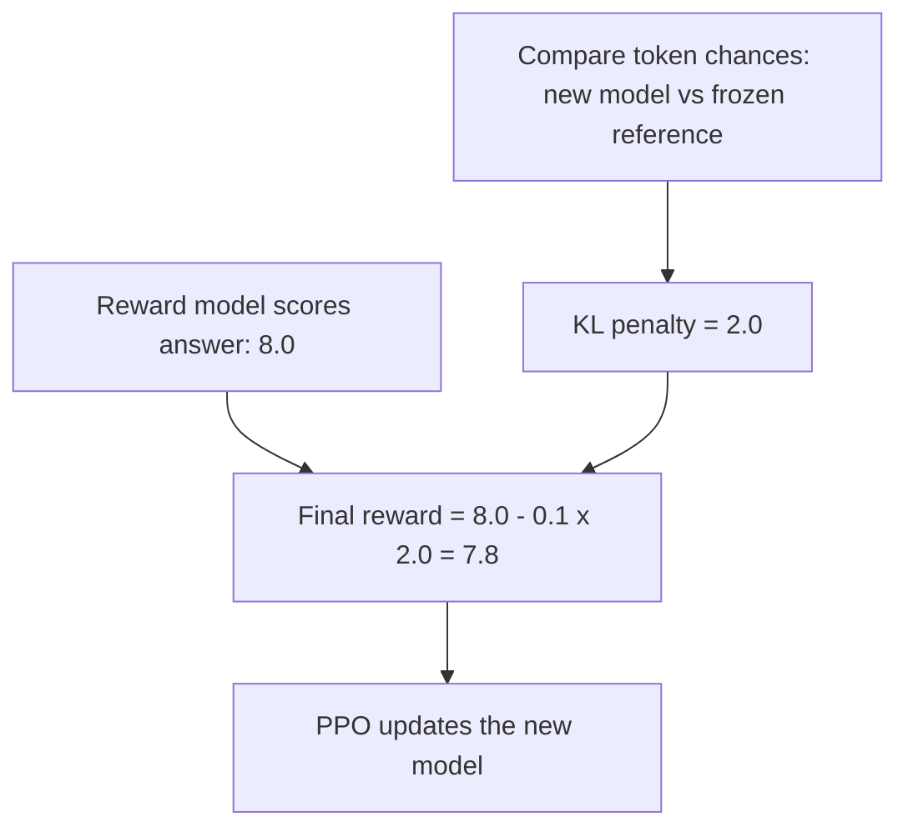

# What is KL Divergence? The Math Explained Step by Step

> **Step 2: Deep Learning and Neural Networks** · ⏱️ 16 min read · [Read original](https://outcomeschool.com/blog/kl-divergence)

## TL;DR
KL Divergence is a single number telling how far a guessed distribution Q is from a true distribution P. It equals cross-entropy minus entropy, which is why minimizing cross-entropy loss pulls the model toward the truth. It also appears as the KL penalty in RLHF, in distillation, and in VAEs.

## Key Concepts
- **Probability distribution** — chances over outcomes that sum to 1. Example: truth P = Sunny 0.6, Cloudy 0.3, Rainy 0.1; app's guess Q = 0.3, 0.3, 0.4.
- **KL(P || Q)** — "divergence of P from Q"; P is truth, Q is guess, order matters.
- **Surprise** — $-\log(\text{chance})$; rare outcomes surprise more.
- **Entropy $H(P)$** — average surprise measured with P itself.
- **Cross-entropy $H(P,Q)$** — average surprise for outcomes from P measured with Q.
- **Nats / bits** — units for natural log / log base 2.

## How It Works
### Building the formula
1. Compare chances by ratio $P(x)/Q(x)$ (a ratio catches 0.02 vs 0.01 being 2x off; a difference does not).
2. Take the log: agreement gives 0; "2x more" and "2x less" become equal and opposite.
3. Weight by $P(x)$ since common outcomes matter more.
4. Sum over outcomes.
$$KL(P\|Q)=\sum_x P(x)\log\frac{P(x)}{Q(x)}$$
If Q(x) = 0 where P(x) > 0, KL is infinite.

### Worked example
| Outcome | P | Q | Term |
|---|---|---|---|
| Sunny | 0.6 | 0.3 | 0.4159 |
| Cloudy | 0.3 | 0.3 | 0 |
| Rainy | 0.1 | 0.4 | -0.1386 |

KL(P||Q) = 0.2773 nats.

### Properties
- Always $\ge 0$ (Gibbs' inequality), even though individual terms can be negative.
- Equals 0 only if P and Q are identical.
- Not symmetric: KL(Q||P) = 0.3466 in the example. It is a divergence, not a distance.

### Link to cross-entropy
$$KL(P\|Q)=H(P,Q)-H(P)$$
Numbers: $H(P)\approx0.898$, $H(P,Q)\approx1.175$, difference 0.277. KL is the extra surprise from using Q instead of P. Since $H(P)$ is fixed by the data, minimizing cross-entropy equals minimizing KL. With a one-hot label, $H(P)=0$ and cross-entropy equals KL exactly.

### Where it is used
- **RLHF / PPO**: final reward = reward model score - beta x KL(new model || reference model). Prevents reward hacking by keeping the model near a frozen reference. Example: 8.0 - 0.1 x 2.0 = 7.8.
- **Knowledge distillation**: student matches the teacher's full distribution (cat 0.7, tiger 0.2, dog 0.1), which carries more information than a hard label.
- **VAEs**: a KL term keeps the latent distribution close to a standard normal so random sampling can generate new data.

## Diagram

## Key Takeaways
- KL(P||Q) = weighted average of log(P/Q), weights from the true P.
- Never negative, zero only when P = Q, and not symmetric.
- KL = cross-entropy - entropy, so training with cross-entropy minimizes KL to the data.
- Infinite if the guess assigns 0 to something that can happen.
- Used as a leash in RLHF, a matching loss in distillation, and a regularizer in VAEs.
