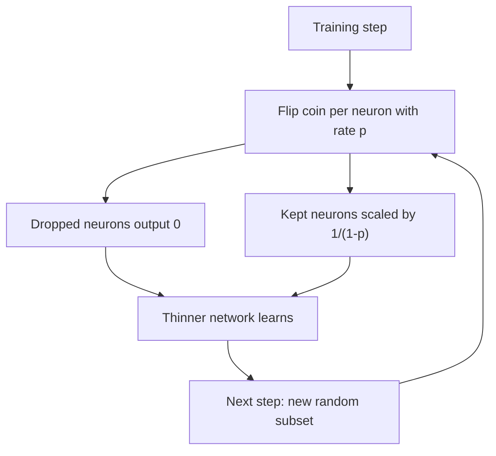

# What is Dropout in Neural Networks?

> **Step 2: Deep Learning and Neural Networks** · ⏱️ 14 min read · [Read original](https://outcomeschool.com/blog/dropout-in-neural-networks)

## TL;DR
Dropout randomly switches off neurons during training so the network cannot lean on a fixed team of strong neurons. This reduces overfitting and acts like training many thinner networks that share weights. It is on during training and off during testing.

## Key Concepts
- **Overfitting** — great on training data, poor on unseen data (the student who memorizes one practice book).
- **Co-adaptation** — a few neurons adapt together and do most of the work, enabling memorization.
- **Dropout rate p** — probability a neuron is switched off in a given step (commonly 0.2 to 0.5).
- **Inverted dropout** — scale surviving activations by $1/(1-p)$ during training so nothing needs adjusting at test time.

## How It Works
### Per training step
1. For each neuron in the Dropout layer, flip a coin with probability p.
2. Dropped neurons output 0 for that step.
3. Remaining neurons pass values forward, scaled up by $1/(1-p)$.
4. Network learns from this thinner version.
5. Next step: new coin flips, a different random subset is dropped.

Over many steps this is like training many networks sharing weights and combining them (like asking many people and taking the common answer).

### Example (p = 0.5)
Outputs [2, 4, 6, 8]; neurons 2 and 4 dropped gives [2, 0, 6, 0]; divide active ones by 0.5 gives [4, 0, 12, 0].

### Training vs testing
Dropout is active only in training. At test time all neurons participate for stable predictions; inverted dropout means no extra scaling is needed. Forgetting this is a common beginner mistake.

```python
model = nn.Sequential(
    nn.Linear(784, 256), nn.ReLU(),
    nn.Dropout(p=0.5),
    nn.Linear(256, 10))
model.train()  # Dropout active
model.eval()   # Dropout off
```

### Variants
| Variant | What is dropped | Used in |
|---|---|---|
| Standard | Individual neurons | Most cases |
| Spatial | Groups of related neurons | CNNs on images |
| DropConnect | Connections between neurons | General |
| Recurrent | Applied carefully to preserve memory | RNNs on sequences |

Too high p stops learning; too low p barely helps. Data augmentation is another way to fight overfitting.

## Diagram


## Key Takeaways
- Dropout fights overfitting by preventing co-adaptation of neurons.
- Each step trains a different thinner network, giving an ensemble-like effect.
- Inverted dropout scales by $1/(1-p)$ during training, so test time needs nothing.
- Use `model.train()` for dropout and `model.eval()` to disable it.
- Typical p is 0.2 to 0.5.
