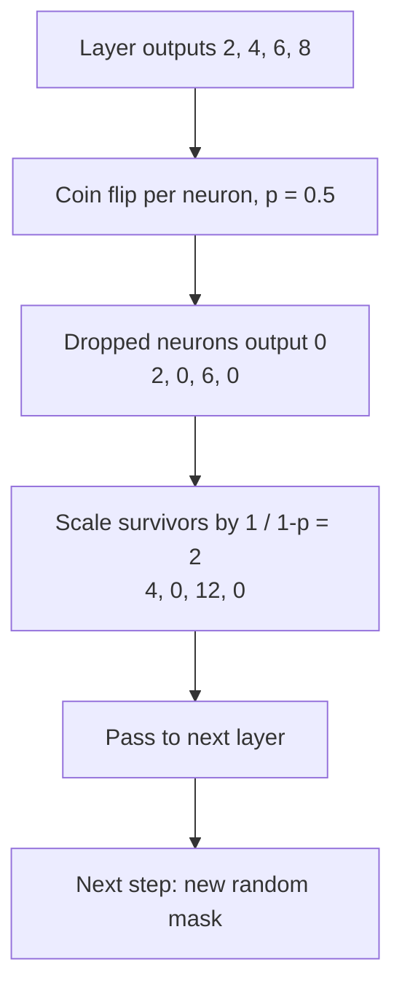
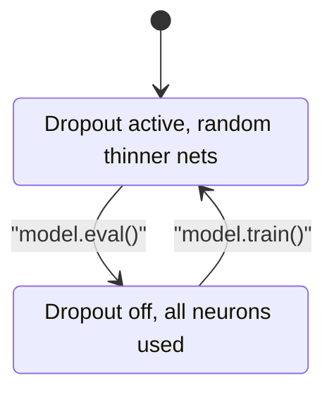

# What is Dropout in Neural Networks?

> **Step 2: Deep Learning and Neural Networks** · ⏱️ 14 min read · [Read original](https://outcomeschool.com/blog/dropout-in-neural-networks)

## TL;DR
Dropout randomly switches off neurons at every training step so the network cannot lean on a fixed team of strong neurons and overfit. Survivors are scaled up (inverted dropout), and Dropout is turned off at test time. It behaves like training many thinner networks that share weights.

## Key Concepts
- **Neuron** — small unit taking numbers in, computing, passing a number forward.
- **Overfitting** — great on training data, poor on unseen data (student who memorized one practice book and fails the real exam). Caught using train/validation/test splits.
- **Co-adaptation** — a few neurons adapt together as a fixed team doing most work while others get lazy; if that team memorizes, the network overfits.
- **Dropout rate `p`** — probability a neuron is switched off in a step (p=0.5: 50%).
- **Keep probability** — $1-p$.
- **Inverted dropout** — scale survivors by $1/(1-p)$ during training; standard today.

## How It Works

### Why it helps
No neuron can count on neighbors being present, so each must learn something useful alone. This breaks the fixed team and favors general patterns. Ensemble effect: asking many people and taking the common answer beats one person; the final net acts like many networks combined.

### Per training step
1. Flip a coin with probability p for each neuron in the Dropout layer.
2. Switched-off neurons output 0 (connections effectively removed).
3. Remaining neurons pass values forward as usual.
4. Network learns from this thinner version for that one step.
5. Next step: flip again, a different random set is dropped.
Dropped neurons are not off for the rest of training, only one step.

### Example (4 neurons, p = 0.5)
Outputs 2, 4, 6, 8. Coins drop neurons 2 and 4 giving 2, 0, 6, 0. Scale survivors by 1/0.5 = 2 giving 4, 0, 12, 0 so the overall signal strength stays about the same. Because scaling is done in training, nothing extra is needed at test time.

### Training vs testing
Dropout on during training, off during testing: full network power, stable, no randomness. Forgetting to turn it off is a common beginner mistake.

### PyTorch
```python
model = nn.Sequential(
    nn.Linear(784, 256), nn.ReLU(),
    nn.Dropout(p=0.5),          # drops 50% in training
    nn.Linear(256, 10))
model.train()  # Dropout active
model.eval()   # Dropout off
```
The Dropout layer sits between layers and zeroes outputs of the previous layer.

### Variants

| Variant | What it does |
|---|---|
| Standard | Randomly drops individual neurons (most used) |
| Spatial | Drops a whole group of related neurons, for CNN image data |
| DropConnect | Drops connections between neurons; neurons stay |
| Recurrent | For RNNs (text, speech); applied carefully so sequence memory isn't damaged |

### Advantages
- Reduces overfitting; no dependency on single neurons.
- Acts like many models in one, so predictions are more robust.
- Very simple (one layer), works with almost any network.

### Where used
Image classification, NLP (language and translation models), speech recognition, almost any large net at overfitting risk. Typical p is 0.2 to 0.5. Too high: net can't learn; too low: little help. Data augmentation is another overfitting remedy.

### FAQ
- Rate? 0.2 to 0.5.
- Stays off all training? No, one step.
- Scale at test? No, inverted dropout handled it.
- Forget `model.eval()`? Dropout stays active, random predictions.
- DropConnect = Dropout? No: connections vs neurons.

## Diagram(s)

### One training step


### Train vs eval


## Trade-offs & Pitfalls
- p too high underfits; too low barely regularizes.
- Must call `model.eval()` for predictions.
- Variants needed for CNNs and RNNs.

## Key Takeaways
- Dropout randomly zeroes neurons each training step to fight overfitting.
- It prevents co-adaptation and acts like an ensemble of thinner networks.
- Inverted dropout divides survivors by 1 - p, so test time needs no change.
- On in training, off in testing.
- Typical p = 0.2 to 0.5.
- Variants: spatial, DropConnect, recurrent.
