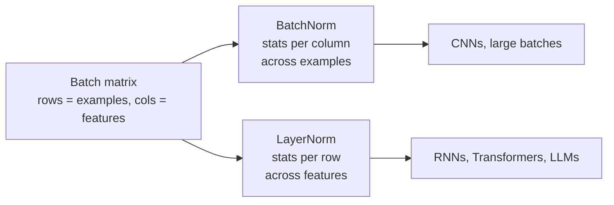
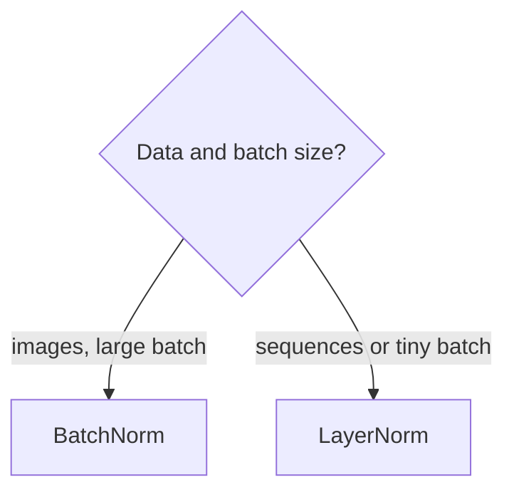

# Batch Normalization vs Layer Normalization

> **Step 2: Deep Learning and Neural Networks** · ⏱️ 9 min read · [Read original](https://outcomeschool.com/blog/batch-normalization-vs-layer-normalization)

## TL;DR
BatchNorm normalizes each feature across all examples in a batch (column-wise); LayerNorm normalizes all features within each single example (row-wise). BatchNorm suits CNNs with large batches; LayerNorm suits RNNs, Transformers and LLMs because it is batch-independent and identical in training and inference.

## Key Concepts
- **Normalization** — rescale values to a similar scale, typically mean 0, variance 1 (e.g. age 0-100 vs salary up to 10,00,000, where the larger feature would dominate).
- **Why needed** — values in deep nets get very large or small: slow training, instability, exploding/vanishing gradients.
- **epsilon** — tiny number added to variance to avoid divide-by-zero.
- **gamma / beta** — learnable scale and shift applied after normalizing.

## How It Works

Shared formulas:

$$
\hat x=\frac{x-\mu}{\sqrt{\sigma^2+\epsilon}},\qquad y=\gamma\hat x+\beta
$$

$\mu,\sigma^2$ = mean and variance over the chosen dimension. The only difference between the two methods is that dimension.

Example batch (4 examples x 3 features): [10,12,14], [20,22,24], [30,32,34], [40,42,44].

### Batch Normalization
- Per feature, over the batch: column 1 = [10,20,30,40], mean 25. Stats depend on the other examples.
- Training uses current batch stats; inference (often one example) uses running averages of mean/variance tracked during training, so behavior differs between training and inference.
- Pros: faster training, higher learning rates allowed, less need for careful initialization, regularizing effect.
- Cons: poor with small batches (unreliable stats; unusable at batch size 1); train/inference mismatch can cause inconsistent predictions; unsuited to RNNs/Transformers since sequence lengths vary.

### Layer Normalization
- Per example, over features: row 1 = [10,12,14], mean 12; each example independent of the batch.
- Same behavior in training and inference.
- Pros: any batch size including 1; good for RNNs and Transformers; used in BERT, GPT, LLMs.
- Con: not always best for CNNs, where BatchNorm usually does better.

### Classroom analogy
4 students, 3 subjects. BatchNorm: compare Math marks across all 4 students. LayerNorm: compare Math, Science, English for one student.

### Comparison

| Aspect | BatchNorm | LayerNorm |
|---|---|---|
| Direction | Across batch (column-wise) | Across features (row-wise) |
| Depends on batch size | Yes | No |
| Training vs inference | Different | Same |
| Batch size 1 | No | Yes |
| Best for | CNNs, images | RNNs, Transformers, LLMs |

### When to use
- Images/CNNs with large batches: BatchNorm.
- Sequences, RNNs, Transformers, LLMs: LayerNorm.
- Very small batches: LayerNorm.
LLMs use LayerNorm because sequence lengths differ and batches can be small.

### FAQ
- BN differs at inference because single examples have no batch stats, so running averages are used.
- gamma scales, beta shifts; both norms use them.
- epsilon prevents division by zero when variance is 0.
- BN with small batches: no, unreliable and fails at batch size 1.

## Diagram(s)

### Axis of normalization

### Choosing

## Trade-offs & Pitfalls
- BN: batch-size sensitive, train/inference gap, bad for variable-length sequences.
- LN: weaker than BN on CNNs.

## Key Takeaways
- BN = per-feature across the batch; LN = per-example across features.
- Same formula with gamma and beta; different axis.
- BN needs running stats at inference; LN does not.
- BN for CNNs, LN for Transformers/LLMs/small batches.
