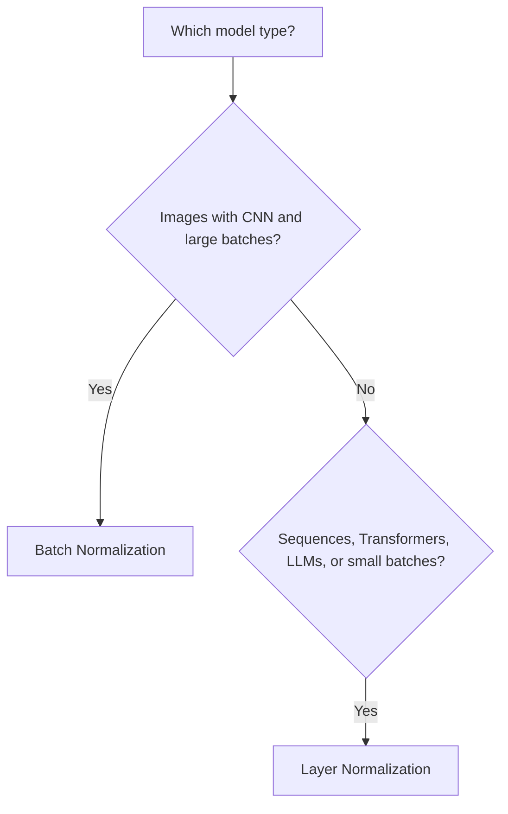

# Batch Normalization vs Layer Normalization

> **Step 2: Deep Learning and Neural Networks** · ⏱️ 9 min read · [Read original](https://outcomeschool.com/blog/batch-normalization-vs-layer-normalization)

## TL;DR
Both normalize activations to stabilize and speed up training; they differ in which dimension supplies the mean and variance. Batch Norm normalizes each feature across the batch; Layer Norm normalizes all features of each example. Batch Norm suits CNNs, Layer Norm suits RNNs, Transformers, and LLMs.

## Key Concepts
- **Why normalize** — values in deep nets can become very large or small, causing slow, unstable training and exploding/vanishing gradients.
- **Batch Normalization** — mean and variance per feature across the batch (column-wise).
- **Layer Normalization** — mean and variance per example across its features (row-wise).
- **Gamma and beta** — learnable scale and shift applied after normalizing.
- **Epsilon** — tiny constant that avoids division by zero.

## How It Works
Both use the same formulas; only the axis differs:
$$\hat x = \frac{x-\text{mean}}{\sqrt{\text{variance}+\epsilon}},\qquad \text{output}=\gamma\hat x+\beta$$

Example batch (4 examples x 3 features): [10,12,14], [20,22,24], [30,32,34], [40,42,44].
- Batch Norm: feature 1 uses [10,20,30,40], mean 25. Depends on other examples.
- Layer Norm: Example 1 uses [10,12,14], mean 12. Independent of the batch.

Classroom analogy: Batch Norm compares Math marks across all students; Layer Norm compares one student's marks across all subjects.

### Batch Norm details
- Training uses the current batch's stats; inference uses running averages tracked during training, so behavior differs.
- Pros: faster training, allows higher learning rates, less dependence on weight initialization, regularizing effect.
- Cons: unreliable with small batches, train/inference mismatch, awkward for variable-length sequences (RNNs, Transformers).

### Layer Norm details
- Pros: any batch size (even 1), same behavior in training and inference, works well for sequences, used in BERT, GPT and other LLMs.
- Cons: not always best for CNNs.

### Comparison
| Aspect | Batch Norm | Layer Norm |
|---|---|---|
| Direction | Across batch (column-wise) | Across features (row-wise) |
| Depends on batch size | Yes | No |
| Training vs inference | Different | Same |
| Batch size of 1 | No | Yes |
| Best for | CNNs, images | RNNs, Transformers, LLMs |

## Diagram

## Key Takeaways
- Batch Norm: one feature across all examples. Layer Norm: all features of one example.
- Batch Norm depends on batch statistics, so it behaves differently in training and inference; Layer Norm does not.
- LLMs use Layer Norm because sequence lengths vary and batches can be small.
- Use Batch Norm for CNNs with large batches.
