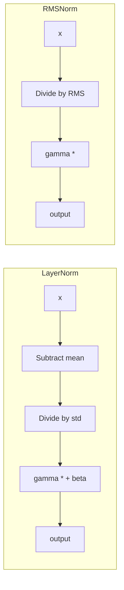
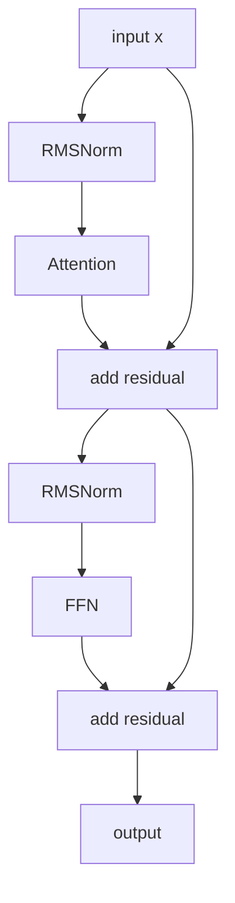

# What is RMSNorm? Root Mean Square Layer Normalization Explained

> **Step 2: Deep Learning and Neural Networks** · ⏱️ 13 min read · [Read original](https://outcomeschool.com/blog/rmsnorm-root-mean-square-layer-normalization)

## TL;DR
RMSNorm is LayerNorm with only the re-scaling step: divide by the root mean square, no mean subtraction, no beta. It is faster and simpler with broadly the same accuracy, so Llama, Mistral, Gemma, Qwen, PaLM and DeepSeek use it, applied pre-norm inside each Transformer block.

## Key Concepts
- **Normalization** — scaling numbers per layer to a healthy range; deep nets otherwise get huge (exploding gradients) or tiny (vanishing), making training slow/unstable.
- **LayerNorm** — re-center (subtract mean) then re-scale (divide by std), then gamma and beta: $\gamma\frac{x-\text{mean}}{\sqrt{\text{var}+\epsilon}}+\beta$. Used in original Transformer, BERT, GPT-2.
- **RMS** — square root of the mean of squares; the typical magnitude of the vector ([100,200,300] big, [0.01,0.02,0.03] tiny).
- **gamma** — learned per-dimension scale; restores expressiveness since dividing by RMS fixes magnitude.
- **eps** — tiny value inside the sqrt (default 1e-6 in code) against divide-by-zero.
- **Pre-norm** — normalize before attention / FFN.

## How It Works

### Origin and insight
Introduced 2019 by Biao Zhang and Rico Sennrich ("Root Mean Square Layer Normalization"). Insight: most of LayerNorm's benefit comes from re-scaling, not re-centering. Mean shifts are absorbed by residual connections and learned projections in Transformers, so only scale needs a dedicated fix. LayerNorm controls shift and scale; RMSNorm only scale.

### Math
$$RMS(x)=\sqrt{\tfrac1n\sum x_i^2},\qquad RMSNorm(x)=\gamma\odot\frac{x}{\sqrt{\text{mean}(x^2)+\epsilon}}$$
Three steps: square, mean, sqrt. No beta (nothing was subtracted, so nothing to shift back).

### Numeric example
x=[2,4,4,8]: squares [4,16,16,64]; mean 100/4=25; RMS=5; x/RMS=[0.4,0.8,0.8,1.6]; with gamma=[1,1,1,1] output [0.4,0.8,0.8,1.6].

### LayerNorm vs RMSNorm

| | LayerNorm | RMSNorm |
|---|---|---|
| Steps | Re-center and re-scale (std) | Re-scale only (RMS) |
| Parameters | gamma and beta | gamma only |
| Speed | Slower (mean and variance) | Faster (RMS only) |
| Used in | Original Transformer, BERT, GPT-2 | Llama, Mistral, Gemma, Qwen, PaLM, DeepSeek |

### Why LLMs prefer it
1. **Speed** — less math; with billions of parameters, trillions of tokens and two norm calls per block across many blocks, savings add up. Paper reported 7% to 64% training time reduction depending on model/task; inference faster too.
2. **Accuracy** — broadly the same as LayerNorm (sometimes slightly better or worse).
3. **Simplicity** — one fewer parameter and statistic; cleaner kernels fuse well on GPUs at scale.

### Code
```python
class RMSNorm(nn.Module):
    def __init__(self, dim, eps=1e-6):
        super().__init__(); self.eps = eps
        self.gamma = nn.Parameter(torch.ones(dim))
    def forward(self, x):
        ms = x.pow(2).mean(dim=-1, keepdim=True)
        return self.gamma * x / torch.sqrt(ms + self.eps)
```

### In a Transformer
RMSNorm before attention and before the feed-forward block (pre-norm, aids stability in very deep nets); residual path skips around each. One extra RMSNorm at the end, before the final output projection to logits.

### FAQ
- Less accurate? No, broadly equal.
- Mean shifts? Residuals and projections absorb them.
- No beta? Never subtracted the mean.
- eps? Avoid division by zero.
- Who? Zhang and Sennrich, 2019.

## Diagram(s)

### LayerNorm vs RMSNorm pipelines


### Pre-norm Transformer block


## Trade-offs & Pitfalls
- Drops mean-centering; relies on the rest of the Transformer to handle mean shifts.
- Without gamma the fixed magnitude would be too restrictive.

## Key Takeaways
- RMSNorm = divide by sqrt(mean(x^2)+eps), times gamma.
- No mean subtraction, no beta; one parameter per dimension.
- Faster (7-64% training time cut reported), simpler, same quality.
- Pre-norm placement plus a final norm before the output projection.
- Standard in modern LLMs.
