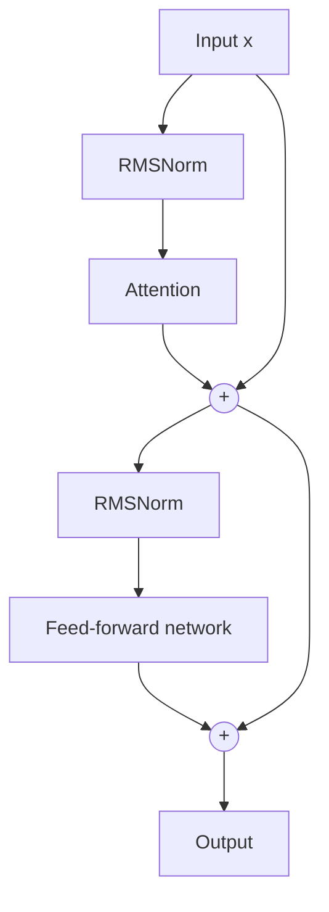

# What is RMSNorm? Root Mean Square Layer Normalization Explained

> **Step 2: Deep Learning and Neural Networks** · ⏱️ 13 min read · [Read original](https://outcomeschool.com/blog/rmsnorm-root-mean-square-layer-normalization)

## TL;DR
RMSNorm is a simplified LayerNorm that only re-scales by the root mean square of the vector and skips mean subtraction and the beta parameter. It is faster and simpler with broadly the same accuracy, so most modern LLMs (Llama, Mistral, Gemma, Qwen, PaLM, DeepSeek) use it.

## Key Concepts
- **Normalization** — keeps activations in a healthy range, avoiding exploding/vanishing values across many layers.
- **LayerNorm** — re-centers (subtract mean), re-scales (divide by std), then applies gamma and beta: $\gamma\frac{x-\text{mean}}{\sqrt{\text{var}+\epsilon}}+\beta$.
- **RMSNorm** — introduced 2019 by Biao Zhang and Rico Sennrich; keeps only re-scaling.
- **RMS** — square each value, take the mean, take the square root.
- **Pre-norm** — normalize before the attention or feed-forward layer.

## How It Works
### Core idea
Most of LayerNorm's benefit comes from re-scaling, not re-centering. Transformers' residual connections and learned projections can absorb mean shifts, so only scale needs a dedicated fix.

### Formulas
$$RMS(x)=\sqrt{\tfrac{1}{n}\sum x_i^2},\qquad RMSNorm(x)=\gamma\cdot\frac{x}{\sqrt{\text{mean}(x^2)+\epsilon}}$$
Gamma (one value per dimension) lets the network restore a useful scale. No beta, because nothing was subtracted.

### Worked example
x = [2, 4, 4, 8]: squares [4,16,16,64], mean 25, RMS 5, result [0.4, 0.8, 0.8, 1.6] (with gamma = 1).

### LayerNorm vs RMSNorm
| LayerNorm | RMSNorm |
|---|---|
| Re-centers and re-scales (std) | Only re-scales (RMS) |
| Parameters: gamma and beta | Parameter: gamma only |
| Slower (mean and variance) | Faster (RMS only) |
| Original Transformer, BERT, GPT-2 | Llama, Mistral, Gemma, Qwen, PaLM, DeepSeek |

### Why LLMs prefer it
1. **Speed** — less math per call, and LLMs make many calls (two per block, many blocks).
2. **Accuracy** — broadly the same as LayerNorm per the original paper.
3. **Simplicity** — fewer parameters and statistics, easier to fuse efficiently on GPUs.

### Code
```python
class RMSNorm(nn.Module):
    def __init__(self, dim, eps=1e-6):
        super().__init__()
        self.eps = eps
        self.gamma = nn.Parameter(torch.ones(dim))
    def forward(self, x):
        ms = x.pow(2).mean(dim=-1, keepdim=True)
        return self.gamma * x / torch.sqrt(ms + self.eps)
```

### Placement
Pre-norm: one RMSNorm before attention and one before the feed-forward layer in every block, with residual paths skipping around. One more RMSNorm sits at the end before the output projection to logits.

## Diagram


## Key Takeaways
- RMSNorm = LayerNorm minus mean subtraction and beta.
- RMS is the square root of the mean of squares; dividing by it removes overall magnitude.
- Same quality, less compute, simpler kernels.
- Used in pre-norm position in modern LLM blocks.
- Original paper: Zhang and Sennrich, 2019.
