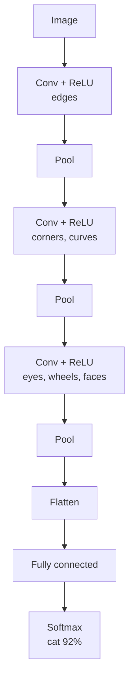

# Convolutional Neural Networks

> **Step 2: Deep Learning and Neural Networks** · ⏱️ 19 min read · [Read original](https://outcomeschool.com/blog/convolutional-neural-network-cnn)

## TL;DR
CNNs slide small learned filters over an image, reusing the same pattern detector everywhere, to find edges, then shapes, then objects. Local connections plus weight sharing slash parameters (1,792 vs 3 billion for a layer), and stacked conv + ReLU + pooling layers feed a final fully connected classifier.

## Key Concepts
- **Pixel / channels** — grayscale pixel 0-255; color pixel has 3 numbers (R, G, B channels). 1000x1000 color photo = 3,000,000 numbers.
- **Edge** — boundary where values change (e.g. black meets white).
- **Fully connected layer** — every neuron connects to every input; each connection has a weight.
- **Filter / kernel** — small grid (commonly 3x3) acting as pattern detector; same thing, two names.
- **Convolution** — slide filter, multiply elementwise and sum at each position.
- **Feature map** — output grid showing where the filter found its pattern.
- **Stride** — pixels moved per step. **Padding** — border of zeros.
- **ReLU** — negative becomes 0, positive kept.
- **Max pooling** — keep the largest value per small window.
- **Flatten** — grid to one long list. **Softmax** — scores to percentages.

## How It Works

### Why plain networks fail on images
1000x1000x3 input = 3M numbers; 1000 first-layer neurons = 3,000,000,000 weights: slow, memory-hungry, data-hungry. It also ignores neighbors (flat list) and does not reuse learning (a cat's eye in top-left must be re-learned for bottom-right). Analogy: finding a friend in a crowd photo by scanning small areas with the same face template.

### Convolution example
Vertical-edge filter: rows `[-1 0 1]` x3 (right brighter than left gives big value). Image 5x5, left three columns 0, right two 9 (255 simplified).
- Position 1 (cols 1-3): all 0 gives 0 (no edge).
- Position 2 (cols 2-4): each row 0*-1 + 0*0 + 9*1 = 9, total 27 (edge).
- Position 3 (cols 3-5): each row 0 + 0 + 9 = 9, total 27.
- Move down a row and repeat.
Feature map: `[0 27 27]` per row, 3x3. Smaller since a 3x3 filter fits in only 3 positions across 5 pixels.
Real layers use many filters (32 or 64), each giving a feature map; color filters are 3x3x3.

### Stride, padding, size
Stride 2 roughly halves the map. Padding of 1 turns 5x5 into 7x7 so the output stays 5x5 and edges are examined properly.
$$\text{out}=\frac{\text{in}+2p-f}{s}+1$$
Unpadded: (5+0-3)/1+1=3. Padded: (5+2-3)/1+1=5.

### ReLU
-5 3 0 -2 8 becomes 0 3 0 0 8. Keeps found patterns; adds nonlinearity (without it, stacked layers collapse to straight-line relationships).

### Pooling
2x2 max pooling on 4x4 map [[1,3,2,0],[4,6,1,2],[0,2,9,5],[1,1,3,7]] gives [[6,2],[2,9]] (16 to 4 numbers). Benefits: smaller data; tolerance to small shifts.

### Putting it together
Conv+ReLU (edges) then pool; conv+ReLU (corners, curves) then pool; conv+ReLU (eyes, ears, wheels) then pool; flatten; fully connected (cheap now); softmax e.g. "cat 92%, dog 7%, car 1%".

### Learning filters
Filter numbers are the weights; learned, not hand-written: show labeled photo, guess, loss, backpropagation, tiny adjustment, repeat over thousands or millions of photos. First-layer filters end up as edge/color detectors on their own.

### Efficiency
3x3 filter on color = 27 weights + 1 bias = 28; 64 filters = 1,792 vs 3,000,000,000. Due to **local connections** and **weight sharing**.

| Point | Fully connected | CNN |
|---|---|---|
| View | Whole image as flat list | Small windows |
| Neighbors respected | No | Yes |
| Same pattern elsewhere | Relearn | Same filter finds it |
| First-layer weights | Billions | A few thousand |
| Training data | Very large | Much less |
| Best for | Tabular | Images, grid data |

### Code (PyTorch, 28x28 digits)
`Conv2d(1,16,3,padding=1)` then ReLU then MaxPool2d(2) (28 to 14); `Conv2d(16,32,3,padding=1)`, ReLU, pool (14 to 7); flatten gives 32*7*7=1,568; `Linear(1568,10)` scores for digits 0-9; highest wins.

### Famous CNNs
- LeNet (1998, Yann LeCun): handwritten digits, bank checks.
- AlexNet (2012): won ImageNet by a large margin using GPUs; start of the modern deep learning era.
- VGG (2014): stacks of small 3x3 filters.
- ResNet (2015): shortcut connections, 100+ layers.

### Strengths and failures
Good: image classification, object detection (self-driving), face recognition, medical imaging, other grid data (spectrograms, some text).
Struggles: long-range relationships (need many layers); rotations and big scale changes; data hungry; adversarial pixel tweaks fool them.
Vision Transformers also work well, especially with huge data; CNNs remain popular for efficiency, simplicity, less data.

### FAQ
- CNN vs ViT? Depends on data amount.
- Non-image data? Yes, any grid.
- Filter vs kernel? Same.
- Why FC at end? Final decision, cheap after shrinking.

## Diagram(s)

### CNN pipeline

### Training loop

## Trade-offs & Pitfalls
- Local view struggles with global context; sensitive to rotation/scale; data hungry; adversarially fragile.

## Key Takeaways
- CNN = shared small filters sliding over the image.
- Local connectivity + weight sharing cut parameters massively.
- Output size = (in + 2p - f)/s + 1.
- Conv, ReLU, pool repeat, then flatten and FC.
- Filters are learned by backprop; early ones become edge detectors.
- Landmarks: LeNet, AlexNet, VGG, ResNet.
