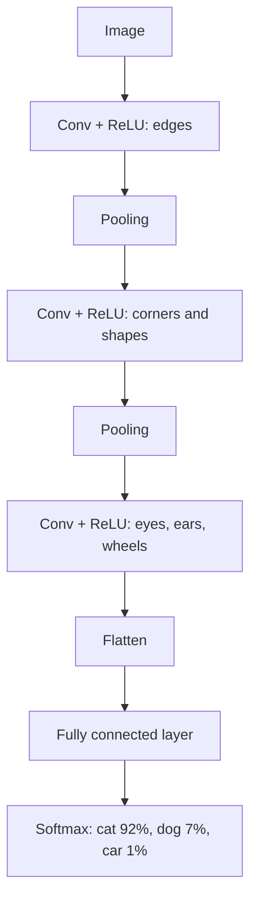

# Convolutional Neural Networks

> **Step 2: Deep Learning and Neural Networks** · ⏱️ 19 min read · [Read original](https://outcomeschool.com/blog/convolutional-neural-network-cnn)

## TL;DR
A CNN looks at an image through small windows and reuses the same learned pattern detectors (filters) everywhere. This slashes the number of weights compared with a fully connected network (1,792 versus billions in the first layer for a 1000 x 1000 color photo) and respects pixel neighborhoods. Stacked layers build from edges to shapes to objects.

## Key Concepts
- **Pixel / channel** — grayscale pixel is 0 to 255; color has 3 channels (RGB), so a 1000 x 1000 photo is 3,000,000 numbers.
- **Filter (kernel)** — small grid (e.g. 3 x 3) acting as a pattern detector; its numbers are learned.
- **Convolution** — slide the filter, multiply and add at each position.
- **Feature map** — output grid showing where the filter's pattern appeared.
- **Stride / padding** — step size of the filter / zero border added around the image.
- **ReLU** — negatives become 0; adds the non-linearity needed for complex patterns.
- **Max pooling** — keep the largest value in each small window (e.g. 2 x 2); shrinks data and tolerates small shifts.
- **Weight sharing / local connections** — the reasons for CNN efficiency.

## How It Works
### Why not fully connected?
A 3,000,000-number input into 1000 neurons needs 3 billion weights, ignores neighboring pixels, and cannot reuse a learned pattern in a new position.

### Convolution example
Vertical-edge filter [[-1,0,1]] x 3 rows on a 5 x 5 image (left 0s, right 9s): top-left window gives 0; shifted windows give 27 each. Feature map = [[0,27,27]] x 3 rows: big values mark the edge. Real layers use many filters (e.g. 32 or 64), one feature map each; on color images filters are 3 x 3 x 3.

### Output size
$$\text{output} = \frac{\text{input} + 2\cdot\text{padding} - \text{filter}}{\text{stride}} + 1$$
(5 + 0 - 3)/1 + 1 = 3; with padding 1, (5 + 2 - 3)/1 + 1 = 5.

### Pooling example
4 x 4 map [[1,3,2,0],[4,6,1,2],[0,2,9,5],[1,1,3,7]] becomes [[6,2],[2,9]].

### Learning
Filters are learned: show a labeled photo, guess, compute loss, backpropagate, adjust filter numbers, repeat over many images. First-layer filters end up as edge and color detectors on their own.

### Efficiency
A 3 x 3 filter on a color image has 27 weights + 1 bias = 28; 64 filters give 1,792 parameters versus 3,000,000,000.

| Point | Fully connected | CNN |
|---|---|---|
| View | Flat list | Small windows |
| Neighbors respected | No | Yes |
| Same pattern elsewhere | Relearn | Same filter |
| Best for | Tabular data | Images and grids |

### Code sketch (28 x 28 digits)
Two `Conv2d` layers (1 to 16, 16 to 32 filters, kernel 3, padding 1), ReLU, `MaxPool2d(2)` each time (28 to 14 to 7), flatten to 32 x 7 x 7 = 1,568, `Linear` to 10 digit scores.

### Famous CNNs
LeNet (1998, handwritten digits), AlexNet (2012, ImageNet win, GPU training), VGG (2014, stacked 3 x 3 filters), ResNet (2015, shortcut connections, 100+ layers).

### Strengths and weaknesses
Good at image classification, object detection, face recognition, medical imaging, spectrograms. Struggles with long-range relationships, rotations and scale changes, needs lots of labeled data, can be fooled by tiny pixel changes. Vision Transformers are strong with huge data; CNNs remain efficient with less data.

## Diagram

## Key Takeaways
- CNN = sliding learned filters + ReLU + pooling, then a fully connected head.
- Local connections and weight sharing cut parameters from billions to thousands.
- Early layers detect edges; deeper layers detect parts and objects.
- Filters are learned through backpropagation, not hand-designed.
- Pooling shrinks data and adds tolerance to small shifts.
