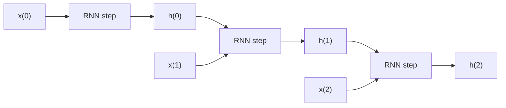

# What is a Recurrent Neural Network (RNN)?

> **Step 2: Deep Learning and Neural Networks** · ⏱️ 4 min read · [Read original](https://outcomeschool.com/blog/recurrent-neural-network)

## TL;DR
An RNN is a neural network with loops that carries context from earlier inputs forward, so it can predict well on sequences like text. It is useful wherever the previous inputs matter. Most modern language models now use Transformers instead.

## Key Concepts
- **RNN** — network whose connections form a loop along a sequence, using an internal state (memory) to process inputs.
- **Hidden state h(t)** — the output of one step that is fed in, with the next input, to the following step.
- **Context** — information from earlier inputs; for next-word prediction, the relation among previous words.

## How It Works
- Ordinary feedforward networks treat inputs as independent; in an RNN inputs are related, so context is retained.
- Analogy: watching a movie, you understand each scene because you remember everything seen so far.
- The loop lets information persist. Unrolled over time: x(0) produces h(0); h(0) together with x(1) produces h(1); h(1) with x(2) feeds the next step, and so on. Context is remembered while training.

### Applications
- Next word prediction
- Music composition
- Image captioning
- Speech recognition
- Time series anomaly detection
- Stock market prediction

Most modern language models moved from RNNs to Transformers.

## Diagram

## Key Takeaways
- RNNs add memory to neural networks through a loop carrying the hidden state.
- Each step takes the current input plus the previous step's output.
- Suited to sequential data: text, speech, time series, music.
- Feedforward networks assume independent inputs; RNNs do not.
- Transformers largely replaced RNNs in modern LLMs.
