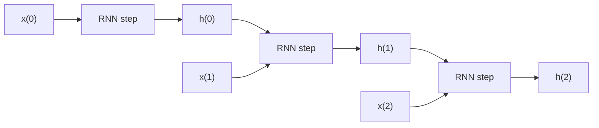

# What is a Recurrent Neural Network (RNN)?

> **Step 2: Deep Learning and Neural Networks** · ⏱️ 4 min read · [Read original](https://outcomeschool.com/blog/recurrent-neural-network)

## TL;DR
An RNN is a neural network with loops that keeps an internal state (memory) of earlier inputs in a sequence and uses it to produce the right output. It suits tasks where context matters, like text.

## Key Concepts
- **RNN** — class of neural network whose connections form a directed graph along a sequence, giving dynamic temporal behavior; uses internal state (memory) to process input sequences, unlike feedforward networks (Wikipedia definition).
- **Context** — information from earlier inputs; sometimes the single most important thing for predicting the right output.
- **Loop** — structure that lets information persist across steps.
- **Hidden output h(t)** — carried to the next step together with the next input.

## How It Works
- Analogy: watching a movie, you relate each scene correctly because you remember what you've seen so far.
- In ordinary networks inputs are independent; in an RNN inputs are related. Predicting the next word uses the relation among all previous words, and the RNN learns these relations during training.
- Rolled view: a network with a loop. Unrolled view: step 1 takes x(0) and outputs h(0); h(0) with x(1) form the input of the next step, producing h(1); h(1) with x(2) feed the following step; and so on. This is how context is retained while training.

### Applications
Next word prediction, music composition, image captioning, speech recognition, time series anomaly detection, stock market prediction; also unsegmented handwriting recognition.

### FAQ
- vs feedforward? RNN uses memory; inputs are related.
- Why loops? Persist information by feeding prior output with next input.
- Modern LMs? Mostly Transformers instead; RNNs are where the journey to today's LLM architectures started.

## Diagram(s)

### Unrolled RNN

## Trade-offs & Pitfalls
- Most modern language models now use Transformers instead of RNNs.

## Key Takeaways
- RNN = network with a loop and memory for sequences.
- Each step gets the current input plus the previous step's output h.
- Inputs are related, unlike independent inputs in other networks.
- Used wherever previous-input context matters (text, speech, music, time series).
- Largely superseded by Transformers in LLMs.
