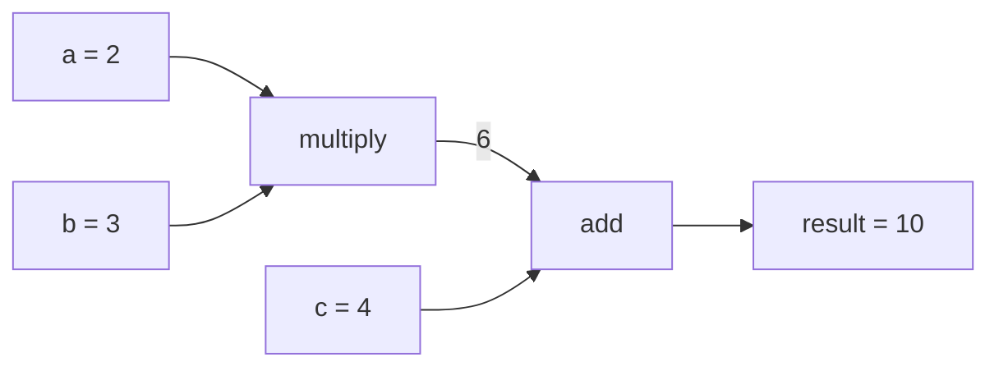
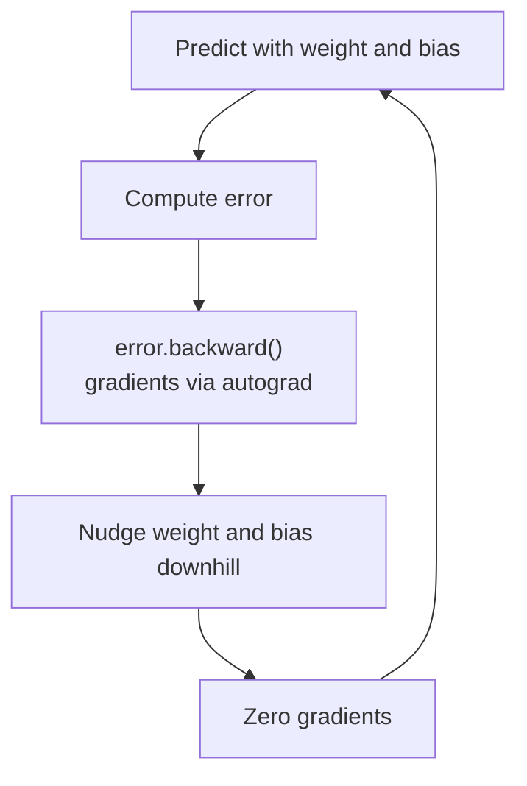

# How does PyTorch work?

> **Step 2: Deep Learning and Neural Networks** · ⏱️ 18 min read · [Read original](https://outcomeschool.com/blog/how-does-pytorch-work)

## TL;DR
PyTorch stores data in tensors, records every math step in a computation graph built on the fly as normal Python runs, and uses autograd to compute gradients by walking that graph backward. Wrapped in a predict-error-backward-update loop, models learn rules from examples, and moving to a GPU needs one small change.

## Key Concepts
- **PyTorch** — free, open-source library for building/training ML models, created at Meta, used from Python; a toolbox so we don't hand-write math.
- **Tensor** — container of numbers: single number, row, grid or bigger. Photos (grids of brightness) and text are turned into numbers and held in tensors.
- **Computation graph** — ordered record of every math step (the forward path/recipe).
- **Autograd** — Auto + Gradient: automatically computes direction and amount of change for each number. Gradient = slope, "downhill" = less error (foggy hill analogy).
- **`requires_grad=True`** — track a tensor for gradients.
- **GPU** — chip doing many simple operations at once. CPU = one fast courier; GPU = a thousand couriers each delivering one letter.
- **cuda** — PyTorch's name for (NVIDIA) GPUs.

## How It Works

### The problem
ML: computer learns a pattern from data without hand-written rules. Loop: random guess, check how wrong, fix slightly, repeat. Fixing needs direction and amount per number (calculus), impossible by hand for millions of numbers, so PyTorch does it via graph + autograd.

### Tensor
```python
x = torch.tensor([1.0, 2.0, 3.0])   # tensor([1., 2., 3.])
```

### Computation graph
`result = a*b + c` with a=2, b=3, c=4 gives 10; PyTorch notes multiply (6) then add. Built line by line while the program runs; needed so it can walk backward later.

### Autograd
```python
x = torch.tensor(3.0, requires_grad=True)
y = x * x
y.backward()
print(x.grad)   # tensor(6.)
```
Slope of x*x at 3 is 6, found automatically. We write the forward pass; PyTorch does backward math (this is backpropagation).

### Complete training example (Celsius to Fahrenheit)
True rule: multiply by 1.8, add 32. Data: 0 to 32, 100 to 212. `weight` and `bias` start at 0 with `requires_grad=True`, lr=0.0001, loop 100000 times:
1. `prediction = weight*celsius + bias`
2. `error = ((prediction - fahrenheit)**2).mean()`
3. `error.backward()` for gradients
4. Under `torch.no_grad()`: `weight -= lr*weight.grad`, same for bias
5. `.grad.zero_()` to reset for next round

Result: weight about 1.8, bias about 32. Many rounds are needed because inputs are unscaled (0 vs 100), so bias converges slowly; real projects scale inputs first. Same loop trains huge models.

### GPU
```python
device = "cuda" if torch.cuda.is_available() else "cpu"
x = torch.tensor([1.0, 2.0, 3.0]).to(device)
```
Rest of code unchanged. (CUDA kernels run behind the scenes.)

### Why popular
Graph built as code runs (readable, testable, debuggable); autograd handles calculus; works with Python; GPU with one small change; free, open source, large community.

| Piece | Role |
|---|---|
| Tensor | Box holding numbers |
| Computation graph | Recipe of every math step |
| Autograd | Finds downhill direction |
| GPU | Crowd doing math fast |

### FAQ
- Build graph ourselves? No.
- Need GPU? No, CPU works; GPU just faster.
- `requires_grad`? Tracks tensor so `backward()` gives its gradient in `.grad`.
- Why reset gradients? Each round starts fresh (otherwise they accumulate).
- Why so many rounds? Unscaled inputs slow learning.

## Diagram(s)

### Computation graph for a*b + c


### Training loop


## Trade-offs & Pitfalls
- Forgetting to zero gradients; unscaled inputs make training slow.
- Learning rate must be small enough for steady learning.

## Key Takeaways
- Tensors hold all data as numbers.
- Computation graph is built dynamically as code runs.
- `backward()` walks the graph to give gradients (backprop).
- Training = predict, error, backward, step, zero_grad, repeat.
- GPU use is `.to(device)`.
- Scale inputs for faster learning.
