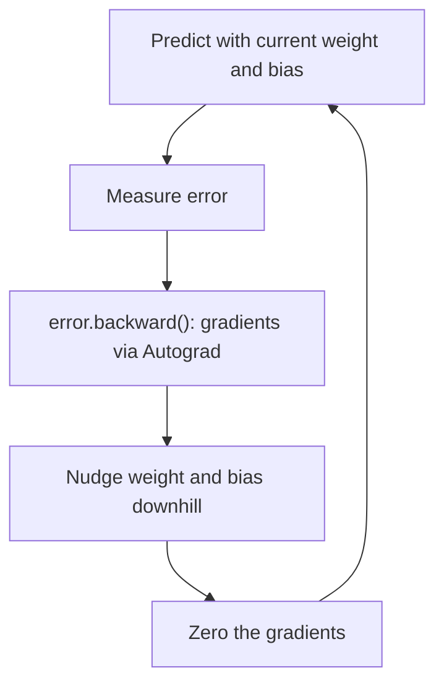

# How does PyTorch work?

> **Step 2: Deep Learning and Neural Networks** · ⏱️ 18 min read · [Read original](https://outcomeschool.com/blog/how-does-pytorch-work)

## TL;DR
PyTorch is a Python toolbox (created at Meta) for building AI. It stores data in Tensors, records every math step in a computation graph as code runs, and uses Autograd to compute gradients automatically, with easy GPU acceleration. This lets us write only the forward calculation and have the backward math handled for us.

## Key Concepts
- **Tensor** — container of numbers: a single value, a row, a grid, or bigger. Photos and text are turned into numbers and held in Tensors.
- **Computation graph** — ordered record of each math step, built line by line while the program runs.
- **Autograd** — "auto + gradient": automatically computes the direction and amount to change each number to reduce error.
- **requires_grad=True** — tells PyTorch to track a Tensor for gradients.
- **GPU** — chip doing huge numbers of simple operations in parallel (CPU is one fast courier, GPU a thousand couriers).

## How It Works
### Problem solved
ML is a loop: guess, measure how wrong, adjust a little, repeat. Knowing how to adjust millions of numbers needs calculus, which is impossible by hand; PyTorch automates it.

### Graph and Autograd
`result = a*b + c` with 2, 3, 4 gives 10 and records multiply then add, so it can walk backward later.
```python
x = torch.tensor(3.0, requires_grad=True)
y = x * x
y.backward()
print(x.grad)   # tensor(6.)
```
`backward()` walks the graph backward (this is backpropagation); slope of $x^2$ at 3 is 6.

### Training example: Celsius to Fahrenheit
Learn weight (about 1.8) and bias (about 32) from examples (0 to 32, 100 to 212):
1. Predict `weight * celsius + bias`.
2. Error = mean squared difference.
3. `error.backward()` gives gradients.
4. Under `torch.no_grad()`, step `weight -= lr * weight.grad` (and bias), then `zero_()` the gradients.

It needs about 100,000 steps at lr 0.0001 because inputs are unscaled; real projects scale inputs first.

### GPU
```python
device = "cuda" if torch.cuda.is_available() else "cpu"
x = torch.tensor([1.0, 2.0, 3.0]).to(device)
```
The rest of the code is unchanged.

### Roles
| Piece | Role |
|---|---|
| Tensor | Holds the numbers |
| Computation graph | Records every step |
| Autograd | Finds the downhill direction |
| GPU | Does the math fast |

### Why popular
Graph built dynamically (easy to read, test, debug), automatic calculus, Pythonic, one-line GPU use, free open-source with a large community.

## Diagram


## Key Takeaways
- Everything in PyTorch is a Tensor.
- The computation graph is built automatically as code executes.
- `requires_grad=True` plus `backward()` gives gradients with no hand-written calculus.
- Reset gradients with `zero_()` each round so each step uses fresh gradients.
- Moving to a GPU is a single `.to(device)` call.
