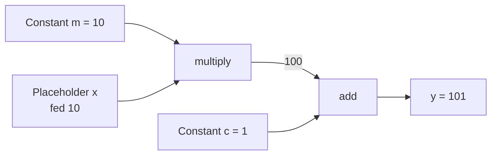
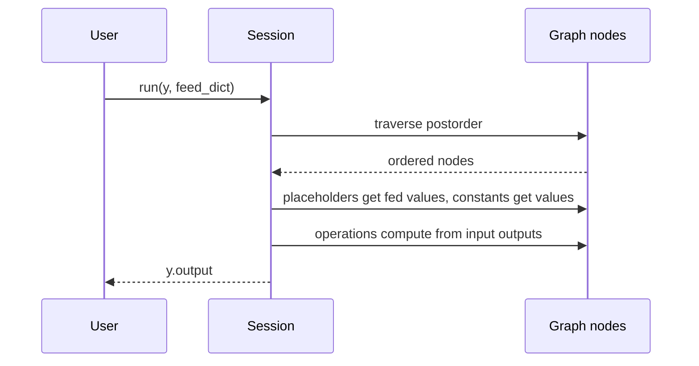

# How does TensorFlow work?

> **Step 2: Deep Learning and Neural Networks** · ⏱️ 9 min read · [Read original](https://outcomeschool.com/blog/how-does-the-machine-learning-library-tensorflow-work)

## TL;DR
TensorFlow is an open-source ML framework (mainly for deep neural networks) in which you first build a data flow graph of constants, variables/placeholders and operations, then execute it in a session on CPUs, GPUs or TPUs. A tiny "mini TensorFlow" (Graph, Session, postorder traversal) shows exactly how this works.

## Key Concepts
- **Graph** — data structure holding all constants, variables and operations to run.
- **Node** — an operation.
- **Edge** — carries tensors; one node's output becomes another's input.
- **Constant** — fixed value given at creation.
- **Placeholder** — variable input, value supplied at run time via `feed_dict`.
- **Session** — executes the graph (`sess.run`).
- **TPU** — tensor processing unit, specialized hardware for tensor math.
- **TensorBoard** — built-in graph visualization/debugging.

## How It Works

### What TensorFlow supports
- Deploy computation to one or more CPUs/GPUs on desktop, server or mobile, simply and fast.
- Express computation as a data flow graph; visualize and debug with TensorBoard.
- Fast iteration, faster training, more experiments.
- Runs on nearly everything: GPUs, CPUs, mobile/embedded (TensorFlow Lite on Android), TPUs.
- Used by Google, Uber, Airbnb, Nvidia, Dropbox, etc. Knowing internals helps use it well. (PyTorch is a comparable alternative.)

### Build then run
Define graph (constants, variables, ops) first, then execute. Example (TF1 style): `a=tf.constant(2)`, `b=tf.constant(3)` run in `tf.Session()`: add 5, multiply 6. With `tf.placeholder` and `tf.add/tf.multiply`, feed `feed_dict={a:2, b:3}`: 5 and 6.

### Mini TensorFlow
- `TFOperation(input_nodes)` base: stores input nodes, registers itself as an output of each input, appends to default graph's operations; `compute()` overridden.
- `add`, `multiply` extend it (`compute` returns x+y / x*y).
- `Placeholder` (output_nodes, registered in graph placeholders) and `Constant(initial_value)`.
- `Graph` holds operations, placeholders, variables; `set_as_default()` sets the global default graph.
- `traverse_postorder(operation)`: recurse into input nodes first, then append the node, so inputs are computed before the operation.
- `Session.run(operation, feed_dict)`: traverse postorder; Placeholder output = feed_dict value; Constant output = its value; operation output = `compute(*input outputs)`; lists become numpy arrays; return operation's output.

Usage for y = 10x + 1 (m=10, c=1):
```python
g = Graph(); g.set_as_default()
m = Constant(10); c = Constant(1); x = Placeholder()
y = add(multiply(m, x), c)
print(Session().run(y, feed_dict={x: 10}))   # 101
```

### FAQ
- Graph? Data structure of constants, variables, ops; nodes ops, edges tensors.
- Mobile? Yes (TF Lite, TPUs too).
- Placeholder vs Constant? Run-time input vs fixed value.
- Why postorder? Visits inputs before the op, so their outputs are ready.

## Diagram(s)

### Graph for y = m*x + c


### Session run


## Trade-offs & Pitfalls
- Two-phase style: nothing computes until the session runs the graph.
- Placeholders must be fed in `feed_dict` or run fails.

## Key Takeaways
- TensorFlow = build a graph, then execute it in a session.
- Nodes are ops, edges are tensors.
- Placeholders take run-time input, constants are fixed.
- Postorder traversal guarantees correct execution order.
- Runs on CPU, GPU, mobile and TPU; TensorBoard visualizes the graph.
