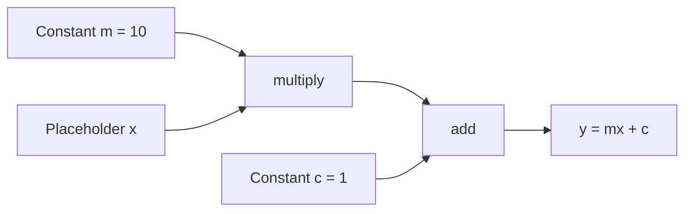

# How does TensorFlow work?

> **Step 2: Deep Learning and Neural Networks** · ⏱️ 9 min read · [Read original](https://outcomeschool.com/blog/how-does-the-machine-learning-library-tensorflow-work)

## TL;DR
TensorFlow is an open-source ML framework (mainly for deep neural networks) that lets you build a data flow graph, where each node is an operation, and then execute that graph on CPUs, GPUs or TPUs. The blog explains the idea by building a tiny "mini TensorFlow" from scratch.

## Key Concepts
- **Data flow graph** — a data structure holding all the constants, variables and operations you want to run.
- **Node** — represents an operation.
- **Edge** — carries tensors; the output of one node becomes the input of another.
- **Constant** — a fixed value given at creation time.
- **Placeholder** — a variable input whose value is supplied only when the session runs (via `feed_dict`).
- **Session** — executes the graph and returns results.
- **TensorBoard** — built-in tool to visualize, inspect and debug the graph.

## How It Works
TensorFlow separates *defining* a computation from *running* it. You first build a graph, then run it inside a session.

**What the architecture enables**
- Deploy computation to one or more CPUs/GPUs on desktop, server or mobile.
- Express computation as a graph and visualize it with TensorBoard.
- Fast iteration, faster training, more experiments.
- Runs on almost everything: GPUs, CPUs, mobile/embedded (TensorFlow Lite) and TPUs.

**Mini TensorFlow (the blog's build)**
1. `TFOperation` — base class; records input nodes and output nodes and registers itself in the default graph. Subclasses `add` and `multiply` implement `compute`.
2. `Placeholder` and `Constant` — leaf nodes of the graph.
3. `Graph` — holds lists of operations, placeholders and variables; can be set as the default graph.
4. `traverse_postorder` — visits all input nodes before the operation itself, so execution order is correct.
5. `Session.run` — walks the nodes in postorder: placeholders take values from `feed_dict`, constants use their stored value, operations compute from their inputs' outputs.

**Example:** $y = mx + c$ with $m=10$, $c=1$, fed $x=10$ gives $y = 101$ by building `add(multiply(m, x), c)` and running it.

## Diagram

## Key Takeaways
- TensorFlow = build a graph of operations, then execute it in a session.
- Nodes are operations; edges carry tensors between them.
- Placeholders get values at run time through `feed_dict`; constants are fixed.
- Postorder traversal guarantees inputs are computed before the operations that use them.
- The same graph can be deployed across CPUs, GPUs, TPUs and mobile devices.
