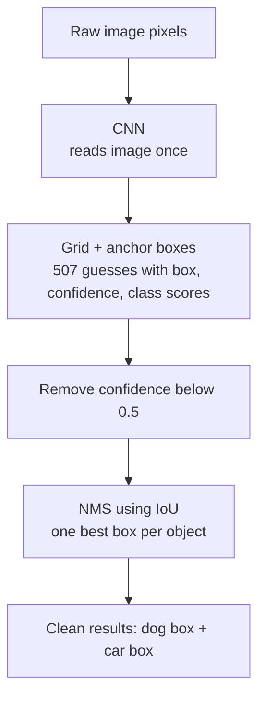
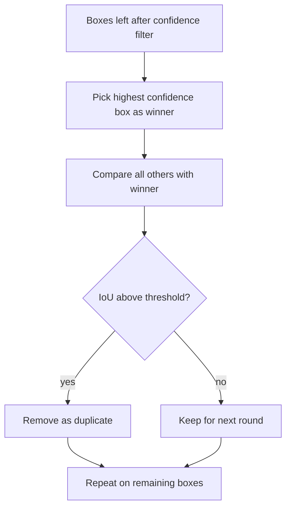

# How does Object Detection work?

> **Step 2: Deep Learning and Neural Networks** · ⏱️ 17 min read · [Read original](https://outcomeschool.com/blog/object-detection)

## TL;DR
Object Detection finds every object in an image, names it and draws a box around it (what and where). Modern detectors run a CNN once over the image, use a grid with anchor boxes to produce many scored boxes in one pass, drop low-confidence ones, then use Non-Maximum Suppression with IoU to keep one clean box per object.

## Key Concepts
- **Image Classification vs Detection** — classification gives one label for the whole image (no location, cannot count, no box). Detection gives many labels, one per object, with a box each, and can count.
- **Bounding box** — tight rectangle described by four numbers: x (left edge to box left), y (top edge to box top), width, height. e.g. x=120, y=80, width=60, height=90.
- **Output per object** — label (e.g. "dog"), confidence 0-1 (e.g. 0.95), box.
- **Grid** — image split into cells (e.g. 13x13 = 169); the cell holding an object's center is responsible for it.
- **Anchor box** — pre-decided box shape (tall, wide, square) used as starting guess; model predicts a small adjustment, easier than guessing from scratch.
- **Confidence score** — 0-1, how sure a real object is in the box.
- **Class score** — one score per object type (e.g. 80 types); highest becomes the label.
- **NMS (Non-Maximum Suppression)** — keeps the best box per object, removes overlapping weaker ones.
- **IoU** — Intersection over Union, overlap measure 0 to 1.
- **Ground truth** — human-drawn correct boxes and labels in the dataset.

## How It Works

### Naive approach fails
Sliding window: slide a small box over the image asking a classifier "is there an object here?" Must repeat with big, medium, tall, wide boxes at every position, so thousands or millions of classifier calls per image. Far too slow, especially for video.

### Modern detection
- Look at the whole image once and predict all boxes in one go (YOLO = "You Only Look Once").
- A CNN turns raw pixels into a meaningful summary: early layers find edges and corners, later ones combine into eyes, wheels, faces. Boxes and labels are predicted on top.
- Per anchor box in every cell the model outputs: box (x, y, width, height), confidence (e.g. 0.92) and class scores (dog 0.88, cat 0.05, car 0.01 ...).

### Too many boxes
13x13 grid x 3 anchors = 169 x 3 = 507 boxes per image. Most are useless (confidence like 0.02), and one object gets many overlapping boxes (e.g. five boxes claiming one dog).
1. Drop boxes below a confidence threshold (e.g. 0.5).
2. Run NMS.

### Non-Maximum Suppression
Boxes A 0.95, B 0.91, C 0.88, D 0.60, E 0.55 all on one dog.
1. Pick the highest-confidence box (A) as winner.
2. Remove every other box that overlaps it heavily (B, C, D, E).
3. Repeat for remaining boxes of other objects.

### IoU

$$
\text{IoU} = \frac{\text{Area of Overlap}}{\text{Area of Union}}
$$

1 = identical boxes, 0 = no touch. Union counts the shared area once. Example: overlap 30, union 100 gives IoU 0.3. In NMS, IoU above a threshold (commonly 0.5) means same object, so the weaker box is removed.

### Training
1. Dataset of images with ground-truth boxes and labels.
2. Model predicts boxes, confidences, labels.
3. Compare with ground truth (IoU checks box match); total mistake = loss.
4. Backpropagation adjusts internal values to reduce loss.
5. Repeat over millions of images; the model then generalizes to unseen images.

### Worked example
Street photo with a dog and a car: CNN summary, then 507 guesses, then remove confidence < 0.5, then NMS with IoU. Result: dog 0.96 box (120, 200, 80, 70); car 0.93 box (400, 150, 220, 140).

## Diagram

### Detection pipeline

### Non-Maximum Suppression steps

## Trade-offs & Pitfalls
- Sliding window is accurate in idea but far too slow.
- Anchor-based grid yields many redundant boxes needing filtering and NMS.
- Not all detectors use anchors: newer models change parts and many predict boxes directly, but keep the core ideas (look, predict many boxes, score, clean up).

## Applications
Self-driving (pedestrians, vehicles, signs), phone camera face focus, security cameras, shelf product counting, tumors in medical scans, defect spotting on conveyor belts.

## Key Takeaways
- Detection answers what and where; classification gives one label for the whole image.
- A box = (x, y, width, height) plus label and confidence.
- Sliding window needs millions of classifier calls; modern detectors (YOLO) look once.
- Grid + anchor boxes: predict adjustments to pre-set shapes; 13x13x3 = 507 boxes.
- Filter by confidence (e.g. 0.5), then NMS removes duplicates.
- IoU = overlap area / union area; above about 0.5 means same object.
- Training uses human ground truth, loss, and backpropagation.
