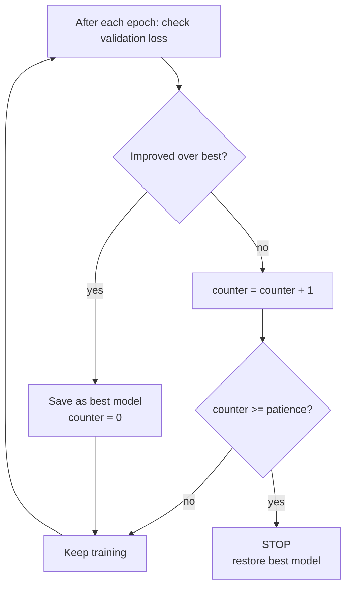

# How does early stopping work?

> **Step 2: Deep Learning and Neural Networks** · ⏱️ 12 min read · [Read original](https://outcomeschool.com/blog/early-stopping)

## TL;DR
Early stopping watches the validation loss during training and stops when the model starts to overfit, instead of running all planned epochs. A patience counter avoids stopping on small bumps, and the best saved model (not the last) is restored. It also acts as implicit regularization by keeping weights from growing too large.

## Key Concepts
- **Epoch** — one full pass over the training data.
- **Loss** — how far answers are from correct ones; lower is better.
- **Overfitting** — model memorizes training examples instead of the general pattern (student memorizing last year's paper, failing the real exam).
- **Training loss** — loss on seen data; **validation loss** — loss on unseen data kept aside, never learned from.
- **Plateau** — validation loss stops improving for a while, flat or slowly worsening.
- **Regularization** — any technique that reduces overfitting. **Explicit**: added penalty. **Implicit**: side effect, no added penalty.
- **Patience** — number of epochs to wait for improvement before stopping.

## How It Works

### Core idea
Split data into training and validation parts. Planned 100 epochs, but best validation performance is at epoch 30: stop there and keep that version.

### Loss curves
- Training loss keeps going down.
- Validation loss goes down, hits a lowest point, then rises.
- Before the minimum the model learns the real pattern; after it, it memorizes. Stop at the minimum.
- This gap (train falls, validation rises) is the sign of overfitting.

### Plateau
Validation loss may go down, up, down a little. A flat, wobbling stretch means more training is unlikely to help on new data and often leads to overfitting; halt there.

### Implicit regularization
- Weights start small and grow as the model fits tighter; very large weights signal a complex, overfit model.
- Stopping early cuts training while weights are moderate, keeping the model simple, like a penalty but without adding one.

### Algorithm with patience
Do not stop at the first rise; it may be a small bump.
1. Track best validation loss and a counter at 0.
2. After each epoch, check validation loss.
3. If improved: save as best model, counter = 0.
4. Else: counter += 1.
5. If counter >= patience: stop and restore the best saved model, not the last.

### Code
```python
best_loss = float("inf"); patience = 5; counter = 0
for epoch in range(100):
    train_one_epoch()
    val_loss = check_validation()
    if val_loss < best_loss:
        best_loss = val_loss; save_model(); counter = 0
    else:
        counter += 1
    if counter >= patience:
        break
restore_best_model()
```
`best_loss` starts at infinity so the first epoch always beats it. The four helper functions stand for your own training code.

### With vs without early stopping
| Point | Without | With |
|---|---|---|
| Training length | All planned epochs | Stops at best point |
| Overfitting risk | Higher | Lower |
| Final model | Last epoch's | Best epoch's |
| Time and compute | Wasted after best point | Saved |
| New-data accuracy | Often worse | Often better |

## Diagram(s)

### Patience logic


## Trade-offs & Pitfalls
- Needs a separate validation set; without it we cannot tell when improvement on new data stops.
- Patience too low stops on harmless bumps; the wait is what tolerates them.
- Always restore the best checkpoint; the last model is usually worse on new data.
- Benefits: saves time, saves compute cost, better model; useful in most setups with a validation set.

## FAQ
- Why restore the best model? → After the best point the model memorizes, so the last model is worse; save on every improvement and load that.
- Why not stop at first rise? → Could be a small bump; patience waits.
- Needs a validation set? → Yes, unseen data is the signal.
- Why does training loss fall while validation rises? → Model memorizes seen data and worsens on unseen data: overfitting.

## Key Takeaways
- Early stopping halts training at the lowest validation loss.
- Training loss always falls; rising validation loss signals overfitting.
- Patience tolerates small bumps and stops only at a real plateau.
- Save the best model on each improvement and restore it at the end.
- It is implicit regularization: it prevents weights from growing too large.
- It saves time and compute and often improves new-data accuracy.
- It requires a held-out validation set.
