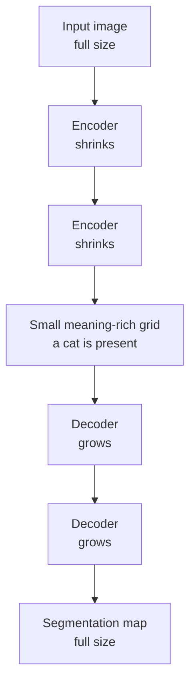
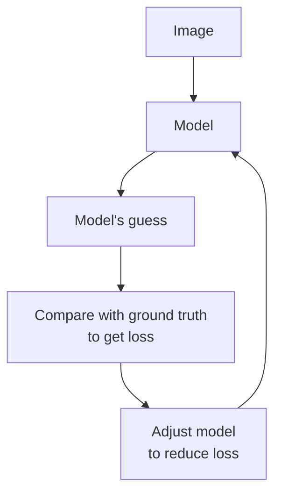

# How does Semantic Segmentation work?

> **Step 2: Deep Learning and Neural Networks** · ⏱️ 14 min read · [Read original](https://outcomeschool.com/blog/semantic-segmentation)

## TL;DR
Semantic Segmentation labels every pixel of an image with a class. An encoder shrinks the image while learning what is in it, and a decoder grows it back to full size, painting a label on each pixel. The model is trained on images with human-painted pixel labels by minimizing a loss.

## Key Concepts
- **Pixel** — a tiny dot of the image; to a computer, numbers for color.
- **Semantic** — meaning: what does this region represent?
- **Class / label** — category given to a pixel (cat, road, sky, tree, person); same thing here.
- **Segmentation map** — output grid, same size as input, each pixel holding a class label (can be shown as colors).
- **Encoder** — first part; understands the image, makes it smaller.
- **Decoder** — second part; regrows to full size with labels.
- **Ground truth** — correct human-painted label on every pixel.
- **Loss** — difference between model's guess and ground truth.
- **Instance Segmentation** — separates individual objects of the same class (dog 1 vs dog 2).

## How It Works

### Classification vs Detection vs Segmentation
Example: a dog sitting on grass.

| Task | What it tells us | Output |
|---|---|---|
| Image Classification | What is in the image | One label for whole image ("dog") |
| Object Detection | What and roughly where | Bounding boxes (rectangle also covers some grass) |
| Semantic Segmentation | Exact shape of every object | A label for every pixel |

- Caveat: semantic segmentation does not separate two touching dogs; all their pixels are "dog". That is Instance Segmentation.

### Why we need it
- Self-driving cars need the exact shape of road, people, cars (pixel-perfect map), not rough boxes.
- Doctors need the exact area of a tumor in a scan.

### Input and output
- Input: 4x4 grid of pixel numbers. Output: same-size grid of labels (classes: cat, background).

```
B B B B
B C C B
B C C B
B B B B
```
- Middle four pixels are cat: exact shape found.

### Encoder and Decoder
- Analogy: close to a photo you see hairs but lose the picture; step back and you lose detail but see "a cat".
- Encoder steps back step by step: image smaller but richer in meaning. After it, the model knows a cat is present but has lost exact pixel locations.
- Output must match original size, so the Decoder takes the small, meaning-rich grid and enlarges it, placing the correct label per pixel.
- Encoder asks "what is in this image?"; Decoder asks "where exactly is each thing?".
- Shrink-then-grow shape looks like a U, hence **U-Net**.
- (Blog refers to CNNs for how a network turns an image into a small meaningful summary.)

### Worked example: one pixel
- Model outputs scores per class: cat = 8.0, background = 2.0.
- Softmax converts scores to probabilities (0 to 1, sum 1): cat = 0.9975, background = 0.0025.
- Pick highest probability, so pixel = cat. Repeat for every pixel to get the segmentation map.

### How the model learns
- Training on labeled data with ground truth.
1. Give an image to the model.
2. Model produces its segmentation map (guess).
3. Compare with ground truth; difference = loss (big loss = big mistake).
4. Adjust the model slightly to reduce loss (gradient descent).
5. Repeat over thousands of images until loss is small.
- Result: labels pixels in unseen images, without anyone writing rules for shapes.

### Real-world use cases
- Self-driving (road, people, vehicles); medical scans (tumor/organ in X-ray, MRI, CT); satellite images (water, forest, road, building); photo editing (separate person from background); video calls (blur room behind person); farming (crops, soil, weeds).

## Diagram(s)

### Encoder-decoder (U shape)


### Training loop


## Trade-offs & Pitfalls
- Does not distinguish individual objects of the same class (needs Instance Segmentation).
- Encoder alone loses exact location; the decoder is needed to recover pixel-level detail.
- Needs expensive pixel-labeled data.

## Key Takeaways
- Semantic Segmentation = one class label per pixel, giving the exact shape of objects.
- Classification gives one label, detection gives boxes, segmentation gives pixel masks.
- Encoder shrinks and understands; decoder regrows and localizes; U-Net is named for the U shape.
- Output is a segmentation map the same size as the input.
- Per pixel: class scores, Softmax to probabilities, pick the highest.
- Trained on pixel-labeled ground truth by reducing loss over many images.
- Same-class touching objects merge; Instance Segmentation separates them.
