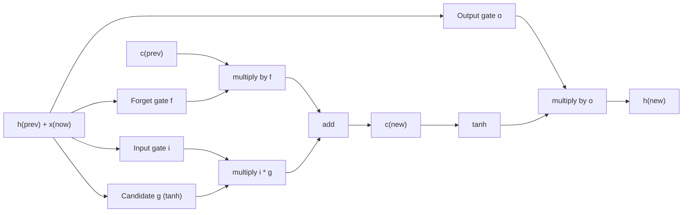
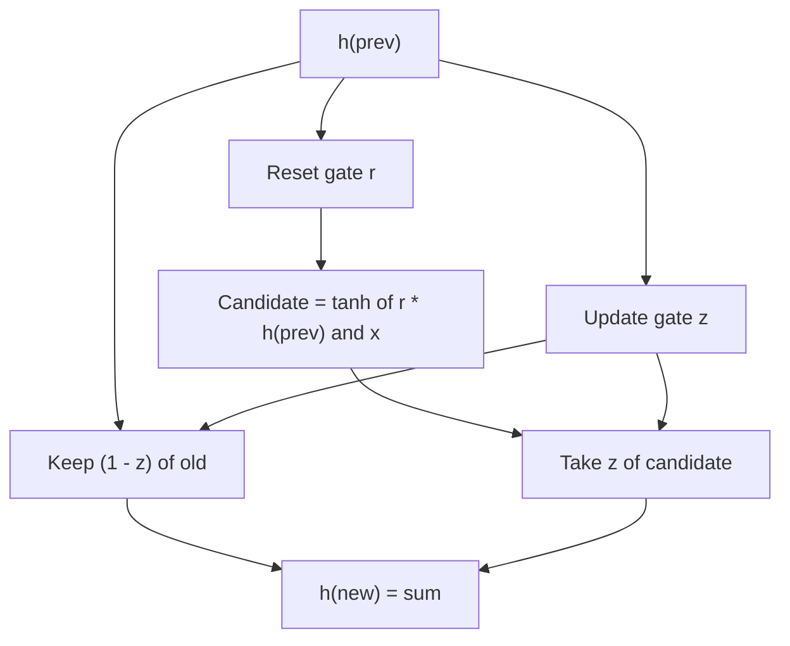

# How do LSTM and GRU work?

> **Step 2: Deep Learning and Neural Networks** · ⏱️ 19 min read · [Read original](https://outcomeschool.com/blog/lstm-and-gru)

## TL;DR
LSTM and GRU are RNNs that read sequences one step at a time and use sigmoid "gates" to decide what to forget, write, and output, so important information survives long sequences. Simple RNNs forget because memory is rewritten each step and gradients vanish. GRU is a lighter version of LSTM with two gates and one memory.

## Key Concepts
- **Sequence data** — data where order matters (sentences, "The dog bit the man" vs "The man bit the dog", temperatures, stock prices, sound).
- **RNN** — reads a sequence step by step, reusing the same network and carrying a **hidden state** (list of numbers summarizing what was read).
- **Vanishing gradient** — the backward correction message (gradient) is multiplied by a number often below 1 at every step, e.g. 0.5 x 0.5 x ... (30 times) is almost 0, so early steps get no correction.
- **Gate** — numbers between 0 (block) and 1 (pass) that multiply information. [8, 4, 6] with gate [1, 0, 0.5] gives [8, 0, 3]. Gate values are learned from current input and memory.
- **Sigmoid** — squeezes to 0-1 (used for gates). **tanh** — squeezes to -1 to 1 (used for content).
- **LSTM** (Long Short-Term Memory, Hochreiter and Schmidhuber, 1997) — gated RNN with cell state (long-term) and hidden state (short-term and output).
- **GRU** (Gated Recurrent Unit, Cho et al., 2014) — simpler gated RNN.

## How It Works

### Why a simple RNN forgets
Example: "Riya grew up in France, ... but at home she still speaks fluent ___" needs "France" from the start. The RNN rewrites its whole memory each step, so old info is mixed and diluted, and vanishing gradients mean the network never learns to keep early information.

### LSTM structure
Carries cell state c and hidden state h. Three gates, all decided from h(prev) and x(now):
- **Forget gate** — what to erase from long-term memory.
- **Input gate** — what new info to write.
- **Output gate** — what part of memory to show now.

Analogy: a student with a notebook who erases old notes, writes new facts, and reads out what is relevant.

The **cell state** is not rewritten, only multiplied by the forget gate and added to.

Formulas (`[h(prev), x(now)]` = the two lists joined, W and b are learned):
- Forget: $f = \sigma(W_f [h_{prev}, x] + b_f)$. Near 1 keep, near 0 forget (e.g. new person "Rahul" enters, lower memory of "Riya").
- Candidate: $g = \tanh(W_g [h_{prev}, x] + b_g)$ (new info, -1 to 1).
- Input: $i = \sigma(W_i [h_{prev}, x] + b_i)$.
- Cell update: $c_{new} = f \cdot c_{prev} + i \cdot g$ (old after forgetting plus new info).
- Output: $o = \sigma(W_o [h_{prev}, x] + b_o)$, $h_{new} = o \cdot \tanh(c_{new})$. Example: reveal "subject is singular" to choose "is" over "are", keep other notes hidden.

### LSTM step with numbers
c(prev) = 5. Forget f = 0.9 gives 4.5. Candidate g = 1.0, input i = 0.2 gives 0.2. c(new) = 4.5 + 0.2 = 4.7. Output o = 0.5, tanh(4.7) = 0.9998, h(new) = 0.4999. Memory 5 mostly survived as 4.7. If f stays near 1, memory lasts very long. If a new sentence starts, f = 0.0 gives 0 x 5 = 0 (erased), then the input gate writes fresh info.

### Why LSTM remembers long
The plus in $c_{new} = f \cdot c_{prev} + i \cdot g$. Forward, memory passes through only a multiplication by f and an addition. Backward, the correction flows the same path, multiplied by f each step. When remembering, f stays near 1 so the message does not fade. 30 steps: simple RNN 0.5^30 is almost 0, LSTM with f=0.99 gives about 0.74. The network learns when to keep f near 1. So "France" can travel to the end on the cell state.

### GRU
No separate cell state (hidden state h is both memory and output), two gates, fewer weights, a little faster.
- **Update gate** — $z = \sigma(W_z [h_{prev}, x] + b_z)$, acts as forget plus input in one, a slider: $h_{new} = (1-z) \cdot h_{prev} + z \cdot h_{cand}$. z near 0 keeps old, near 1 replaces with candidate, 0.3 means 70% old and 30% new. Forgetting and adding are tied.
- **Reset gate** — $r = \sigma(W_r [h_{prev}, x] + b_r)$, $h_{cand} = \tanh(W_h [r \cdot h_{prev}, x] + b_h)$. r near 0 ignores the past (useful for a new topic), near 1 uses it fully.
- Numeric: h(prev)=0.8, h(cand)=-0.4, z=0.25 gives 0.75 x 0.8 + 0.25 x (-0.4) = 0.6 - 0.1 = 0.5.
- Analogy: one whiteboard. Reset decides whether to look at the old board while drafting, update decides how much to wipe and replace.
- Some sources swap z and (1-z), same idea.

### In PyTorch
`nn.LSTM(input_size=8, hidden_size=16, batch_first=True)` and `nn.GRU(...)` on x of shape (4, 10, 8) (4 sentences, 10 steps, 8 numbers per step). LSTM returns outputs plus (h, c), GRU returns outputs plus h only. Shapes: outputs [4,10,16], states [1,4,16] (1 = stacked layers). Parameter counts: LSTM 1664, GRU 1248, so GRU has exactly 3/4 of the weights (LSTM has four weight sets: forget, input, candidate, output, GRU has three: update, reset, candidate).

### LSTM vs GRU
| Point | LSTM | GRU |
|---|---|---|
| Introduced | 1997 | 2014 |
| Memories | Two: cell and hidden | One: hidden |
| Gates | Three: forget, input, output | Two: update, reset |
| Weight sets | Four | Three |
| Forget and add | Separate | Tied by one update gate |
| Speed | A little slower | A little faster |
| Memory control | Finer | Simpler |
| Accuracy | Similar on many tasks | Similar on many tasks |

Rule: start with GRU for smaller, faster model or less data. Use LSTM for very long sequences or fine memory control. If accuracy matters, try both and compare on validation data.

### Uses today
Speech recognition, machine translation (before Transformers), phone keyboard text prediction, time series (sales, energy, sensors), music and handwriting generation. Most LLMs now use Transformers (look at all tokens at once, so training on huge data is much faster). LSTM and GRU remain popular on small devices, real-time streaming, and time series, since they are light and process one step at a time with fixed memory.

## Diagram(s)

### LSTM cell flow

### GRU update as a slider

## Trade-offs & Pitfalls
- Simple RNNs forget on long sequences (dilution plus vanishing gradients).
- LSTM is a bit heavier and slower (four weight sets). GRU is lighter but has less fine memory control.
- Both read step by step, so training on huge data is slower than Transformers.

## FAQ
- Who introduced them? → LSTM: Hochreiter and Schmidhuber 1997. GRU: Cho et al. 2014.
- GRU faster? → Slightly, 3/4 of LSTM's weights, similar accuracy.
- Why sigmoid and tanh? → Sigmoid (0-1) suits gates, tanh (-1 to 1) suits candidate and cell content.
- Why Transformers for LLMs? → They see all tokens at once, so training is much faster. LSTM and GRU stay for small devices, streaming, time series.

## Key Takeaways
- RNNs forget because memory is overwritten each step and gradients vanish.
- A gate is a learned 0-1 multiplier from sigmoid.
- LSTM: forget, input, output gates plus a cell state (long-term) and hidden state (output).
- Cell update $c_{new} = f \cdot c_{prev} + i \cdot g$ keeps gradients alive when f is near 1.
- GRU merges forget and input into one update gate, adds a reset gate, and drops the cell state.
- GRU has 3/4 of LSTM's weights, accuracy often similar.
- Transformers dominate LLMs, but LSTM and GRU still suit streaming, small devices, time series.
