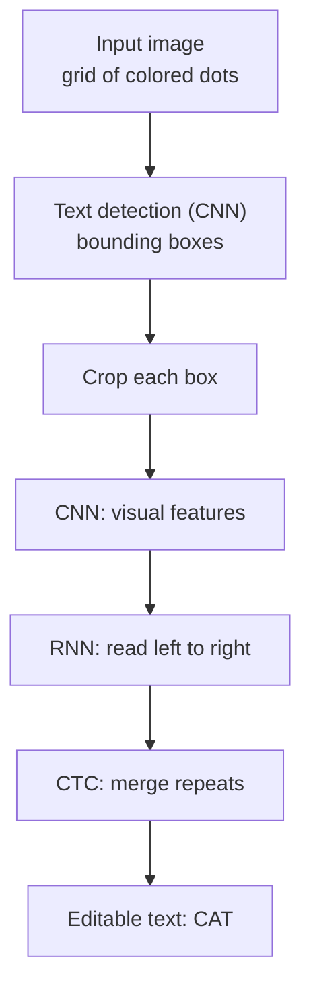
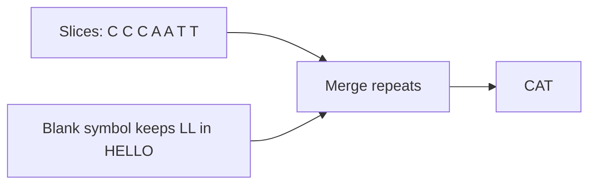

# How does OCR with Deep Learning work?

> **Step 2: Deep Learning and Neural Networks** · ⏱️ 15 min read · [Read original](https://outcomeschool.com/blog/optical-character-recognition-ocr)

## TL;DR
OCR with Deep Learning reads text from an image in two stages: a CNN detects where the text is (bounding boxes), then a CNN plus RNN with CTC recognizes what it says. The model learns from labeled examples instead of hand-written rules, so it copes with messy fonts, blur, and tilt.

## Key Concepts
- **OCR** — Optical Character Recognition: turn text in an image into editable, searchable text. To a computer an image is just a grid of colored dots.
- **Rule-based OCR** — humans hand-write shape rules per letter (e.g. "A" = two slanted lines meeting at top plus a middle line).
- **Text detection** — find where text is, via bounding boxes (rectangles around text).
- **Text recognition** — read the text inside each box.
- **CNN** — scans the image in small pieces, learns edges, curves, shapes. Text has sharp edges packed close together.
- **RNN** — handles ordered sequences, reads left to right one slice at a time and remembers what it saw (order matters: "CAT" vs "ACT").
- **CTC** (Connectionist Temporal Classification) — merges repeated per-slice predictions into the final word, using a blank symbol.
- **Loss** — number saying how wrong the guess is.

## How It Works

### Why OCR, and why the old way failed
- Need: a photo of a bill cannot be searched, and typing 10,000 bills by hand takes days and is error-prone. OCR does it in seconds. Examples: invoice amount and date, toll-gate number plates, document photos on phone, digitizing old books.
- Old rule-based OCR worked only for clean printed text in one font. Different fonts, blur, bad light, tilt, handwriting broke it. You cannot write a rule for every possible letter shape.
- Deep Learning learns patterns from thousands of examples with a neural network instead.

### Pipeline: OCR = Text Detection + Text Recognition
1. **Detection** — a CNN scans the image (e.g. street with signboards, sky, road, cars) and draws bounding boxes around text regions only. Related: object detection.
2. **Recognition** — crop each box (e.g. "CAT"), pass it through a CNN for visual features, then an RNN reads left to right to keep letter order (LSTM/GRU are improved RNNs).

### Reading characters one by one
The model looks at thin vertical slices left to right, predicting a letter per slice: C, then A, then T. Raw output: `C C C A A T T`. Repeats appear because many slices belong to one letter. CTC merges repeats into "CAT". The blank symbol between slices keeps real double letters (the "LL" in "HELLO") from being merged. This works even though letter widths are unknown in advance.

### Training
1. Show an image (e.g. labeled "CAT"), model guesses (mostly wrong at first).
2. Compare to the correct answer: the gap is the loss (big = very wrong).
3. Update parameters a tiny bit so the next guess is closer, which is the learning.
4. Repeat millions of times with millions of examples, loss shrinks.
No hand-written rules needed.

### Code (easyocr)
`reader = easyocr.Reader(['en'])`, `result = reader.readtext('my_image.png')`, each result is (box, text, confidence). For "Outcome School" it prints "Outcome" and "School". The library holds a trained model: CNN detection, then RNN plus CTC recognition.

### Real-world uses
Banking (cheques, invoices), toll and parking number plates, phone document scanning, translation apps, digitizing books and newspapers, identity verification (passports, ID cards).

## Diagram(s)

### OCR pipeline

### CTC merging

## Trade-offs & Pitfalls
- Rule-based OCR breaks on any variation (fonts, blur, lighting, tilt, handwriting).
- Per-slice prediction yields repeated letters, so CTC is needed, with blank to protect real double letters.
- Early training guesses are mostly wrong, learning needs many labeled examples.

## FAQ
- Why CNN and RNN? → CNN understands visual letter features, RNN keeps left-to-right order.
- What does CTC do? → Merges repeats like "CCCAATT" into "CAT", blank symbol protects "LL".
- Bounding box? → Rectangle around text, recognition reads only the crop.
- Train our own? → Not necessarily, easyocr has a pretrained model and returns confidence scores.

## Key Takeaways
- OCR = text detection (where) + text recognition (what).
- Rule-based OCR fails on real-world variation, deep learning learns from examples.
- CNN finds text and extracts letter features, RNN keeps letter order.
- CTC collapses repeated slice predictions and uses a blank for double letters.
- Training loop: guess, measure loss, nudge parameters, repeat millions of times.
- Libraries like easyocr give detection plus recognition in a few lines.
