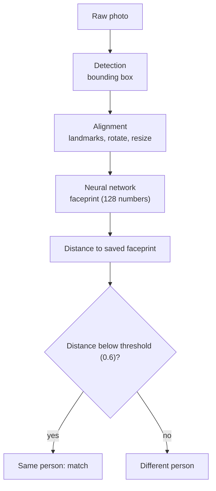
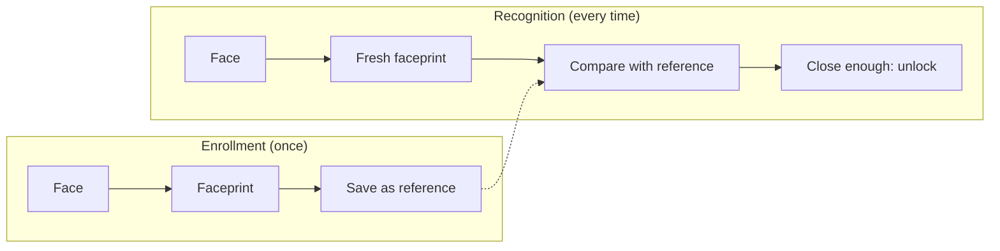

# How does a face recognition system work?

> **Step 2: Deep Learning and Neural Networks** · ⏱️ 17 min read · [Read original](https://outcomeschool.com/blog/face-recognition)

## TL;DR
A face recognition system finds a face in a photo, straightens it, turns it into a list of numbers (a faceprint) with a neural network, and compares that with saved faceprints using distance and a threshold. The network is trained with triplet loss so the same person gets close numbers and different people get far ones. It powers phone unlock, airport gates and more, but has weak spots like twins, spoofing and bias.

## Key Concepts
- **Face detection** — "is there a face, and where?" Draws boxes, knows no names. **Face recognition** — "whose face is this?" Comes after detection.
- **Bounding box** — rectangle tightly wrapping the face.
- **Landmarks** — key points (eye corners, nose tip, mouth corners) used for alignment.
- **Faceprint / face embedding** — list of numbers (e.g. 128) describing a face; a numeric signature like a fingerprint.
- **Threshold** — pre-decided distance cut-off (e.g. 0.6) for match vs no match.
- **Triplet loss** — training method using anchor, same-person, different-person photos.
- **Enrollment** — saving a reference faceprint once. **Recognition** — fresh faceprint compared every time.
- **Verification (1:1)** vs **identification (1:N)**.
- **Liveness detection** — check that a real live person is present, not a photo.

## How It Works

### Four-step pipeline
Raw photo -> detection -> alignment -> faceprint -> compare -> same person yes/no.

### Step 1: Finding the face
- Camera image includes background, other objects; the system wants only the face.
- It scans the image asking "does this look like a face?" using the common pattern: two eyes at top, nose middle, mouth below.
- Draws a bounding box and discards everything outside. Face detection is a special case of object detection.

### Step 2: Aligning the face
- Real faces are tilted, turned, small/far or big/close; comparing them unaligned is unfair (same person could look different).
- Find landmarks, rotate until both eyes are level, resize to a fixed size (e.g. small square). Every face enters in a standard position.

### Step 3: Turning a face into numbers
- Raw pixels fail: light, smile or camera shift change pixel values, so the same person gives different numbers.
- A neural network takes the aligned face and outputs a compact list of numbers capturing features (eye spacing, nose width, jaw shape).
- Trained so the same person yields very similar numbers across light, angle and expression; different people yield very different numbers.
- Example faceprint: `[0.12, -0.88, 0.34, ..., 0.77]` (128 numbers). We store this, not the photo; numbers are easy to store and compare.

### Step 4: Comparing two faces
- Analogy: describing people with height and weight; similar people have close numbers. A faceprint is the same with ~128 numbers.
- Measure distance between faceprints: small = probably same person, large = probably different.
- Rule: distance below threshold = same person; above = different. Threshold 0.6: distance 0.3 matches, 0.9 does not.

### How the system learns
- Train on millions of labeled faces. Each step uses three faces: one photo of a person, another photo of the same person, a photo of a different person.
- Update parameters to pull same-person faceprints closer and push the different-person one farther (triplet loss), repeated millions of times.
- After training it works on unseen faces without retraining.

### Enrollment vs recognition
- Enrollment (once): e.g. Face Unlock setup takes pictures, builds a faceprint, saves it as reference.
- Recognition (every use): capture face, build fresh faceprint, compare with saved one; close enough = unlock.

### One-to-one vs one-to-many
| | One-to-one (verification) | One-to-many (identification) |
|---|---|---|
| Question | Are you who you claim to be? | Who among all these are you? |
| Example | Phone Face Unlock vs your one saved faceprint | Office gate camera vs 1,000 stored faceprints, pick closest |
| Cost | One comparison | Nearest neighbor search at scale (ANN) |

- Same faceprint-and-distance idea; only number of comparisons changes.

### Walkthrough (Ravi unlocks phone)
1. Faceprint Ravi_saved stored last week.
2. Camera captures frame (face plus background).
3. Detection boxes the face, background removed.
4. Alignment straightens and resizes.
5. Network makes Ravi_now.
6. Distance = 0.25.
7. Threshold 0.6: 0.25 < 0.6, match, phone unlocks.
- Stranger: distance 0.95 > 0.6, stays locked.

### Where used
- Phone unlock, airport gates (vs passport photos), photo app grouping, attendance, payments, security/access doors. Always: faceprint, compare, threshold.

## Diagram(s)

### Recognition pipeline

### Enrollment vs recognition

## Trade-offs & Pitfalls
- **Lighting and angle** — dark rooms or extreme side angles confuse it; alignment helps but not fully.
- **Look-alikes** — identical twins can have close faceprints, so it may fail to separate them.
- **Aging and change** — beard, glasses, years raise distance, causing wrong rejection.
- **Spoofing** — photo or video of a face; liveness detection (blink, depth sensor for 3D shape) counters it.
- **Fairness and privacy** — training mostly on one type of face works worse on others, so test across many people; faceprints are sensitive personal data, store safely and with consent.

## FAQ
- Does it store my photo? → No, only the faceprint (still sensitive data).
- Can a photo fool it? → Possibly; good systems add liveness detection.
- Can it tell twins apart? → Not always; faceprints may be very close.
- Retrain for a new person? → No; just enroll them (one faceprint saved).

## Key Takeaways
- Detection finds the face; recognition identifies it, and detection comes first.
- Alignment (landmarks, rotate, resize) makes comparisons fair.
- A neural network converts the face into a faceprint (embedding), since raw pixels are too unstable.
- Match = distance between faceprints below a threshold.
- Triplet loss pulls same-person faceprints together and pushes different people apart.
- Enroll once, recognize many times; no retraining for new people.
- Verification is 1:1, identification is 1:N (needs fast nearest-neighbor search).
- Weaknesses: twins, aging, spoofing (use liveness), bias, privacy.
